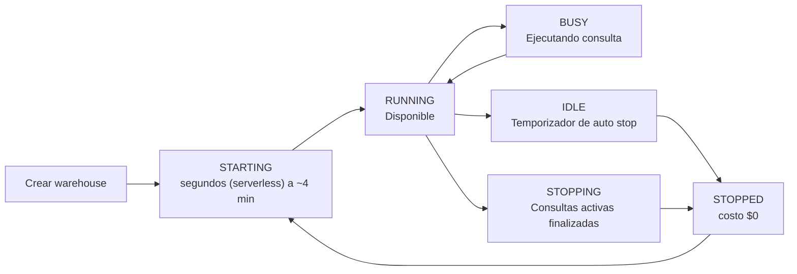

# SQL Warehouses

## 1. ¿Qué es un SQL Warehouse?

Un **SQL Warehouse** (anteriormente llamado *SQL Endpoint*) es el motor de cómputo especializado dentro de **Databricks SQL** optimizado exclusivamente para ejecutar consultas SQL, alimentar dashboards de BI y conectar herramientas externas (Power BI, Tableau, Looker) contra la capa de almacenamiento Delta Lake.

> **Nota clave de examen:** A diferencia de los clústeres de propósito general (*All-Purpose Compute*) o de trabajos (*Job Compute*), los SQL Warehouses **no ejecutan código Python, R ni Scala**; solo ejecutan SQL y están optimizados para alta concurrencia y baja latencia.


## 2. Tipos de SQL Warehouse (Comparativa de Examen)

| Característica | Serverless | Pro | Classic |
| :--- | :--- | :--- | :--- |
| **Motor Photon** | ✅ Sí | ✅ Sí | ✅ Sí |
| **Predictive IO** | ✅ Sí | ✅ Sí | ❌ No |
| **Intelligent Workload Management (IWM)** | ✅ Sí | ❌ No | ❌ No |
| **Federación de Consultas (Query Federation)** | ✅ Sí | ✅ Sí | ❌ No |
| **Gestión de Infraestructura (VMs)** | Cuenta de Databricks | Cuenta del Cliente | Cuenta del Cliente |
| **Tiempo de arranque (Startup)** | **2 a 6 segundos** | Minutos (~3-5 min) | Minutos (~3-5 min) |
| **Auto-stop agresivo (por defecto)** | Sí (ej. 5-10 min) | Configurable (ej. 10-45 min) | Configurable (ej. 10-45 min) |
| **Facturación** | Unificada (DBU incluye VM) | Dividida (DBU + VM en nube) | Dividida (DBU bajo + VM en nube) |

### Detalle por tipo y cuándo elegirlo en el examen:
1. **Serverless SQL Warehouse (Opción por defecto recomendada):**
   * **Tecnologías:** Photon + Predictive IO + IWM (usa Machine Learning para predecir recursos, enrutar consultas y escalar instantáneamente).
   * **Escenario de examen:** Cargas de trabajo intermitentes o en ráfagas (*spiky workloads*), dashboards interactivos donde los usuarios no pueden esperar minutos a que arranque el clúster, o cuando se busca minimizar costos por tiempo ocioso (*idle time*).
2. **Pro SQL Warehouse:**
   * **Tecnologías:** Photon + Predictive IO + Lakehouse Federation. Carece de IWM.
   * **Escenario de examen:** Cuando la empresa requiere **aislamiento de red personalizado (VNet/VPC injection)** para conectarse a bases de datos *on-premises* o privadas, o en regiones donde *Serverless* no está disponible.
3. **Classic SQL Warehouse:**
   * **Tecnologías:** Solo motor Photon.
   * **Escenario de examen:** Cargas ETL/ELT programadas por lotes (*batch*), consultas predecibles de larga duración donde la latencia de arranque inicial no importa y se prioriza el menor costo por DBU.


## 3. Tecnologías de Optimización (Conceptos Clave)

* **Photon:** Motor de ejecución vectorizado escrito en C++ que acelera drásticamente las consultas SQL y operaciones sobre Delta Lake. **Está activo en los 3 tipos de Warehouse.**
* **Predictive IO:** Acelera las lecturas selectivas mediante técnicas de aprendizaje automático que predicen qué datos leer sin necesidad de crear ni mantener índices manualmente. (Solo en **Serverless** y **Pro**).
* **Intelligent Workload Management (IWM):** Conjunto de capacidades impulsadas por IA que gestionan las colas de consultas, estiman la memoria necesaria antes de ejecutar una consulta y escalan los clústeres de forma elástica. (Exclusivo de **Serverless**).


## 4. Dimensionamiento y Escalado (Sizing & Scaling)

En el examen suelen evaluar la diferencia entre **escalar verticalmente** y **escalar horizontalmente**:

### A. Cluster Size (Escalado Vertical / Scale Up)
* Va desde **2X-Small** hasta **4X-Large**.
* Duplica los recursos de cómputo (vCPUs y RAM) en cada salto de tamaño.
* **Cuándo usarlo:** Cuando **una sola consulta compleja** es lenta, tiene *spilling to disk* (desbordamiento a disco por falta de RAM) o realiza grandes agregaciones y *joins*.

| Tamaño | Workers (classic y pro) |
| :--- | :---: |
| 2X-Small | 1 |
| X-Small | 2 |
| Small | 4 |
| Medium | 8 |
| Large | 16 |
| X-Large | 32 |
| 2X-Large | 64 |
| 3X-Large | 128 |
| 4X-Large | 256 |
| 5X-Large (Public Preview, pro y serverless) | 512 |


### B. Multi-cluster Load Balancing (Escalado Horizontal / Scale Out)
* Se configura mediante los parámetros **Min** y **Max** de clústeres.
* **Cuándo usarlo:** Cuando hay **alta concurrencia** (muchos usuarios simultáneos ejecutando consultas o abriendo dashboards) y las consultas se quedan en estado *Queued* (en cola).
* **Regla de oro:** Databricks enruta aproximadamente hasta **10 consultas concurrentes por clúster** antes de levantar un clúster adicional (hasta el límite `Max` configurado).


## 5. Gestión de Costos y Monitoreo

* **Auto Stop:** Apaga el warehouse tras un periodo de inactividad para ahorrar costos. En *Serverless* puede configurarse tan bajo como **1 minuto** (vía API/UI) gracias a su arranque instantáneo.
* **Query History (Historial de Consultas):** Herramienta fundamental del Data Analyst para:
  * Identificar consultas lentas y ver el **Query Profile** (plan de ejecución).
  * Detectar cuellos de botella (ej. *Task time*, *Compilation time*, *Queued time* o *Bytes spilled to disk*).
  * Verificar si una consulta leyó datos desde la caché (**Disk Cache / Delta Cache** o **Query Result Cache**).
* **Caché en SQL Warehouses:**
  * **Query Result Cache:** Si se ejecuta exactamente la misma consulta y los datos subyacentes no han cambiado, devuelve el resultado al instante sin usar cómputo.
  * **Disk Cache (antes Delta Cache):** Almacena copias locales de los archivos Parquet/Delta en los discos SSD de los nodos trabajadores para acelerar lecturas repetidas.

Los warehouses consumen DBU (Databricks Units) mientras están en ejecución; los tamaños mayores y un mayor número de clústeres consumen más. Las tarifas dependen del tipo de warehouse, la nube y el contrato, por lo que conviene consultar la [página de precios](https://www.databricks.com/product/pricing/databricks-sql) en lugar de memorizar una cifra.

### Estrategias de optimización de costos

1. **Dimensiona correctamente tu warehouse**: empieza con poco, supervisa el uso y escala gradualmente
2. **Usa el escalado automático**: deja que Databricks escale según la demanda y paga solo por lo que usas
3. **Configura auto-stop**: pausa los warehouses automáticamente fuera del horario laboral
4. **Comparte warehouses**: varios equipos en un mismo warehouse reducen el costo por equipo
5. **Usa la caché de resultados**: las consultas repetidas devuelven resultados en caché al instante

### Ciclo de vida de un SQL warehouse



### Descripciones de los estados

| Estado | Costo | Acción | Duración |
|-------|------|--------|----------|
| **RUNNING** | Sí | Aceptando consultas | Continua |
| **IDLE** | Sí | Sin consultas, cuenta regresiva para detenerse | Hasta que venza el tiempo de auto stop |
| **STOPPED** | No | Sin costo, puede reiniciarse | Indefinida |
| **STARTING** | Limitado | Inicialización, consultas en cola | 2–6 segundos (serverless); aprox. 4 minutos (pro, classic) |
| **STOPPING** | No | Apagado ordenado iniciado | 1-2 minutos


## 6. Ejecución y rendimiento de las consultas

### ### Tiempo de espera y concurrencia de las consultas

```sql
-- Set query timeout (5 minutes)
SET STATEMENT_TIMEOUT = 300;  -- seconds

-- Check active queries
SELECT * FROM system.query.history
WHERE start_time > CURRENT_TIMESTAMP - INTERVAL 1 HOUR
ORDER BY start_time DESC;
```

## Caché de resultados

| Caché | Dónde | Duración |
| :--- | :--- | :--- |
| Caché de resultados local | En memoria, por clúster | Duración del clúster, hasta 24 horas por entrada; se borra al detener |
| Caché de resultados remota | Solo serverless, compartida por todos los warehouses del workspace | 24 horas; sobrevive a los reinicios |
| Caché de disco | SSD locales, datos leídos del almacenamiento | Igual que la caché local |

Las cachés de resultados se invalidan cuando se actualizan las tablas subyacentes. Consulta [Photon y rendimiento de consultas](../03-analyzing-queries/01-photon-and-query-performance.md) para más detalles y para `SET use_cached_result = false`.

## Supervisión de SQL warehouses

### Métricas clave que conviene supervisar

| Métrica | Qué mide | Rango saludable | Acción si es alta |
|--------|------------------|---------------|-----------------|
| **Latencia de consulta** | Tiempo desde el envío hasta la finalización | < 30 s para paneles | Revisar el perfil de la consulta |
| **Concurrencia** | Consultas ejecutándose simultáneamente | Unas 10 por clúster | Aumentar el número máximo de clústeres |
| **Tiempo de espera en cola** | Tiempo que espera una consulta antes de ejecutarse | < 5 segundos | Añadir capacidad al warehouse |
| **Utilización del warehouse** | % de tiempo que el warehouse está ocupado | 60-80% | Redimensionar o consolidar |
| **Tasa de aciertos de caché** | % de consultas que usan resultados en caché | > 40% para paneles | Optimizar la estrategia de caché |

### Supervisión desde la interfaz de Databricks

```sql
-- Query performance history
SELECT
    statement_id,
    executed_by,
    statement_text,
    total_duration_ms,
    produced_rows,
    start_time
FROM system.query.history
WHERE compute.warehouse_id = 'abc123'
ORDER BY start_time DESC
LIMIT 100;
```


## 7. Mejores prácticas para SQL warehouses

### **Dimensionamiento adecuado para tu carga de trabajo**

```sql
-- Start with Small warehouse for analytics
-- Monitor query performance and scale up as needed
-- Use Small → Medium → Large progression
```

### **Optimización de consultas**

```sql
-- ❌ Inefficient - full table scan
SELECT * FROM large_table WHERE col IS NOT NULL;

-- ✅ Efficient - column projection and predicate pushdown
SELECT id, name, amount
FROM large_table
WHERE status = 'active' AND date >= '2024-01-01';
```

### **Usa tipos de datos adecuados**

```sql
-- ❌ Storage waste - string instead of integer
CREATE TABLE users (id STRING, name STRING, age STRING);

-- ✅ Appropriate types
CREATE TABLE users (id INT, name STRING, age INT);
```

### **Agrupa (cluster) las tablas grandes**

```sql
-- Liquid clustering replaces partitioning and ZORDER for new tables
CREATE TABLE sales (
    id INT,
    amount DECIMAL(10,2),
    sale_date DATE
)
CLUSTER BY (sale_date);

SELECT SUM(amount)
FROM sales
WHERE sale_date >= '2024-01-01';  -- files outside the range are skipped
```

Consulta [Historial de Delta y liquid clustering](../03-analyzing-queries/02-delta-history-and-liquid-clustering.md).

### **Programa las cargas de mayor demanda**

- Ejecuta los trabajos analíticos pesados fuera de las horas punta
- Actualizaciones de paneles durante el horario laboral (warehouse más pequeño)
- Trabajos por lotes durante la noche (warehouse más grande, optimizado en costos)

### **Usa varios warehouses**

```yaml
# Example warehouse strategy

dashboards:
  size: Small
  purpose: Paneles interactivos
  cost: Bajo

batch_jobs:
  size: Large
  purpose: Procesamiento analítico pesado
  cost: Más alto, pero de duración limitada

testing:
  size: 2X-Small
  purpose: Desarrollo y pruebas
  cost: Mínimo
```


## 8. Preguntas Tipo Examen (Autoevaluación)

**Pregunta 1:** *Un equipo de analistas experimenta picos extremos de consultas los lunes a las 9:00 AM al abrir sus dashboards ejecutivos, pero el resto del día el uso es mínimo. Quieren evitar tiempos de espera en el arranque y no pagar por capacidad ociosa. ¿Qué configuración deben elegir?*

* **Respuesta:** **Serverless SQL Warehouse** con **Auto-scaling** habilitado y un tiempo de **Auto-stop** corto.

**Pregunta 2:** *Un dashboard tiene 50 usuarios concurrentes los viernes por la tarde. Los usuarios reportan que sus gráficos tardan mucho en cargar, y al revisar el Query History notas que las consultas pasan mucho tiempo en estado "Queued". El tamaño actual es Medium (Min: 1, Max: 1). ¿Cuál es la mejor solución?*

* **Respuesta:** Aumentar el parámetro **Max clusters** (escalado horizontal / *scale out*) para manejar la concurrencia, en lugar de subir el tamaño a Large.

**Pregunta 3:** *Una consulta compleja que une dos tablas de billones de filas falla o tarda demasiado debido a un alto volumen de "Bytes spilled to disk" en el Query Profile. ¿Qué acción debes tomar?*

* **Respuesta:** Aumentar el **Cluster Size** (escalado vertical / *scale up*, por ejemplo, de Medium a Large) para dotar a los nodos de más memoria RAM.

**Pregunta 4:** *La empresa tiene una política estricta de seguridad que exige que todo el tráfico de cómputo pase por su propia VPC/VNet privada para consultar una base de datos SQL Server local mediante Query Federation. ¿Qué tipo de warehouse deben usar?*

* **Respuesta:** **Pro SQL Warehouse** (soporta Query Federation y se despliega dentro de la red en la nube del cliente).


## 9. Problemas y errores comunes

### Errores OOM

**Escenario:** La asimetría de datos (data skew) hace que un ejecutor se quede sin memoria.
**Solución:** Usa Adaptive Query Execution (AQE) y revisa la lógica de unión (joins).

### Tiempo de espera agotado en conjuntos de datos grandes

**Escenario:** Las consultas sobre tablas grandes sin agrupar (clustering) agotan el tiempo de espera en SQL warehouses pequeños.
**Solución:** Aumenta el tamaño del warehouse o añade filtros `WHERE` para reducir los datos examinados. Usa `EXPLAIN` para comprobar el tamaño del escaneo antes de ejecutar.


##  10. Consejos para el examen

- Conoce los tres tipos de warehouse y sus características: IWM es exclusivo de serverless; Predictive I/O está en pro y serverless; Photon está en todos
- Tamaño = latencia de cada consulta; clústeres máximos = concurrencia
- Valores predeterminados de auto stop: 10 minutos en serverless, 45 minutos en pro y classic
- Las cachés de resultados duran hasta 24 horas y se invalidan cuando cambian las tablas
- Escalar durante una consulta no afecta a las consultas en ejecución; solo las nuevas usan el tamaño escalado


## 11. Puntos clave

- **Rol**: el warehouse es el cómputo que planifica y ejecuta cada consulta de Databricks SQL, con Photon
- **Tres tipos**: serverless (predeterminado en la interfaz), pro, classic
- **Inicio**: 2–6 segundos en serverless; aprox. 4 minutos en pro y classic
- **Tamaño frente a escalado**: workers por clúster frente a número de clústeres (aprox. uno por cada 10 consultas concurrentes)
- **Auto stop**: 10 minutos (serverless) / 45 minutos (pro, classic) por defecto
- **Supervisión**: historial de consultas y `system.query.history`


## 12. Temas relacionados

- [SQL Essentials](../../../shared/fundamentals/sql-essentials.md) - Conceptos esenciales de SQL para Databricks
- [Spark Fundamentals](../../../shared/fundamentals/spark-fundamentals.md) - Comprender el motor de cómputo detrás de los SQL warehouses
- [Performance Optimization Cheat Sheet](../../../shared/cheat-sheets/performance-optimization.md) - Guía rápida para ajustar consultas


## 13. Documentación oficial

- [Tipos de SQL warehouse](https://docs.databricks.com/aws/en/compute/sql-warehouse/warehouse-types)
- [Crear un SQL warehouse](https://docs.databricks.com/aws/en/compute/sql-warehouse/create)
- [Comportamiento de tamaño, escalado y colas de los SQL warehouses](https://docs.databricks.com/aws/en/compute/sql-warehouse/warehouse-behavior)

---

**[↑ Volver a la sección](./README.md) | [Siguiente: Editor de consultas, asistente y ejecución →](./02-query-editor.md)**
