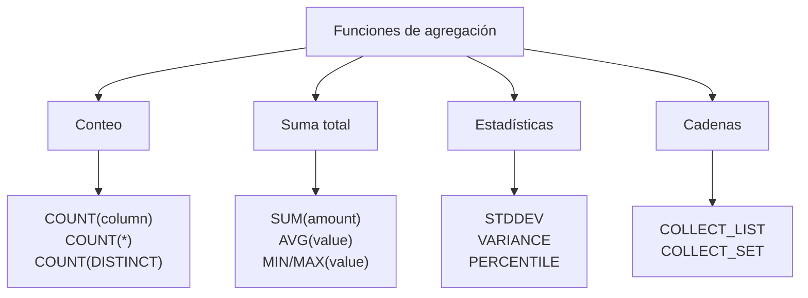

# Agregaciones, ordenamiento y filtrado

## 1. Orden Lógico de Ejecución SQL
Aunque escribimos las consultas empezando por `SELECT`, el motor de Databricks las ejecuta en un orden lógico específico. Entender esto explica por qué no puedes usar un alias del `SELECT` dentro del `WHERE` o cuándo actúa `HAVING`.


> **Regla de oro de examen:**  
> * **`WHERE`** filtra **filas individuales** *antes* de agrupar (no admite funciones de agregación como `SUM()` o `COUNT()`).  
> * **`HAVING`** filtra **grupos agregados** *después* del `GROUP BY` (sí admite funciones de agregación).


## 2. Filtrado Avanzado y Manejo de `NULL`

### A. Operadores de Filtrado Clave
* **`IN` vs `BETWEEN`:**
  * `BETWEEN a AND b` es **inclusivo en ambos extremos** (`>= a AND <= b`). *Cuidado con fechas/timestamps:* `WHERE fecha BETWEEN '2026-01-01' AND '2026-01-31'` equivale a `'2026-01-31 00:00:00'`, por lo que excluye registros del día 31 con horas posteriores a medianoche.
* **`LIKE` vs `ILIKE`:**
  * `LIKE` distingue entre mayúsculas y minúsculas (*case-sensitive*). Comodines: `%` (cero o más caracteres) y `_` (exactamente un carácter).
  * `ILIKE` es insensible a mayúsculas/minúsculas (*case-insensitive*, específico y muy práctico en Databricks SQL).
* **`FILTER (WHERE ...)` en agregaciones (Agregación condicional):**
  * Permite aplicar un filtro específico dentro de una función agregada sin afectar al resto de columnas (alternativa más limpia que `CASE WHEN`).
  ```sql
  SELECT
    region,
    COUNT(*) AS total_pedidos,
    COUNT(*) FILTER (WHERE status = 'COMPLETED') AS pedidos_completados,
    SUM(amount) FILTER (WHERE year = 2026) AS ingresos_2026
  FROM sales
  GROUP BY region;
  ```

### B. Comportamiento con Valores `NULL` (Trampa clásica de examen)
1. **Comparaciones:** `col = NULL` o `col != NULL` siempre devuelven `UNKNOWN` (nunca verdadero). Siempre debes usar **`IS NULL`** o **`IS NOT NULL`**.
2. **Funciones de reemplazo de nulos:**
   * `COALESCE(val1, val2, ...)`: Devuelve el **primer valor no nulo** de la lista (estándar ANSI).
   * `NVL(val1, val2)` / `IFNULL(val1, val2)`: Equivalente a `COALESCE` con solo dos argumentos.
   * `NULLIF(val1, val2)`: Devuelve `NULL` si `val1 = val2`; de lo contrario devuelve `val1` (muy útil para evitar errores de división por cero: `ingresos / NULLIF(visitas, 0)`).

### NULL en agregados

```sql
-- NULLs are ignored in aggregates
SELECT
    COUNT(*) as total_rows,         -- 100 (includes NULLs)
    COUNT(phone) as phone_count,    -- 95 (excludes NULLs)
    AVG(age) as avg_age             -- 35.2 (excludes NULLs)
FROM users;

-- Handle NULLs in aggregates
SELECT
    COUNT(CASE WHEN phone IS NOT NULL THEN 1 END) as with_phone,
    COUNT(CASE WHEN phone IS NULL THEN 1 END) as without_phone
FROM users;
```

### NULL en GROUP BY

```sql
-- NULL by itself is a group
SELECT
    region,
    COUNT(*) as orders
FROM orders
GROUP BY region;

-- Result includes:
-- North: 250,000
-- South: 180,000
-- NULL: 5,000 (records with no region)
```


## 3. Funciones de Agregación y Subtotales



### Funciones COUNT

```sql
-- COUNT(*): Count all rows including NULLs
SELECT COUNT(*) FROM orders;
-- Result: 1,000,000 (all rows)

-- COUNT(column): Count non-NULL values
SELECT COUNT(customer_id) FROM orders;
-- Result: 999,500 (if 500 NULLs)

-- COUNT(DISTINCT): Unique values
SELECT COUNT(DISTINCT customer_id) FROM orders;
-- Result: 50,000 unique customers

-- Comparison
SELECT
    COUNT(*) as total_rows,
    COUNT(customer_id) as rows_with_customer,
    COUNT(DISTINCT customer_id) as unique_customers
FROM orders;
```

### SUM y AVG

```sql
-- Totals and averages
SELECT
    SUM(amount) as total_revenue,
    AVG(amount) as avg_order_value,
    MIN(amount) as smallest_order,
    MAX(amount) as largest_order
FROM orders;

-- By category
SELECT
    category,
    COUNT(*) as order_count,
    SUM(amount) as total_revenue,
    AVG(amount) as avg_order_value
FROM orders
GROUP BY category;
```

### Agregación de cadenas

```sql
-- Collect values into array (Spark SQL)
SELECT
    customer_id,
    COLLECT_LIST(product_name) as products_purchased,
    COLLECT_SET(category) as categories  -- Unique values
FROM orders
GROUP BY customer_id;

-- Example output:
-- customer_id=1:
--   products: ["Widget", "Gadget", "Widget"]
--   categories: ["Electronics", "Hardware"]
```

### Funciones estadísticas

```sql
-- Standard deviation and variance
SELECT
    STDDEV(price) as price_stddev,
    VARIANCE(price) as price_variance,
    PERCENTILE(price, 0.5) as median_price,  -- 50th percentile
    PERCENTILE(price, 0.95) as p95_price     -- 95th percentile
FROM products;
```

### Agrupación simple

```sql
-- Group by one column
SELECT
    region,
    COUNT(*) as order_count,
    SUM(amount) as total_revenue
FROM orders
GROUP BY region;

-- Result table:
-- region        | order_count | total_revenue
-- North         | 250,000     | $12,500,000
-- South         | 180,000     | $9,000,000
-- East          | 350,000     | $17,500,000
-- West          | 220,000     | $11,000,000
```

### Varias columnas en GROUP BY

```sql
-- Group by multiple dimensions
SELECT
    region,
    category,
    YEAR(order_date) as year,
    COUNT(*) as orders,
    SUM(amount) as revenue,
    AVG(amount) as avg_order_value
FROM orders
GROUP BY region, category, YEAR(order_date)
ORDER BY revenue DESC;

-- Enables analysis like:
-- North / Electronics / 2024: 50,000 orders, $5M revenue
-- North / Electronics / 2023: 45,000 orders, $4.5M revenue
```

### GROUP BY con HAVING

```sql
-- Filter aggregates with HAVING (not WHERE)
SELECT
    category,
    COUNT(*) as order_count,
    SUM(amount) as total_revenue
FROM orders
GROUP BY category
HAVING COUNT(*) > 100 AND SUM(amount) > 1000000;

-- Difference:
-- WHERE: Filters rows BEFORE grouping
-- HAVING: Filters groups AFTER grouping
```

### WHERE frente a HAVING

```sql
-- Correct: WHERE before GROUP BY
SELECT
    region,
    COUNT(*) as orders
FROM orders
WHERE status = 'completed'  -- Filter rows first
GROUP BY region
HAVING COUNT(*) > 100;      -- Filter groups

-- ❌ Wrong: Using WHERE to filter aggregates
-- This won't work:
-- WHERE COUNT(*) > 100  ← Error! Can't use agg in WHERE

-- ✅ Correct: Use HAVING for aggregates
-- HAVING COUNT(*) > 100
```

### GROUP BY ALL (forma abreviada)

```sql
-- PostgreSQL/Databricks: GROUP BY ALL
SELECT
    region,
    category,
    status,
    COUNT(*) as orders,
    SUM(amount) as revenue
FROM orders
GROUP BY ALL;
-- Groups by every column in SELECT (except aggregates)

-- Equivalent to:
-- GROUP BY region, category, status
```

### ROLLUP (totales jerárquicos)

```sql
-- ROLLUP creates hierarchy: Year > Quarter > Month
SELECT
    YEAR(order_date) as year,
    QUARTER(order_date) as quarter,
    MONTH(order_date) as month,
    COUNT(*) as orders,
    SUM(amount) as revenue
FROM orders
GROUP BY ROLLUP(
    YEAR(order_date),
    QUARTER(order_date),
    MONTH(order_date)
)
ORDER BY year DESC, quarter DESC, month DESC;

-- Result rows:
-- 2024, Q1, 1: 50,000 orders, $2.5M
-- 2024, Q1, 2: 55,000 orders, $2.75M
-- 2024, Q1, NULL: 105,000 orders, $5.25M (Q1 subtotal)
-- 2024, NULL, NULL: 250,000 orders, $12.5M (2024 total)
-- NULL, NULL, NULL: 1,000,000 orders, $50M (grand total)
```

### CUBE (todas las combinaciones)

```sql
-- CUBE creates all combinations of grouping columns
SELECT
    region,
    category,
    status,
    COUNT(*) as orders,
    SUM(amount) as revenue
FROM orders
GROUP BY CUBE(region, category, status)
ORDER BY region, category, status;

-- Generates subtotals for:
-- region only
-- category only
-- status only
-- region + category
-- region + status
-- category + status
-- region + category + status
-- GRAND TOTAL

-- 3 dimensions = 2^3 = 8 aggregation levels
```

### Función GROUPING_ID

```sql
-- Identify which rows are subtotals
SELECT
    region,
    category,
    COUNT(*) as orders,
    SUM(amount) as revenue,
    GROUPING_ID(region, category) as grouping
FROM orders
GROUP BY ROLLUP(region, category);

-- GROUPING_ID output:
-- 0: Both dimensions specified (detail rows)
-- 1: Region subtotal (category is NULL)
-- 2: Category subtotal (region is NULL)
-- 3: Grand total (both NULL)

-- Filter to show only subtotals
WHERE GROUPING_ID(region, category) > 0;
```


## 4. Ordenamiento (`ORDER BY`, `SORT BY` y `NULLS`)

### A. Manejo de `NULL` en el Ordenamiento (¡Muy preguntado!)
En Databricks SQL (a diferencia de algunos motores tradicionales como SQL Server o MySQL):
* Por defecto en **`ORDER BY col ASC`**: los valores **`NULL` aparecen PRIMERO** (`NULLS FIRST`).
* Por defecto en **`ORDER BY col DESC`**: los valores **`NULL` aparecen AL FINAL** (`NULLS LAST`).
* Puedes forzar explícitamente el comportamiento añadiendo **`NULLS FIRST`** o **`NULLS LAST`**:
  ```sql
  SELECT product_name, discount
  FROM products
  ORDER BY discount DESC NULLS LAST;
  ```

### B. `ORDER BY` vs `SORT BY` (Diferencia de arquitectura distribuida)
* **`ORDER BY`:** Garantiza un **ordenamiento global** en todo el conjunto de resultados final (envía todos los datos a través de un único flujo ordenado). Es el que debes usar siempre que necesites resultados ordenados en reportes o junto a `LIMIT`.
* **`SORT BY`:** Ordena los datos **únicamente dentro de cada partición** de los nodos trabajadores, sin garantizar el orden global entre particiones. Se usa para optimización interna de pipelines, no para presentación final.


## 5. Optimización del rendimiento

### Preagregar antes de unir

```sql
-- ❌ Slow - join then aggregate
SELECT
    c.region,
    COUNT(o.order_id) as orders
FROM customers c
JOIN orders o ON c.customer_id = o.customer_id
GROUP BY c.region;

-- ✅ Fast - aggregate then join
WITH order_counts AS (
    SELECT customer_id, COUNT(*) as order_count
    FROM orders
    GROUP BY customer_id
)
SELECT
    c.region,
    SUM(oc.order_count) as orders
FROM customers c
LEFT JOIN order_counts oc ON c.customer_id = oc.customer_id
GROUP BY c.region;
```


## 6. Recuentos aproximados y estadísticas de resumen

### `approx_count_distinct`

```sql
SELECT approx_count_distinct(visitor_id) AS approx_visitors,  -- HyperLogLog++ estimate
       count(DISTINCT visitor_id)        AS exact_visitors
FROM web.page_views;
```

`approx_count_distinct(expr [, relativeSD])` devuelve una estimación `BIGINT` mediante HyperLogLog++. Por defecto, el resultado es preciso dentro de un 5 %; `relativeSD` define el error permitido. Úsalo cuando un `COUNT(DISTINCT)` exacto sobre miles de millones de filas sea demasiado lento. `mean` es un sinónimo de `avg`.

### Estadísticas de resumen en un notebook

- En la tabla de resultados de un notebook, un **perfil de datos** muestra estadísticas de resumen de las columnas numéricas, de cadena y de fecha, con histogramas de la distribución de cada columna.
- En Python, `dbutils.data.summarize(df)` calcula y muestra un perfil del mismo tipo para un DataFrame de Spark o pandas (Public Preview). Algunas estadísticas son aproximadas salvo que pases `precise=True`.


## 7. Preguntas Tipo Examen (Autoevaluación)

**Pregunta 1:** *Una tabla `evaluaciones` tiene 5 filas con las siguientes puntuaciones: `100`, `80`, `90`, `NULL`, `NULL`. ¿Qué devolverá la consulta `SELECT AVG(puntuacion), COUNT(*), COUNT(puntuacion) FROM evaluaciones;`?*
* **Respuesta:** **`90`**, **`5`**, **`3`**. (`AVG` y `COUNT(columna)` ignoran los valores `NULL`, dividiendo `270 / 3 = 90`, mientras que `COUNT(*)` cuenta todas las filas).

**Pregunta 2:** *Un analista ejecuta `SELECT region, SUM(ventas) FROM pedidos ORDER BY SUM(ventas) DESC;` y recibe un error de análisis. ¿Cuál es el problema y cuál es la causa?*
* **Respuesta:** Falta la cláusula **`GROUP BY region`**. Siempre que una consulta combine columnas no agregadas (`region`) con funciones de agregación (`SUM(ventas)`), todas las columnas no agregadas deben incluirse en el `GROUP BY`.

**Pregunta 3:** *Necesitas generar un informe de ventas con subtotales por `año` y `trimestre`, además del total general, pero NO necesitas subtotales agrupados solo por `trimestre` sin importar el año. ¿Qué extensión de `GROUP BY` debes utilizar?*
* **Respuesta:** **`GROUP BY ROLLUP(año, trimestre)`**, ya que genera las agrupaciones jerárquicas `(año, trimestre)`, `(año)` y `()`.

**Pregunta 4:** *Al ordenar una tabla de clientes por `fecha_ultima_compra ASC`, los clientes que nunca han comprado (`fecha_ultima_compra IS NULL`) aparecen al principio de la lista. ¿Cómo modificas la consulta para que aparezcan al final manteniendo el orden ascendente?*
* **Respuesta:** Añadiendo **`NULLS LAST`**: `ORDER BY fecha_ultima_compra ASC NULLS LAST`.


## 8. Problemas y errores comunes

### Error: columna no incluida en GROUP BY

**Escenario:** `SELECT name, SUM(sales)` falla porque `name` no está en la cláusula GROUP BY.
**Solución:** Todas las columnas no agregadas en SELECT deben aparecer en GROUP BY. Añade la columna a GROUP BY o inclúyela en una función de agregación.

## 9. Consejos para el examen

- COUNT(*) cuenta todas las filas, incluidos los NULL; COUNT(column) excluye los NULL; COUNT(DISTINCT column) cuenta los valores únicos no nulos
- Las agregaciones no se pueden usar en WHERE; usa HAVING para filtrar según los resultados agregados
- Conoce el orden de ejecución de la consulta: FROM, WHERE, GROUP BY, HAVING, SELECT, ORDER BY, LIMIT
- ROLLUP genera subtotales jerárquicos y un total general; CUBE genera todas las combinaciones de dimensiones
- `approx_count_distinct` sacrifica un pequeño error (5 % por defecto) a cambio de velocidad
- Los NULL se ordenan primero en `ASC` y al final en `DESC`

## 10. Puntos clave

- **COUNT(*)**: todas las filas; **COUNT(col)**: valores no nulos; **COUNT(DISTINCT)**: valores únicos
- **GROUP BY**: agrega filas por las columnas indicadas
- **HAVING**: filtra agregados (se usa después de GROUP BY)
- **WHERE**: filtra filas (se usa antes de GROUP BY)
- **ROLLUP**: subtotales jerárquicos
- **CUBE**: todas las combinaciones de dimensiones
- **Manejo de NULL**: los NULL se ignoran en las agregaciones y NULL constituye su propio grupo
- **El orden importa**: FROM → WHERE → GROUP BY → HAVING → SELECT
- **Aproximados**: `approx_count_distinct`; **estadísticas de resumen**: perfil de datos / `dbutils.data.summarize`

## 11. Temas relacionados

- [SQL Essentials](../../../shared/fundamentals/sql-essentials.md) - Conceptos fundamentales de SQL, incluido GROUP BY
- [SQL Functions Cheat Sheet](../../../shared/cheat-sheets/sql-functions.md) - Guía rápida de funciones de agregación y escalares
- [CTE Patterns](../../../shared/code-examples/sql/cte_patterns.md) - Patrones de expresiones de tabla comunes (CTE) usados con agregaciones

## 12. Documentación oficial

- [Cláusula GROUP BY](https://docs.databricks.com/aws/en/sql/language-manual/sql-ref-syntax-qry-select-groupby)
- [Funciones integradas: funciones de agregación](https://docs.databricks.com/aws/en/sql/language-manual/sql-ref-functions-builtin)
- [approx_count_distinct](https://docs.databricks.com/aws/en/sql/language-manual/functions/approx_count_distinct)

---

**[← Anterior: JOIN y operaciones de conjuntos](./03-joins-and-set-operations.md) | [↑ Volver a la sección](./README.md) | [Siguiente: Funciones de ventana y análisis →](./05-window-functions.md)**
