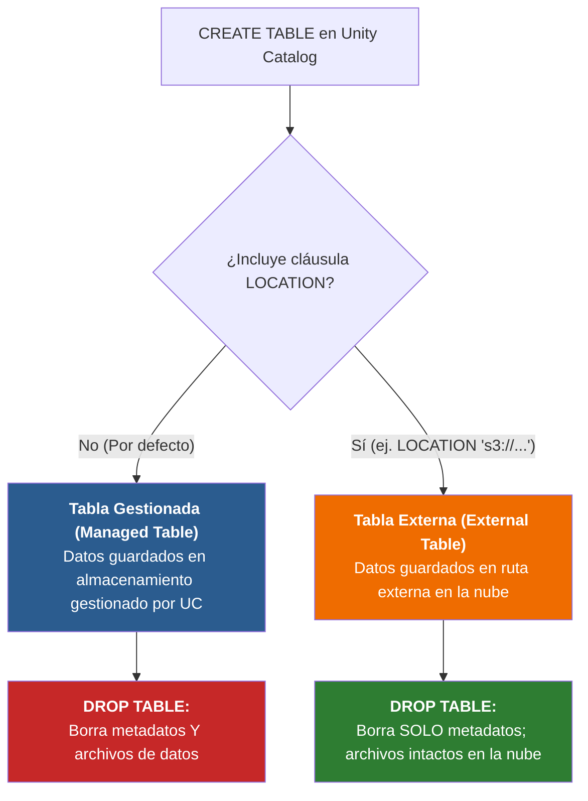

# Creación de Tablas y Time Travel en Delta Lake

## 1. ¿Por qué Delta Lake es el formato por defecto en Databricks?
Desde Databricks Runtime 8.0+, **Delta Lake** es el formato de almacenamiento predeterminado al crear tablas (`USING DELTA` ya no es obligatorio escribirlo, aunque es válido). Añade una capa transaccional sobre archivos Parquet mediante un registro de transacciones llamado **`_delta_log`**.

### Capacidades clave que evalúa el examen:
* **Transacciones ACID:** Garantiza atomicidad, consistencia, aislamiento y durabilidad (evita lecturas sucias o archivos corruptos si falla una escritura).
* **Schema Enforcement (Aplicación de esquema):** Rechaza escrituras si los tipos de datos o columnas no coinciden con la tabla destino.
* **Schema Evolution (Evolución de esquema):** Permite añadir nuevas columnas dinámicamente (ej. usando `MERGE` o `ALTER TABLE`).
* **Time Travel (Viaje en el tiempo):** Permite consultar y restaurar versiones históricas de los datos gracias al `_delta_log`.


## 2. Tablas Gestionadas vs. Tablas Externas
En **Unity Catalog**, la diferencia entre una tabla gestionada (*Managed*) y una externa (*External*) radica en **quién controla el ciclo de vida de los archivos de datos** y **qué ocurre al ejecutar `DROP TABLE`**:



| Característica | Tabla Gestionada (*Managed*) | Tabla Externa (*External*) |
| :--- | :--- | :--- |
| **Cláusula `LOCATION`** | **NO** se especifica | **SÍ** se especifica (`LOCATION '...'`) |
| **Ubicación de archivos** | Gestionada automáticamente por Unity Catalog | Ruta explícita en almacenamiento cloud (S3, ADLS, GCS) |
| **Efecto de `DROP TABLE`** | Elimina **metadatos Y archivos** (tras periodo de retención) | Elimina **solo metadatos**; los archivos permanecen en la nube |
| **Recomendación Databricks** | **Opción recomendada por defecto** (soporta optimización predictiva completa) | Solo cuando sistemas externos necesitan leer/escribir directamente en esa ruta |


## 3. Métodos de Creación de Tablas en Databricks SQL

### A. Creación estándar y CTAS (`CREATE TABLE AS SELECT`)
```sql
-- 1. Crear tabla gestionada vacía con restricciones y comentarios
CREATE TABLE IF NOT EXISTS sales.gold.customers (
    customer_id INT NOT NULL,
    email STRING COMMENT 'Correo principal del cliente',
    created_at TIMESTAMP
)
COMMENT 'Tabla maestra de clientes';

-- 2. CTAS: Crea la tabla e inserta los datos en una sola operación atómica
CREATE OR REPLACE TABLE sales.gold.active_customers AS
SELECT customer_id, email, created_at
FROM sales.silver.customers
WHERE status = 'ACTIVE';

-- 3. Externa: Los datos se encuentran en una ruta de una ubicación externa que tú gestionas
CREATE TABLE main.sales.customers_ext (
  customer_id BIGINT,
  name        STRING
)
LOCATION 's3://acme-data/customers/';
```
> **Nota de examen sobre CTAS:** Las sentencias `CREATE TABLE AS SELECT` infieren los nombres y tipos de columnas automáticamente, pero **no permiten definir restricciones (`NOT NULL`, `PRIMARY KEY`) ni `PARTITIONED BY` complejos** directamente en la cabecera; para eso se usa `CREATE TABLE` + `INSERT INTO`.

### B. Clonación de Tablas: `DEEP CLONE` vs `SHALLOW CLONE` (¡Muy preguntado!)
Permiten copiar una tabla Delta (incluida una versión histórica de Time Travel) para pruebas, auditoría o migración:

| Característica | `DEEP CLONE` | `SHALLOW CLONE` (Clon superficial) |
| :--- | :--- | :--- |
| **Qué copia** | Copia **metadatos + todos los archivos de datos** a una nueva ubicación. | Copia **solo los metadatos (`_delta_log`)** apuntando a los archivos originales. |
| **Velocidad y costo** | Más lento y duplica el costo de almacenamiento. | **Casi instantáneo** y sin costo extra de almacenamiento inicial. |
| **Independencia** | **100% independiente.** Si borras o haces `VACUUM` en la tabla origen, el clon sigue intacto. | **Dependiente.** Si ejecutas `VACUUM` en la tabla origen y borra archivos referenciados, el clon se corrompe. |
| **Uso ideal** | Backups permanentes, migraciones entre entornos, archivado. | Pruebas rápidas en desarrollo (*dev/staging*) sobre datos de producción sin duplicar terabytes. |

```sql
-- Crear un entorno de pruebas instantáneo sin duplicar datos
CREATE TABLE dev.sales.orders_test SHALLOW CLONE prod.sales.orders;

-- Crear una copia física completa para auditoría
CREATE TABLE archive.sales.orders_2026 DEEP CLONE prod.sales.orders;
```

### C. Creación de una tabla a partir de varias fuentes

read_files` lee archivos del almacenamiento en la nube o de volumes como una tabla. Admite JSON, CSV, XML, TEXT, BINARYFILE, PARQUET, AVRO y ORC, e infiere un esquema cuando no se proporciona uno. Dentro de `CREATE TABLE ... AS SELECT` (CTAS), puedes unir fuentes de archivos con tablas Delta existentes:

```sql
CREATE OR REPLACE TABLE main.sales.customer_orders AS
SELECT c.customer_id,
       c.name,
       p.category,
       o.order_id,
       o.amount
FROM read_files('/Volumes/main/raw/customers/', format => 'csv') AS c
JOIN main.sales.orders AS o                                  -- existing Delta table
  ON o.customer_id = c.customer_id
JOIN read_files('/Volumes/main/raw/products/', format => 'parquet') AS p
  ON p.product_id = o.product_id;
```

El resultado es una nueva tabla Delta administrada. Para mantenerla actualizada a medida que llegan archivos nuevos, usa en su lugar una tabla de streaming; consulta [Vistas materializadas y tablas de streaming](./07-materialized-views-and-streaming-tables.md).

### D. Reemplazo seguro de una tabla

| Sentencia | Si la tabla existe |
| :--- | :--- |
| `CREATE TABLE t (...)` | Error |
| `CREATE TABLE IF NOT EXISTS t (...)` | La sentencia se ignora |
| `CREATE OR REPLACE TABLE t (...)` | La tabla se reemplaza; **se conservan el historial, los privilegios concedidos, los filtros de fila y las máscaras de columna** |
| `DROP TABLE t; CREATE TABLE t (...)` | Se pierden el historial y los permisos |

`CREATE OR REPLACE TABLE ... IF NOT EXISTS` no está permitido. Databricks recomienda encarecidamente usar `REPLACE` en lugar de eliminar y volver a crear una tabla.


## 4. Vistas en Databricks SQL (Comparativa Rápida)
* **`VIEW` (Vista estándar):** Guarda la consulta SQL en Unity Catalog. Se calcula dinámicamente cada vez que se consulta.
* **`TEMPORARY VIEW`:** Existe únicamente durante la sesión actual (al cerrar el SQL Warehouse o sesión, desaparece). No se registra en Unity Catalog.
* **`MATERIALIZED VIEW` (Vista Materializada):** Almacena físicamente los resultados precalculados en Delta Lake y se actualiza de forma incremental en **Databricks SQL (Serverless / Pro)** para acelerar dashboards pesados.


## 5. Delta Lake Time Travel (Viaje en el Tiempo)
Cada operación que modifica una tabla Delta (`INSERT`, `UPDATE`, `DELETE`, `MERGE`, `OPTIMIZE`) genera una **nueva versión** numerada secuencialmente (`0, 1, 2, ...`) y con una marca de tiempo (*timestamp*) en el `_delta_log`.

### A. Consultar el historial de versiones
```sql
DESCRIBE HISTORY sales.gold.customers;
```

### B. Consultar datos históricos (`VERSION AS OF` / `TIMESTAMP AS OF`)
```sql
-- Consultar por número de versión exacto
SELECT * FROM sales.gold.customers VERSION AS OF 3;

-- Sintaxis abreviada equivalente con @vN
SELECT * FROM sales.gold.customers@v3;

-- Consultar por fecha/hora exacta
SELECT * FROM sales.gold.customers TIMESTAMP AS OF '2026-11-18 14:30:00';
```

### C. Restaurar una tabla a un estado anterior (`RESTORE`)
```sql
RESTORE TABLE sales.gold.customers TO VERSION AS OF 4;
-- O por timestamp:
RESTORE TABLE sales.gold.customers TO TIMESTAMP AS OF '2026-11-18 14:30:00';
```
> **Dato clave:** `RESTORE` crea una **nueva versión** en el historial (ej. la versión `5` con los datos de la `4`), manteniendo intacta la auditoría.


## 6. Retención de Historial y el Comando `VACUUM` (¡Trampa crítica!)
* **`VACUUM`:** Elimina físicamente del almacenamiento en la nube los archivos de datos que ya no están referenciados por la versión actual y que superan el umbral de retención.
* **Periodo de retención por defecto:** **7 días (168 horas)**.
* **Consecuencia en el examen:** Si ejecutas `VACUUM`, **pierdes la capacidad de hacer Time Travel** hacia versiones anteriores al periodo de retención, aunque los registros de `DESCRIBE HISTORY` sigan siendo visibles.

```sql
-- Elimina archivos obsoletos con más de 7 días de antigüedad
VACUUM sales.gold.customers;

-- Simulación: muestra qué archivos se borrarían sin eliminarlos realmente
VACUUM sales.gold.customers DRY RUN;
```

### ¿Cuánto tiempo atrás se puede ir?

| Configuración | Predeterminado | Controla |
| :--- | :--- | :--- |
| `delta.logRetentionDuration` | 30 días | Cuánto tiempo se conserva el historial de la tabla |
| `delta.deletedFileRetentionDuration` | 7 días | La antigüedad que deben tener los archivos sin referencias antes de que `VACUUM` los elimine |


## 7. Preguntas Tipo Examen (Autoevaluación)

**Pregunta 1:** *Un ingeniero de datos ejecutó por error una sentencia `DELETE FROM ventas.pedidos;` sin cláusula `WHERE` hace 10 minutos, eliminando todos los registros. La última versión válida era la `12`. ¿Cuál es la forma más rápida de recuperar los datos?*

* **Respuesta:** Ejecutar **`RESTORE TABLE ventas.pedidos TO VERSION AS OF 12;`**.

**Pregunta 2:** *Un analista ejecuta `DROP TABLE finanzas.ingresos_2025;` sobre una tabla externa (`EXTERNAL TABLE`) en Unity Catalog. ¿Qué ocurre con los datos?*

* **Respuesta:** Se elimina la definición y metadatos en Unity Catalog, pero **los archivos de datos permanecen intactos** en el almacenamiento en la nube.

**Pregunta 3:** *Necesitas crear una copia de una tabla de producción de 10 TB en desarrollo para pruebas rápidas. Quieres que sea instantánea y no duplique costos de almacenamiento. ¿Qué comando debes usar?*

* **Respuesta:** **`CREATE TABLE dev.esquema.tabla SHALLOW CLONE prod.esquema.tabla;`**.

**Pregunta 4:** *Un analista intenta consultar una versión de una tabla de hace 15 días usando `TIMESTAMP AS OF`, pero recibe un error indicando que los archivos requeridos ya no existen (`FileNotFoundException`). ¿Cuál es la causa más probable?*

* **Respuesta:** Se ejecutó el comando **`VACUUM`** sobre la tabla (cuya retención por defecto es de **7 días**), eliminando físicamente los archivos históricos necesarios para reconstruir esa versión.


## 8. Problemas y errores comunes

### El time travel falla para una versión antigua

**Escenario:** `VERSION AS OF` falla para una versión que `DESCRIBE HISTORY` todavía muestra.
**Solución:** `VACUUM` eliminó los archivos de datos. Conserva las versiones más tiempo aumentando `delta.deletedFileRetentionDuration` (y `logRetentionDuration`) antes de que se eliminen los archivos.

### Los usuarios pierden el acceso tras una reconstrucción

**Escenario:** Tras `DROP TABLE` y `CREATE TABLE`, los analistas reciben errores de permisos.
**Solución:** Usa `CREATE OR REPLACE TABLE`, que conserva los privilegios concedidos.

## 9. Consejos para el examen

- `CREATE OR REPLACE` conserva el historial y los permisos; `DROP` + `CREATE` los pierde
- `read_files(path, format => 'csv')` convierte archivos en una tabla dentro de una consulta
- Retención predeterminada: 30 días de historial y 7 días antes de que `VACUUM` pueda eliminar archivos antiguos

## 10. Puntos clave

- **Administradas frente a externas**: DROP elimina los datos solo en las tablas administradas
- **CTAS + read_files**: una sola sentencia puede unir archivos y tablas Delta
- **Time travel**: `VERSION AS OF`, `TIMESTAMP AS OF`, sintaxis `@v`, `RESTORE`
- **VACUUM**: la causa habitual de que las versiones antiguas dejen de ser legibles

## 11. Temas relacionados

- [Tables & Schemas](../06-managing-data/01-tables-schemas.md) - Tablas administradas y externas en profundidad
- [Delta History & Liquid Clustering](../03-analyzing-queries/02-delta-history-and-liquid-clustering.md) - Auditoría y comparación de versiones
- [Importing Data](../08-importing-data/01-importing-data-overview.md) - Carga de archivos con la interfaz, `COPY INTO` y Auto Loader

## 12. Documentación oficial

- [CREATE TABLE \[USING\]](https://docs.databricks.com/aws/en/sql/language-manual/sql-ref-syntax-ddl-create-table-using)
- [Función con valor de tabla read_files](https://docs.databricks.com/aws/en/sql/language-manual/functions/read_files)
- [Trabajar con el historial de tablas](https://docs.databricks.com/aws/en/delta/history)

---

**[← Anterior: Funciones de ventana y análisis](./05-window-functions.md) | [↑ Volver a la sección](./README.md) | [Siguiente: Vistas materializadas y tablas de streaming →](./07-materialized-views-and-streaming-tables.md)**
