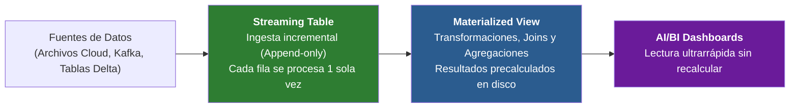

# Vistas materializadas y tablas de streaming

## 1. Visión General: ¿Por qué existen ambos objetos?
En Databricks SQL (impulsados por **Lakeflow Declarative Pipelines / Delta Live Tables** bajo el capó), las **Vistas Materializadas (Materialized Views)** y las **Tablas de Streaming (Streaming Tables)** permiten construir pipelines de datos declarativos directamente con SQL, optimizando el rendimiento de los dashboards y la ingesta continua.




## 2. Tabla Comparativa (¡Clave para el Examen!)

| Característica | Vista Estándar (`VIEW`) | Vista Materializada (`MATERIALIZED VIEW`) | Tabla de Streaming (`STREAMING TABLE`) |
| :--- | :--- | :--- | :--- |
| **Almacenamiento físico** | ❌ No (solo guarda la consulta SQL) | ✅ Sí (guarda resultados precalculados en Delta) | ✅ Sí (guarda datos ingeridos en tabla Delta) |
| **Cuándo se computa** | En cada consulta (`SELECT`) | Al crearla y al ejecutar `REFRESH` | Al crearla y al ejecutar `REFRESH` (continuo o programado) |
| **Patrón de datos** | Cualquier consulta | Agregaciones (`GROUP BY`), `JOIN`, ventanas, lógica compleja | Ingesta incremental (*Append-only*), datos nuevos que llegan |
| **Requisito de SQL Warehouse** | Cualquiera (Classic, Pro, Serverless) | **Serverless** o **Pro** (con Unity Catalog) | **Serverless** o **Pro** (con Unity Catalog) |
| **Manejo de cambios (Updates/Deletes)** | Siempre refleja el estado actual | ✅ Sí (recalcula incrementalmente si es posible o completo) | ⚠️ Solo inserciones nuevas (salvo configuración SCD/CDC específica) |


## 3. Vistas Materializadas (Materialized Views - MV)

### ¿Qué son?
Una **Vista Materializada** es una tabla gestionada por Unity Catalog que **almacena físicamente el resultado precalculado** de una consulta SQL. Cuando un usuario o un dashboard de Power BI/AI-BI consulta la vista materializada, Databricks lee directamente los resultados ya calculados en lugar de volver a procesar millones de filas y `JOIN` pesados.

### Características clave en el examen:
* **Actualización Incremental Automática:** Cuando ejecutas `REFRESH MATERIALIZED VIEW`, Databricks analiza la consulta y, siempre que sea posible, **solo procesa los datos que cambiaron** en las tablas origen en lugar de recalcular toda la tabla desde cero.
* **Ideal para la capa Gold (BI):** Perfectas para tablas de hechos agregadas, KPIs complejos y modelos dimensionales que alimentan dashboards con alta concurrencia.
* **Gobernanza en Unity Catalog:** Se registran en el esquema (`catalogo.esquema.nombre_mv`) y se gestionan permisos con `GRANT SELECT` igual que una tabla normal.

### Sintaxis SQL
```sql
-- 1. Crear una Vista Materializada con programación automática (SCHEDULE)
CREATE MATERIALIZED VIEW sales.gold.monthly_revenue_mv
SCHEDULE EVERY 1 HOUR
AS
SELECT
    DATE_TRUNC('month', order_date) AS sales_month,
    region,
    COUNT(DISTINCT customer_id) AS unique_customers,
    SUM(amount) AS total_revenue
FROM sales.silver.orders
GROUP BY 1, 2;

-- 2. Actualizar manualmente bajo demanda
REFRESH MATERIALIZED VIEW sales.gold.monthly_revenue_mv;
```


## 4. Tablas de Streaming (Streaming Tables - ST)

### ¿Qué son?
Una **Tabla de Streaming** es una tabla Delta gestionada optimizada para **ingesta continua o incremental de datos** donde cada fila nueva se procesa **exactamente una vez (*exactly-once processing*)**.

### Características clave en el examen:
* **Lectura de fuentes incrementales:** Se utilizan principalmente junto con la función **`STREAM()`** (para leer otras tablas Delta de forma incremental) o **`read_files()`** (Auto Loader en SQL para leer nuevos archivos JSON, CSV o Parquet que aterrizan en almacenamiento en la nube).
* **Semántica *Append-Only*:** Por defecto, esperan que la fuente solo añada registros nuevos. Si una fila existente en la tabla origen se modifica (`UPDATE`) o borra (`DELETE`), una tabla de streaming estándar arrojará un error a menos que se habilite explícitamente `skipChangeCommits` (para ignorar cambios) o se use un flujo CDC (`APPLY CHANGES`).
* **Ideal para la capa Bronze / Silver:** Perfectas para ingerir logs, eventos IoT, transacciones nuevas o archivos crudos desde S3/ADLS/GCS sin reprocesar archivos ya leídos anteriormente.

### Sintaxis SQL
```sql
-- 1. Ingerir archivos nuevos desde almacenamiento en la nube (Auto Loader en SQL)
CREATE STREAMING TABLE sales.bronze.raw_orders_st
SCHEDULE EVERY 15 MINUTES
AS
SELECT *
FROM STREAM read_files(
    's3://mi-bucket/landing/orders/',
    format => 'json'
);

-- 2. Transformar incrementalmente desde otra tabla usando STREAM()
CREATE STREAMING TABLE sales.silver.clean_orders_st
AS
SELECT
    order_id,
    customer_id,
    CAST(amount AS DECIMAL(10,2)) AS amount,
    order_timestamp
FROM STREAM(sales.bronze.raw_orders_st)
WHERE order_id IS NOT NULL;

-- 3. Ejecutar actualización manual
REFRESH STREAMING TABLE sales.bronze.raw_orders_st;
```


## 5. Vistas dinámicas

Una **vista dinámica** es una vista cuya consulta usa funciones como `is_account_group_member()` para decidir, por usuario, qué filas o valores de columna devolver:

```sql
CREATE VIEW main.hr.employees_v AS
SELECT name,
       department,
       CASE WHEN is_account_group_member('hr_admins') THEN salary ELSE NULL END AS salary
FROM main.hr.employees;
```

Como se ejecuta en el momento de la lectura, cada usuario ve datos actualizados y filtrados para él. Una vista materializada almacena un único resultado precalculado para todos, por lo que no es la herramienta adecuada para la seguridad por usuario.


## 6. Requisitos y Limitaciones Importantes (Trampas de Examen)

1. **Dependencia de Unity Catalog y Warehouse:**
   * Tanto las Vistas Materializadas como las Tablas de Streaming creadas en Databricks SQL **requieren Unity Catalog** (no funcionan en el antiguo `hive_metastore`).
   * Requieren un **Serverless SQL Warehouse** o **Pro SQL Warehouse** (no se pueden crear ni refrescar en un *Classic SQL Warehouse*).
2. **Permisos del propietario (*Owner*):**
   * Al crear una Vista Materializada o Tabla de Streaming, el **creador (Owner)** debe mantener permisos `SELECT` sobre las tablas origen para que las actualizaciones programadas (`SCHEDULE`) sigan funcionando.
3. **Diferencia frente a una Vista Estándar (`CREATE VIEW`):**
   * Si el examen pregunta cómo evitar que un dashboard lento recalcule un `JOIN` de 5 tablas cada vez que un usuario cambia un filtro, la respuesta es **Materialized View** (no una `VIEW` estándar, porque la vista estándar no guarda datos en disco).
4. **¿Cuándo elegir `STREAMING TABLE` vs `MATERIALIZED VIEW`?**
   * Usa **`STREAMING TABLE`** cuando los datos llegan de forma continua/incremental (archivos nuevos o tablas *append-only*) y quieres garantizar que cada registro se procese una sola vez con baja latencia.
   * Usa **`MATERIALIZED VIEW`** cuando necesitas realizar **agregaciones (`SUM`, `COUNT`, `GROUP BY`)**, **`JOIN`** complejos o manejar tablas origen donde los datos sufren actualizaciones (`UPDATE`/`DELETE`).


## 7. Preguntas Tipo Examen (Autoevaluación)

**Pregunta 1:** *Un dashboard ejecutivo tarda 45 segundos en cargar porque consulta una vista estándar (`CREATE VIEW`) que une tres tablas grandes y calcula múltiples agregaciones cada vez que se abre. Los datos solo necesitan actualizarse cada hora. ¿Qué objeto debe usar el analista para acelerar la carga del dashboard?*
* **Respuesta:** Convertir la vista estándar en una **Vista Materializada (`CREATE MATERIALIZED VIEW ... SCHEDULE EVERY 1 HOUR`)**, ya que precalcula y almacena físicamente los resultados en disco.

**Pregunta 2:** *Nuevos archivos CSV con registros de transacciones aterrizan cada 10 minutos en una carpeta de Amazon S3 gobernada por Unity Catalog. Un analista necesita ingerir únicamente los archivos nuevos de forma incremental sin volver a leer los antiguos usando Databricks SQL. ¿Qué combinación debe utilizar?*
* **Respuesta:** Una **Tabla de Streaming (`CREATE STREAMING TABLE`)** utilizando la función **`STREAM read_files(...)`**.

**Pregunta 3:** *Un analista intenta crear una Vista Materializada en su entorno de desarrollo usando un Classic SQL Warehouse, pero la operación falla. ¿Cuál es la causa más probable?*
* **Respuesta:** Las Vistas Materializadas y Tablas de Streaming en Databricks SQL requieren un **Serverless SQL Warehouse** (o **Pro SQL Warehouse**) y tablas registradas en **Unity Catalog**; no son compatibles con *Classic SQL Warehouses*.

**Pregunta 4:** *Tienes una Tabla de Streaming que lee de una tabla Delta mediante `STREAM(tabla_origen)`. Un ingeniero ejecuta una sentencia `DELETE` en `tabla_origen` para eliminar registros antiguos. ¿Qué ocurrirá la próxima vez que se refresque la Tabla de Streaming (si no se configuraron opciones especiales)?*
* **Respuesta:** La actualización **fallará con un error**, porque por defecto las fuentes de streaming solo admiten operaciones de inserción (*append-only*) y detectan eliminaciones o modificaciones como una violación de integridad del flujo.


## 8. Problemas y errores comunes

### La creación de la MV falla en una agregación

**Escenario:** `CREATE MATERIALIZED VIEW ... AS SELECT region, SUM(amount) FROM ...` falla.
**Solución:** Asigna un alias a las columnas agregadas y a las expresiones (`SUM(amount) AS revenue`).

### La tabla de streaming vuelve a cargar duplicados tras una actualización completa

**Escenario:** Una actualización `FULL` vuelve a leer todos los archivos.
**Solución:** Usa una actualización normal para las cargas incrementales; usa `FULL` solo cuando realmente necesites reconstruir la tabla.


## 9. Consejos para el examen

- Datos de solo adición que llegan de forma continua → tabla de streaming
- Consultas frecuentes y complejas sobre datos que cambian → vista materializada
- `TRIGGER ON UPDATE` actualiza una MV cuando cambia su fuente; `SCHEDULE` actualiza según un horario establecido
- Vista dinámica = calculada por usuario en el momento de la lectura; MV = resultado almacenado


## 10. Puntos clave

- Las **vistas** almacenan lógica, las **MV** almacenan resultados y las **ST** almacenan las filas añadidas
- Las actualizaciones de MV y ST se ejecutan en pipelines serverless gestionados por Databricks
- `STREAM read_files` ofrece Auto Loader en SQL


## 11. Temas relacionados

- [Creación de tablas y time travel de Delta](./06-creating-tables-and-time-travel.md)
- [Data Modeling with Databricks SQL](../09-data-modeling-with-databricks-sql/01-data-modeling-overview.md) - Dónde encajan las vistas y las MV en un modelo
- [Access Control & Security](../07-securing-data/01-access-control.md) - Filtros de fila, máscaras de columna y vistas dinámicas


## 12. Documentación oficial

- [Usar vistas materializadas independientes](https://docs.databricks.com/aws/en/views/materialized)
- [Usar tablas de streaming independientes](https://docs.databricks.com/aws/en/tables/streaming)
- [Crear una vista dinámica](https://docs.databricks.com/aws/en/views/dynamic)

---

**[← Anterior: Creación de tablas y time travel de Delta](./06-creating-tables-and-time-travel.md) | [↑ Volver a la sección](./README.md) | [Siguiente: Consultas federadas →](./08-federated-queries.md)**
