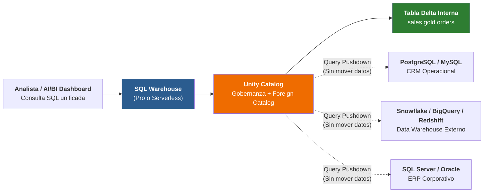

# Consultas federadas (Lakehouse Federation)

## 1. ¿Qué es Lakehouse Federation (Consultas Federadas)?
**Lakehouse Federation** es la capacidad nativa de Databricks que permite **consultar, unir y analizar datos almacenados en bases de datos y data warehouses externos directamente desde Databricks SQL, sin necesidad de migrar ni copiar los datos previamente** al Lakehouse.



### ¿Cuándo usar Consultas Federadas? (Casos de uso en el examen)
1. **Reportes ad-hoc sin ETL:** Consultar datos operacionales en tiempo real que residen en PostgreSQL, MySQL o SQL Server sin construir ni mantener pipelines de ingesta.
2. **Enriquecimiento de datos (*Cross-source JOIN*):** Unir una tabla maestra de clientes en Salesforce/PostgreSQL con tablas históricas de clics en Delta Lake dentro de una sola consulta SQL.
3. **Migraciones graduales:** Permitir que los analistas sigan consultando sistemas heredados (*legacy*) desde un único punto de entrada gobernado mientras se migran las tablas a Delta Lake.


## 2. Arquitectura en Unity Catalog: `CONNECTION` y `FOREIGN CATALOG`
Para habilitar consultas federadas, Unity Catalog introduce **dos objetos securizables** específicos:

### Paso 1: Crear una Conexión (`CONNECTION`)
Almacena de forma segura las credenciales (usuario/contraseña o token), el host, el puerto y el tipo de motor externo.
* **Privilegio necesario:** `CREATE CONNECTION` en el Metastore de Unity Catalog (normalmente lo crea un administrador).
* **Privilegio para usarla:** `USE CONNECTION`.

```sql
-- Ejemplo: Crear conexión a una base de datos PostgreSQL externa
CREATE CONNECTION postgres_crm_conn
TYPE postgresql
OPTIONS (
    host '://empresa.com',
    port '5432',
    user secret('crm_scope', 'db_user'),
    password secret('crm_scope', 'db_password')
);
```

### Paso 2: Crear un Catálogo Externo (`FOREIGN CATALOG`)
Refleja automáticamente los esquemas y tablas de la base de datos externa dentro del espacio de nombres de 3 niveles de Unity Catalog (`foreign_catalog.esquema_remoto.tabla_remota`).
* **Privilegio necesario:** `CREATE CATALOG` en el Metastore y `USE CONNECTION` en la conexión.

```sql
-- Ejemplo: Mapear la base de datos 'customers_prod' como un catálogo en Unity Catalog
CREATE FOREIGN CATALOG crm_federated
USING CONNECTION postgres_crm_conn
OPTIONS (database 'customers_prod');

-- Consultar y unir directamente con una tabla Delta interna
SELECT
    c.customer_name,
    c.segment,
    SUM(o.total_amount) AS lifetime_value
FROM crm_federated.public.customers c
JOIN sales.gold.orders o
    ON c.customer_id = o.customer_id
GROUP BY 1, 2;
```


## 3. Optimización: Query Pushdown (Empuje de Consultas)
Una pregunta habitual en el examen es **cómo mantiene el rendimiento** Databricks al consultar sistemas externos sin mover terabytes de datos por la red:

* **Query Pushdown:** Databricks analiza el plan de ejecución y **delega (empuja) operaciones como filtros (`WHERE`), proyecciones (`SELECT` de columnas específicas), agregaciones y ciertos `JOIN`** para que se ejecuten directamente en el motor de la base de datos remota antes de transferir los resultados a Databricks.
* **Beneficio:** Minimiza el tráfico de red y aprovecha los índices y capacidad de cómputo del sistema origen.


## 4. Requisitos, Permisos y Limitaciones (¡Trampas de Examen!)

| Aspecto | Regla / Requisito en Databricks |
| :--- | :--- |
| **Gobernanza obligatoria** | **Requiere Unity Catalog.** No está disponible en el antiguo `hive_metastore`. |
| **Tipos de SQL Warehouse soportados** | Solo **Pro SQL Warehouse** y **Serverless SQL Warehouse**. *(No funciona en Classic SQL Warehouse)*. |
| **Red y conectividad privada** | Si la base de datos externa está en una red privada (*on-premises* o VPC privada sin acceso público), se suele usar **Pro SQL Warehouse** (desplegado dentro de tu VNet/VPC) o conectividad privada configurada para Serverless. |
| **Operaciones permitidas** | **Solo lectura (`SELECT`).** No puedes ejecutar `INSERT`, `UPDATE`, `DELETE` ni `DROP` contra tablas de un `FOREIGN CATALOG`. |
| **Control de acceso granular** | Una vez creado el `FOREIGN CATALOG`, los administradores gestionan permisos estándar de Unity Catalog (`GRANT USE CATALOG`, `GRANT USE SCHEMA`, `GRANT SELECT`) sin tener que dar credenciales de la base de datos externa a cada analista. |
| **Sistemas soportados habituales** | PostgreSQL, MySQL, Microsoft SQL Server, Oracle, Snowflake, Amazon Redshift, Google BigQuery, Azure Synapse y Databricks-to-Databricks. |


## 5. Lakehouse Federation vs. Ingesta (`COPY INTO` / Streaming Tables)

| Criterio | Lakehouse Federation (Consultas Federadas) | Ingesta al Lakehouse (Delta Lake) |
| :--- | :--- | :--- |
| **Movimiento de datos** | ❌ Ninguno (los datos permanecen en origen) | ✅ Sí (se copian a almacenamiento cloud en Delta) |
| **Latencia de frescura** | Tiempo real (lee el estado actual del origen) | Depende de la frecuencia del pipeline / `REFRESH` |
| **Rendimiento en consultas pesadas / BI masivo** | Limitado por la capacidad del sistema origen y la red | **Máximo rendimiento** (Photon, Disk Cache, Liquid Clustering) |
| **Impacto en la BD operacional** | Consume CPU/IO de la BD origen en cada consulta | Ningún impacto en el sistema origen tras la ingesta |


## 6. Preguntas Tipo Examen (Autoevaluación)

**Pregunta 1:** *Un analista necesita cruzar datos de transacciones almacenados en Delta Lake con una tabla pequeña de estados de envío que reside en una base de datos PostgreSQL operacional. No se requiere copiar los datos al Lakehouse y la consulta se ejecuta unas pocas veces al día. ¿Qué funcionalidad de Databricks debe utilizar?*
* **Respuesta:** **Lakehouse Federation (Consultas Federadas)** configurando una `CONNECTION` y un `FOREIGN CATALOG` en Unity Catalog.

**Pregunta 2:** *Un analista intenta escribir registros de auditoría en una tabla dentro de un `FOREIGN CATALOG` conectado a SQL Server mediante una sentencia `INSERT INTO`, pero recibe un error. ¿Por qué ocurre esto?*
* **Respuesta:** Porque las tablas en un `FOREIGN CATALOG` de Lakehouse Federation son **estrictamente de solo lectura (`SELECT`)**; Databricks no permite modificar datos en sistemas externos a través de consultas federadas.

**Pregunta 3:** *¿Qué tipo de SQL Warehouse es compatible con Lakehouse Federation cuando la empresa necesita desplegar el cómputo dentro de su propia red virtual privada (VNet/VPC) para alcanzar una base de datos Oracle local?*
* **Respuesta:** **Pro SQL Warehouse** (soporta Lakehouse Federation y se ejecuta dentro de la red en la nube gestionada por el cliente; *Classic* no soporta federación).

**Pregunta 4:** *¿Qué dos objetos de Unity Catalog deben crearse para que un analista pueda consultar tablas externas usando la nomenclatura de tres niveles (`catalogo.esquema.tabla`) sin conocer las credenciales de la base de datos remota?*
* **Respuesta:** Una **`CONNECTION`** (que encapsula las credenciales y ubicación del servidor) y un **`FOREIGN CATALOG`** (que mapea la base de datos externa en Unity Catalog).


## 7. Problemas y errores comunes

### La consulta federada falla en un warehouse

**Escenario:** Una consulta sobre un foreign catalog funciona en un warehouse y falla en otro.
**Solución:** Usa un SQL warehouse pro o serverless; los warehouses classic no son compatibles con Lakehouse Federation.

### Fallo al insertar en una tabla externa (foreign)

**Escenario:** `INSERT INTO pg_crm.public.customers ...` devuelve un error.
**Solución:** Los foreign catalogs son de solo lectura. Escribe directamente en el sistema de origen o ingiere los datos en Delta.


## 8. Consejos para el examen

- "Unir sin copiar datos" + base de datos externa → Lakehouse Federation
- Conexión → foreign catalog → permiso → consulta
- Solo warehouses pro o serverless; de solo lectura


## 9. Puntos clave

- La federación expone tablas externas como `catalog.schema.table` en Unity Catalog
- Las consultas se envían al origen, por lo que los datos permanecen donde están
- Los permisos y el linaje de Unity Catalog también se aplican a los foreign catalogs


## 10. Temas relacionados

- [Joins & Set Operations](./03-joins-and-set-operations.md)
- [Importing Data](../08-importing-data/01-importing-data-overview.md) - Cuándo ingerir en lugar de federar
- [Lakehouse Federation (DE Pro)](../../data-engineer-professional/02-data-ingestion-and-acquisition/08-lakehouse-federation.md) - Perspectiva de ingeniería más detallada


## 11. Documentación oficial

- [¿Qué es Lakehouse Federation?](https://docs.databricks.com/aws/en/query-federation/)
- [Ejecutar consultas federadas en PostgreSQL](https://docs.databricks.com/aws/en/query-federation/postgresql)

---

**[← Anterior: Vistas materializadas y tablas de streaming](./07-materialized-views-and-streaming-tables.md) | [↑ Volver a la sección](./README.md)**
