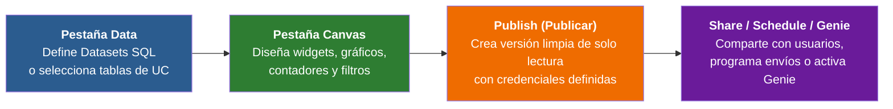

# AI/BI dashboards y diseño de paneles

# Guía de Estudio: AI/BI Dashboards y Diseño de Paneles en Databricks
**Certificación:** Databricks Certified Data Analyst Associate  
**Dominio del examen:** Data Visualization, AI/BI Dashboards & Sharing  


## 1. ¿Qué son los AI/BI Dashboards?

Los **AI/BI Dashboards** (anteriormente llamados *Lakeview Dashboards*) son la herramienta nativa de visualización e inteligencia de negocios de última generación en Databricks. Están diseñados para ofrecer **alto rendimiento, gobernanza unificada con Unity Catalog y capacidades de IA generativa integradas**.



### Arquitectura fundamental (¡Clásico de examen!)
Un AI/BI Dashboard separa claramente la **lógica de datos** de la **presentación visual** mediante dos pestañas principales:
1. **Pestaña `Data` (Conjuntos de datos / Datasets):**
   * Aquí se definen las fuentes de datos mediante consultas SQL o seleccionando directamente tablas/vistas de Unity Catalog.
   * **Reutilización y rendimiento:** Un solo *Dataset* puede alimentar múltiples widgets/gráficos en distintas páginas del panel, ejecutándose una sola vez y aprovechando la caché.
   * **Campos calculados (*Calculated Fields*):** Permiten crear nuevas métricas o dimensiones (ej. margen de beneficio o ratios) directamente sobre un dataset sin reescribir la consulta SQL base.
2. **Pestaña `Canvas` (Lienzo visual):**
   * Espacio cuadriculado (*grid*) multipágina donde se colocan y organizan visualizaciones, KPIs (*Counters*), tablas, cuadros de texto (Markdown) y filtros interactivos.


## 2. Borrador vs. Publicado (`Draft` vs. `Published`) — ¡Muy Preguntado!

AI/BI Dashboards implementa un ciclo de vida de dos estados para evitar que los usuarios finales vean cambios a medio hacer:

| Característica | Estado `Draft` (Borrador) | Estado `Published` (Publicado) |
| :--- | :--- | :--- |
| **Propósito** | Desarrollo, edición de consultas SQL, diseño de gráficos y pruebas. | Consumo final por parte de los usuarios de negocio (*Viewers*). |
| **Visibilidad** | Solo visible para usuarios con permiso `Can Edit` o `Can Manage`. | Visible para todos los usuarios con quienes se compartió (`Can View` / `Can Run`). |
| **Impacto al editar** | Editar el borrador **NO afecta** al panel publicado hasta que pulses **Publish**. | Se actualiza únicamente cuando el autor vuelve a pulsar **Publish**. |

### Niveles de Permisos

| Nivel | Qué puede hacer |
| :--- | :--- |
| CAN VIEW / CAN RUN | Ver el panel publicado e interactuar con los filtros |
| CAN EDIT | Editar el borrador y gestionar los suscriptores |
| CAN MANAGE | Todo, incluida la gestión de permisos |


## 3. Credenciales de Ejecución al Publicar (`Run as`)

Al hacer clic en **Publish**, debes elegir bajo qué identidad se ejecutarán las consultas del panel:

1. **`Run as Viewer` (Ejecutar como espectador - Recomendado por seguridad):**
   * Las consultas se ejecutan usando los **permisos de Unity Catalog de cada usuario** que abre el panel.
   * Si un usuario no tiene permiso `SELECT` sobre una tabla o tiene restricciones de seguridad a nivel de fila/columna (*Row/Column Level Security*), solo verá los datos autorizados para él.
   * **Requisito clave:** Cada espectador debe tener permiso `CAN USE` sobre el SQL Warehouse asociado (o seleccionar su propio warehouse).
2. **`Run as Owner` (Ejecutar como propietario):**
   * Las consultas se ejecutan usando los **permisos del creador/propietario** del panel.
   * **Cuándo usarlo:** Cuando quieres compartir un resumen ejecutivo con usuarios de negocio (o usuarios de cuenta sin acceso directo a las tablas subyacentes) para que vean datos agregados sin otorgarles acceso `SELECT` a las tablas crudas.


## 4. Tipos de Visualizaciones y Cuándo Elegir Cada Una (Diseño de Paneles)

El examen evalúa la capacidad de elegir el gráfico más efectivo según la pregunta de negocio y los principios de diseño visual:

| Tipo de Visualización | Mejor caso de uso en el examen |
| :--- | :--- |
| **Counter (Contador / KPI)** | Mostrar un **único valor numérico clave** (ej. Ingresos totales, Tasa de conversión) y su comparación/variación frente a un objetivo o periodo anterior. |
| **Line Chart (Gráfico de líneas)** | Mostrar **tendencias continuas a lo largo del tiempo** (ventas diarias, crecimiento mensual). |
| **Bar Chart (Gráfico de barras)** | **Comparar valores entre categorías discretas** (ventas por país, rendimiento por vendedor). Usar barras horizontales si los nombres de categoría son largos. |
| **Stacked Bar Chart (Barras apiladas)** | Comparar totales por categoría y ver la **composición interna** de cada barra (100% apilado para proporciones relativas). |
| **Scatter Plot (Gráfico de dispersión)** | Identificar **correlaciones, patrones o valores atípicos (*outliers*)** entre dos variables numéricas continuas. |
| **Histogram (Histograma)** | Mostrar la **distribución de frecuencias** de una única variable numérica agrupada en intervalos (*bins*). |
| **Heatmap (Mapa de calor)** | Visualizar patrones de intensidad o densidad en una matriz de **dos dimensiones categóricas/temporales** (ej. tráfico web por día de la semana y hora). |
| **Pie / Donut Chart** | Mostrar proporciones parte-de-un-todo **únicamente cuando hay pocas categorías** (idealmente ≤ 4-5). Para más categorías, preferir siempre un gráfico de barras. |
| **Table / Pivot Table** | Mostrar valores exactos detallados, múltiples métricas simultáneas o cruces multidimensionales con subtotales. |
| **Map (Choropleth / Point Map)** | Datos geoespaciales por país, región o coordenadas (latitud/longitud). |

### Buenas prácticas de diseño evaluadas:
* **Jerarquía visual:** Colocar los KPIs principales (*Counters*) en la **parte superior izquierda** (donde empieza la lectura), seguidos de tendencias generales en el centro y tablas de detalle en la parte inferior.
* **Cross-filtering (Filtrado cruzado):** Al hacer clic en una barra, punto o segmento de un gráfico, los demás gráficos del panel basados en el mismo dataset se filtran dinámicamente.
* **Filtros globales vs. locales:** Los filtros colocados en la barra superior afectan a toda la página o a múltiples datasets; los filtros dentro del lienzo afectan a los widgets seleccionados.
* **Parámetros en Datasets:** Permiten filtrar los datos **antes de que se ejecute la consulta en el SQL Warehouse** (ideal para tablas masivas), mientras que los **Filtros de Dashboard** filtran los resultados **ya recuperados en el navegador/caché** (instantáneo para datasets medianos/pequeños).


## 5. Automatización, Suscripciones y AI/BI Genie

### A. Programación y Suscripciones (*Schedules & Subscriptions*)
* Permite programar la actualización periódica del dashboard (ej. todos los lunes a las 8:00 AM) usando un SQL Warehouse específico.
* Envía automáticamente por **correo electrónico o Slack** una captura visual del panel (y opcionalmente un archivo PDF adjunto) a los suscriptores.
* **Nota de seguridad:** Las suscripciones programadas **siempre se ejecutan con las credenciales del propietario (`Run as Owner`)**, por lo que debes tener cuidado de no enviar datos sensibles a usuarios que no deberían verlos.

### B. Integración con AI/BI Genie
* Al publicar un dashboard, puedes habilitar **Genie** con un clic.
* Genie utiliza los datasets, metadatos y descripciones del panel para permitir que los usuarios de negocio hagan **preguntas de seguimiento en lenguaje natural** (ej. *"¿Por qué cayeron las ventas en Madrid el martes pasado?"*) sin tener que pedirle al analista que cree un gráfico nuevo.


## 6. Alertas en Databricks SQL (Alerts)

Aunque se gestionan en su propia sección junto a los paneles, suelen preguntarse en el mismo bloque del examen:
* **Cómo funcionan:** Evalúan periódicamente el resultado de una **consulta SQL guardada** (no directamente un widget gráfico).
* **Condición de disparo:** Compara el valor de una columna en la **primera fila** del resultado contra un umbral (ej. `error_count > 100` o `status == 'FAILED'`).
* **Estados:** `OK` (no cumple condición), `TRIGGERED` (cumple condición y envía notificación), `UNKNOWN` (la consulta falló o no devolvió filas).
* **Destinos de notificación:** Correo electrónico, Slack, Microsoft Teams, PagerDuty o Webhooks.


## 7. Creación de paneles

### Configuración básica del panel

```yaml
Create Dashboard:
  Name: "Sales Performance Dashboard"
  Description: "Weekly sales metrics and trends"
  Permissions:
    Owner: analyst_team@company.com
    Viewers: everyone@company.com

Dashboard Settings:
  Refresh Schedule: Every 8 hours
  Timezone: America/New_York
  Layout: Grid (auto-resizing)
  Color Theme: Light/Dark
```

### Widget de tarjeta KPI

```sql
-- Query for KPI card (single number)
SELECT COUNT(*) as total_orders
FROM orders
WHERE order_date >= CURRENT_DATE - 30;

-- Output: 1,245
```

**Configuración del widget:**

```yaml
Type: Scalar (Number)
Format: 1,234 (with thousand separator)
Font Size: Large (for prominence)
Color: Green/Red based on threshold
Icon: Up arrow (for trend)
Comparison: "↑ 15% vs last month"
```

### Gráfico de series temporales

```sql
-- Daily revenue trend
SELECT
    DATE_TRUNC('day', order_date) as day,
    SUM(amount) as revenue,
    COUNT(*) as order_count
FROM orders
WHERE order_date >= CURRENT_DATE - 90
GROUP BY DATE_TRUNC('day', order_date)
ORDER BY day;
```

**Configuración de la visualización:**

```yaml
Type: Line Chart
X-axis: day (time)
Y-axis: revenue (quantity)
Series: Multiple lines (order_count on secondary Y)
Zoom: Enable
Legend: Display
Colors: Brand colors (blue #0066CC)
Tooltip: Show on hover
```

### Comparación de categorías (gráfico de barras)

```sql
-- Revenue by region
SELECT
    region,
    SUM(amount) as revenue,
    COUNT(DISTINCT customer_id) as customers
FROM orders
GROUP BY region
ORDER BY revenue DESC;
```

**Configuración de la visualización:**

```yaml
Type: Bar Chart
X-axis: region (categories)
Y-axis: revenue (quantity)
Sort: Descending by revenue
Colors: Sequential gradient
Drill-down: Click region for detailed view
Show Values: On bars
```

### Progreso respecto a un objetivo

AI/BI dashboards no dispone de una visualización de tipo indicador (gauge). Muestre el progreso con un **contador** (que puede comparar un valor con un valor de referencia) o con un gráfico de barras de valores reales frente a objetivos.

```sql
SELECT
    SUM(amount) AS actual,
    500000 AS target,
    ROUND(SUM(amount) * 100.0 / 500000, 1) AS pct_of_target
FROM orders
WHERE order_date >= CURRENT_DATE - 30;
```


## 8. Diseño y distribución del panel

### Sistema de cuadrícula

```text
Dashboard 12-column grid:
┌─ ─ ─ ─ ─ ─ ─ ─ ─ ─ ─ ─┐
│ KPI  │ KPI  │ KPI  │KPI │  (Row 1: 3 cols each)
├─ ─ ─ ─ ─ ─ ─ ─ ─ ─ ─ ─┤
│            │            │  (Row 2: 6 cols each)
│   Chart 1  │  Chart 2   │
│            │            │
├─ ─ ─ ─ ─ ─ ─ ─ ─ ─ ─ ─┤
│                          │  (Row 3: 12 cols full width)
│        Data Table        │
└─ ─ ─ ─ ─ ─ ─ ─ ─ ─ ─ ─┘
```

### Prácticas recomendadas de diseño

**1. Jerarquía visual**

```text
Dashboard Structure:
├─ 1. Title (prominent, at top)
├─ 2. Key metrics (KPIs first, largest)
├─ 3. Trends (time-series charts)
├─ 4. Details (filtered data, tables)
└─ 5. Context (definitions, links)
```

**2. Codificación por color**

```text
Standard Colors:
  Green: Positive, good, exceeds target
  Yellow: Caution, meets target
  Red: Negative, below target
  Blue: Neutral information
  Gray: Disabled/unavailable states
```

**3. Densidad de información**

```text
❌ Too dense:
├─ 20+ charts on one page
├─ No white space
└─ Hard to scan

✅ Balanced:
├─ 5-8 key visualizations
├─ Clear sections
├─ White space for focus
└─ Easy to scan
```

## 9. Interactividad y parámetros

### Filtros del panel

```sql
-- Query with multiple parameters
SELECT
    DATE_TRUNC('day', order_date) as day,
    region,
    SUM(amount) as revenue
FROM orders
WHERE order_date BETWEEN :date_range.min AND :date_range.max   -- date range parameter
  AND (region = :selected_region OR :selected_region IS NULL)
GROUP BY DATE_TRUNC('day', order_date), region;
```

**Configuración del widget de filtro:**

```yaml
Parameter: date_range
  Type: Date (range)
  Widget: Date range picker

Parameter: selected_region
  Type: Dropdown
  Options: North, South, East, West, All
  Default: All
```

### Navegación de detalle

```sql
-- Dashboard query (summary level)
SELECT
    region,
    COUNT(*) as orders,
    SUM(amount) as revenue
FROM orders
GROUP BY region;

-- Drill-down query (detail level, triggered by click)
SELECT
    region,
    store_id,
    COUNT(*) as orders,
    SUM(amount) as revenue
FROM orders
WHERE region = :selected_region
GROUP BY region, store_id;
```

**Configuración de la navegación:**

```yaml
Dashboard:
  - Regional Summary (click for drill)
    └─ Link to Store Detail Dashboard
         with parameter: region_filter = selected_region
```


## 10. Nomenclatura y organización de paneles

### Convención de nomenclatura

```text
Good names:
  "Sales Performance - Weekly"
  "Customer Churn Analysis"
  "Inventory by Location"

Poor names:
  "Dashboard 1"
  "Report123"
  "Sales"
```


## 11. Preguntas Tipo Examen (Autoevaluación)

**Pregunta 1:** *Un analista tiene un AI/BI Dashboard publicado en producción. Necesita añadir tres gráficos nuevos y modificar una consulta SQL sin que los usuarios ejecutivos vean gráficos incompletos mientras trabaja. ¿Cómo debe proceder?*
* **Respuesta:** Realizar los cambios en la pestaña **Draft (Borrador)** del dashboard; los usuarios seguirán viendo la última versión estable hasta que el analista haga clic en **Publish**.

**Pregunta 2:** *Un panel de recursos humanos muestra salarios por departamento. La empresa exige que cada gerente regional solo vea los salarios de su propia región al abrir el dashboard, aplicando las políticas de seguridad a nivel de fila ya definidas en Unity Catalog. ¿Qué configuración debe elegir el analista al publicar el panel?*
* **Respuesta:** Publicar el dashboard con la opción **`Run as Viewer` (Ejecutar como espectador)**.

**Pregunta 3:** *Un dashboard consulta una tabla de 500 millones de filas. El analista quiere que los usuarios seleccionen un rango de fechas (`start_date` y `end_date`) y que ese filtro se envíe directamente en la cláusula `WHERE` al SQL Warehouse para evitar traer millones de filas innecesarias al navegador. ¿Qué mecanismo debe usar?*
* **Respuesta:** Parámetros de consulta (Query Parameters) en el Dataset (en lugar de un filtro visual posterior sobre el resultado ya descargado).

Pregunta 4: Quieres mostrar en un dashboard la relación entre el gasto en publicidad (eje X) y las ventas generadas (eje Y) para 2,000 campañas distintas con el objetivo de detectar correlaciones y campañas atípicas. ¿Qué tipo de visualización es la más adecuada?
* **Respuesta:** Un Gráfico de dispersión (Scatter Plot).


## 12. Problemas y errores comunes

### El panel muestra datos obsoletos

**Escenario:** El panel muestra las cifras del día anterior aunque se hayan cargado datos nuevos.
**Solución:** Compruebe la programación de actualización. Los paneles no se actualizan automáticamente a menos que se configure una programación. Haga clic en "Actualizar" o configure un intervalo de actualización automática.


## 13. Consejos para el examen

- Un panel puede tener varias páginas y varios conjuntos de datos; los widgets incluyen visualizaciones, filtros, texto e imágenes
- La frecuencia de actualización depende del caso de uso; configúrela con **Programar**
- Un parámetro compartido puede filtrar varios widgets simultáneamente cuando se usa en la consulta de cada widget
- Editar un panel compartido lo actualiza para todos los espectadores con acceso
- Optimice el tiempo de carga filtrando las consultas (rango de fechas), preagregando los datos y aprovechando la caché de resultados


## 14. Conclusiones clave

- **Panel**: colección de visualizaciones con interactividad
- **AI/BI dashboards**: el producto actual; los paneles heredados están retirados
- **Pestaña Data + páginas**: varios conjuntos de datos y varias páginas por panel
- **Widgets**: visualizaciones, filtros, texto, imágenes
- **Actualización**: botón Programar; los suscriptores reciben instantáneas
- **Permisos**: CAN VIEW / CAN RUN, CAN EDIT, CAN MANAGE
- **Uso compartido**: por correo electrónico, enlaces o grupos
- **Rendimiento**: las consultas deben ejecutarse en < 5 segundos
- **Drill-down**: navegar del resumen al detalle


## 15. Temas relacionados

- [Visualizaciones y tipos de gráficos](./02-visualizations.md) - Elección del tipo de gráfico adecuado para los widgets del panel
- [Alertas y programación](./03-alerts-scheduling.md) - Automatización de la actualización de paneles y las notificaciones de alertas
- [Fundamentos de SQL](../../../shared/fundamentals/sql-essentials.md) - Escritura de consultas eficientes para los widgets del panel


## 16. Documentación oficial

- [AI/BI dashboards](https://docs.databricks.com/aws/en/dashboards/)
- [Crear paneles](https://docs.databricks.com/aws/en/dashboards/manage/)
- [Programar actualizaciones periódicas de los paneles](https://docs.databricks.com/aws/en/dashboards/schedule-subscribe)

---

**[↑ Volver a la sección](./README.md) | [Siguiente: Visualizaciones y tipos de gráficos →](./02-visualizations.md)**
