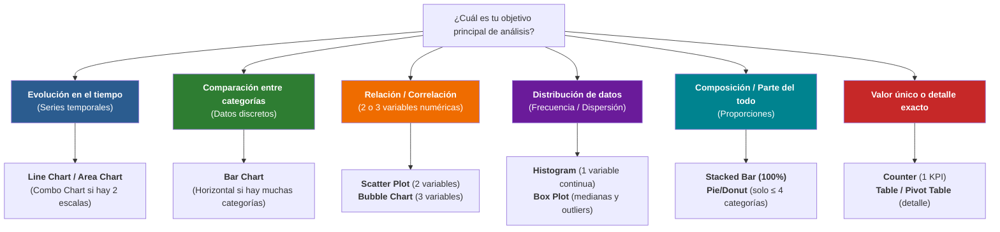

# Visualizaciones y tipos de gráficos

## 1. Mapa de Decisión: ¿Qué Gráfico Elegir en el Examen?

En la certificación de Data Analyst, muchas preguntas presentan un escenario de negocio y piden elegir la **visualización más efectiva** según el tipo de datos (categóricos, numéricos o temporales) y el objetivo analítico:




## 2. Catálogo Completo de Visualizaciones en Databricks

### A. Tendencias y Series Temporales
* **Line Chart (Gráfico de líneas):**
  * **Uso:** Mostrar cambios continuos a lo largo del tiempo (días, meses, años).
  * **Regla de examen:** Es siempre la mejor opción para series temporales continuas. Evita usar gráficos de líneas para categorías sin orden natural (como países o departamentos).
* **Area Chart (Gráfico de áreas):**
  * **Uso:** Similar al de líneas, pero rellena el área bajo la curva para enfatizar la **magnitud o volumen acumulado** a lo largo del tiempo.
* **Combo Chart (Gráfico combinado Línea + Barra):**
  * **Uso:** Comparar **dos métricas con escalas o unidades muy diferentes** sobre el mismo eje temporal o categórico mediante un **eje Y dual** (ej. Volumen de ventas en barras en el eje izquierdo vs. Margen porcentual `%` en línea en el eje derecho).

### B. Comparación entre Categorías
* **Bar Chart (Gráfico de barras verticales / columnas):**
  * **Uso:** Comparar valores numéricos entre categorías discretas (ej. ingresos por trimestre o producto).
  * **Regla visual:** El eje Y debe empezar siempre en **cero (0)** para no exagerar visualmente las diferencias.
* **Horizontal Bar Chart (Barras horizontales):**
  * **Uso:** Preferible cuando hay **muchas categorías** (ej. Top 15 clientes) o cuando las etiquetas de texto son largas, facilitando su lectura sin inclinar el texto.
* **Grouped Bar Chart (Barras agrupadas):**
  * **Uso:** Comparar subcategorías lado a lado dentro de cada categoría principal (ej. ventas de 2025 vs. 2026 por región).

### C. Composición (Parte de un Todo)
* **Stacked Bar Chart (Barras apiladas):**
  * **Estándar:** Muestra tanto el total de cada categoría como la contribución absoluta de cada subcategoría.
  * **100% Stacked Bar:** Normaliza todas las barras al 100% para comparar **proporciones relativas** entre categorías o a lo largo del tiempo.
* **Pie Chart / Donut Chart (Gráfico circular / de anillo):**
  * **Uso:** Mostrar porcentajes de un total.
  * **Trampa clásica de examen:** Solo deben usarse cuando hay **muy pocas categorías (idealmente ≤ 4 o 5)** y las diferencias son claras. Si hay 10 categorías o valores muy similares, la respuesta correcta en el examen siempre es cambiarlo por un **Bar Chart**.
* **Sankey Diagram (Diagrama de Sankey):**
  * **Uso:** Visualizar **flujos, transiciones o embudos complejos** entre etapas o nodos (ej. recorrido de usuarios desde canales de marketing hasta compra/abandono, o flujo de presupuestos). El grosor de cada banda es proporcional al volumen del flujo.
* **Funnel Chart (Gráfico de embudo):**
  * **Uso:** Mostrar la reducción progresiva de valores a través de etapas secuenciales lineales (ej. Visitas -> Registro -> Carrito -> Pago).

### D. Relación y Correlación entre Variables
* **Scatter Plot (Gráfico de dispersión):**
  * **Uso:** Analizar la **correlación** (positiva, negativa o nula), agrupaciones (*clusters*) y **valores atípicos (*outliers*)** entre **dos variables numéricas** (ej. tiempo en web vs. importe gastado).
* **Bubble Chart (Gráfico de burbujas):**
  * **Uso:** Extensión del Scatter Plot que añade una **tercera variable numérica** representada por el **tamaño del círculo** (y opcionalmente una cuarta variable categórica mediante el color).
* **Heatmap (Mapa de calor):**
  * **Uso:** Mostrar intensidad o densidad mediante escala de colores en una matriz de **dos dimensiones** (ej. número de incidencias por día de la semana y hora del día, o matriz de correlación).

### E. Distribución Estadística
* **Histogram (Histograma):**
  * **Uso:** Mostrar la **distribución de frecuencias** de una **única variable numérica continua** dividida en intervalos contiguos (*bins*, sin espacios entre barras). *(No confundir con el Bar Chart, que compara categorías separadas)*.
* **Box Plot (Diagrama de caja y bigotes):**
  * **Uso:** Resumir la distribución estadística de una o varias categorías mostrando **mediana, cuartiles (Q1 y Q3), rango intercuartílico (IQR) y valores atípicos (*outliers*)**.

### F. KPIs, Detalle y Mapas Geoespaciales
* **Counter (Contador / KPI Card):**
  * **Uso:** Resaltar un **único número crítico** (ej. `1.45M €`) junto con una etiqueta objetivo o variación porcentual respecto al periodo anterior.
* **Table / Pivot Table (Tabla / Tabla dinámica):**
  * **Table:** Mostrar registros exactos, aplicar formato condicional (*barras de progreso en celdas, colores*) y enlaces clicables.
  * **Pivot Table:** Resumir grandes volúmenes cruzando filas y columnas con subtotales y totales dinámicos.
* **Map — Choropleth (Mapa coroplético):**
  * **Uso:** Colorear regiones geográficas delimitadas (países, estados, provincias) según una métrica agregada o tasa (ej. ventas per cápita por provincia).
* **Map — Marker / Point Map (Mapa de puntos):**
  * **Uso:** Ubicar eventos o entidades exactas mediante **latitud y longitud** (ej. ubicación de tiendas o entregas).


## 3. Tipos de gráficos principales

### Gráfico de barras

**Finalidad**: comparar valores entre categorías

```sql
-- Revenue by region
SELECT region, SUM(amount) as revenue
FROM orders
GROUP BY region
ORDER BY revenue DESC;
```

**Configuración de la visualización:**

```yaml
Type: Column Chart (vertical bars)
X-axis: region (categorical)
Y-axis: revenue (quantitative)
Sort: Descending
Colors: Single color or gradient
Show Values: On bars or hover
Stacked: No (comparison)
```

**Variantes:**

```text
Vertical Column Chart: Good for limited categories
Horizontal Bar Chart: Better for long labels (>20 chars)
Stacked Bar: Show totals + breakdown
Clustered Bar: Compare multiple series
```

**Prácticas recomendadas:**

- ✅ Limite a 5-15 categorías (si hay más, use una tabla)
- ✅ Ordene por valor (los patrones se vuelven evidentes)
- ✅ Use la misma escala en el eje Y
- ❌ Efectos 3D (distorsionan la percepción)

### Gráfico de líneas

**Finalidad**: mostrar tendencias a lo largo del tiempo

```sql
-- Weekly revenue trend
SELECT
    DATE_TRUNC('week', order_date) as week,
    SUM(amount) as revenue
FROM orders
GROUP BY DATE_TRUNC('week', order_date)
ORDER BY week;
```

**Configuración de la visualización:**

```yaml
Type: Line Chart
X-axis: week (time)
Y-axis: revenue (quantitative)
Line Style: Solid
Markers: Dots at data points
Zoom: Enable for time-series
Multiple Series: Support for overlays
Forecast: Optional trend line
```

**Prácticas recomendadas:**

- ✅ Úselo con datos secuenciales ordenados por tiempo
- ✅ Varias series para comparar (2-4 líneas)
- ✅ Agregue una línea de tendencia para la previsión
- ✅ Habilite el zoom para inspeccionar los detalles
- ❌ Más de 4 líneas = ilegible

### Gráfico circular

**Finalidad**: mostrar relaciones parte-todo (cuota de mercado, composición)

```sql
-- Market share by company
SELECT
    company_name,
    COUNT(*) as orders,
    ROUND(COUNT(*) * 100.0 / SUM(COUNT(*)) OVER (), 2) as market_share_pct
FROM orders
GROUP BY company_name
ORDER BY orders DESC;
```

**Configuración de la visualización:**

```yaml
Type: Pie Chart
Values: orders
Labels: company_name + market_share_pct
Colors: Distinct colors or palette
Donut Style: Optional center cutout
Legend: Show company names
```

**Cuándo usarlo:**

- ✅ Solo 3-5 segmentos
- ✅ Mostrar composición (80% rojo, 20% azul)
- ✅ Relaciones parte-todo

**Cuándo evitarlo:**

- ❌ Más de 5 segmentos (la comparación se dificulta)
- ❌ Comparar valores (use mejor un gráfico de barras)
- ❌ Valores precisos (etiquetas con %)

### Gráfico de dispersión

**Finalidad**: mostrar la relación o correlación entre dos variables

```sql
-- Price vs revenue correlation
SELECT
    price,
    revenue_generated
FROM products
WHERE category = 'electronics'
ORDER BY price;
```

**Configuración de la visualización:**

```yaml
Type: Scatter Plot
X-axis: price
Y-axis: revenue_generated
Bubble Size: Optional third metric
Color: Optional category
Trend Line: Linear regression fit
Correlation Coefficient: Show R²
```

**Interpretación:**

```text
Scatter Pattern Analysis:
  Tight cluster along diagonal: Strong positive correlation
  Inverse diagonal: Strong negative correlation
  Random scatter: No correlation

R² Value:
  0.9-1.0: Very strong correlation
  0.7-0.9: Strong correlation
  0.3-0.7: Moderate correlation
  <0.3: Weak or no correlation
```

### Gráfico de área

**Finalidad**: mostrar totales acumulados a lo largo del tiempo

```sql
-- Stacked area: Revenue trend by region
SELECT
    DATE_TRUNC('month', order_date) as month,
    region,
    SUM(amount) as revenue
FROM orders
GROUP BY month, region
ORDER BY month, region;
```

**Configuración de la visualización:**

```yaml
Type: Stacked Area Chart
X-axis: month (time)
Y-axis: revenue (quantitative)
Series: Separate area per region
Legend: Region names with colors
Stack: Stacked (cumulative) or grouped
Fill: Semi-transparent for visibility
```

**Casos de uso:**

- ✅ Crecimiento acumulado (total + desglose)
- ✅ Asignación de recursos a lo largo del tiempo
- ✅ Cambios en la composición de la cartera

### Contador

**Finalidad**: mostrar un único KPI de forma destacada, opcionalmente comparado con un valor de referencia

```sql
-- Current month revenue
SELECT SUM(amount) AS current_revenue
FROM orders
WHERE order_date >= DATE_TRUNC('MONTH', CURRENT_DATE);
```

### Tabla

**Finalidad**: mostrar datos detallados con capacidad de ordenar y filtrar

```sql
-- Detailed customer orders
SELECT
    order_id,
    customer_name,
    order_date,
    amount,
    status
FROM orders
ORDER BY order_date DESC
LIMIT 1000;
```

**Configuración de la tabla:**

```yaml
Type: Table View
Columns:
  - order_id (number, right-align)
  - customer_name (text, left-align)
  - order_date (date, center)
  - amount (currency, formatted $)
  - status (text, color-coded)
Sorting: User-clickable headers
Filtering: Quick filter per column
Pagination: 25 rows per page
Export: CSV, JSON download
```

**Cuándo usarlo:**

- ✅ Mostrar valores exactos (no estimaciones)
- ✅ Conjuntos de datos grandes (más de 15 puntos de datos)
- ✅ Varias dimensiones o atributos
- ✅ El usuario desea explorar los datos


## 4. Errores Comunes y Buenas Prácticas Evaluadas en el Examen

| Escenario / Problema | Solución recomendada en el examen |
| :--- | :--- |
| Gráfico circular (*Pie Chart*) con 12 categorías ilegibles | Reemplazar por un **Horizontal Bar Chart** ordenado de mayor a menor. |
| Dos métricas con escalas opuestas (ej. Ingresos en millones vs. Tasa de retorno en `%`) | Usar un **Combo Chart** con eje Y dual (o dividir en dos gráficos separados). |
| Confundir **Histograma** con **Bar Chart** | **Histograma** = 1 variable numérica agrupada en rangos (*bins*); **Bar Chart** = comparación de categorías discretas. |
| Uso excesivo de colores saturados o paletas arcoíris | Usar paletas secuenciales para valores numéricos, divergentes para variaciones (+/-) y pocos colores distintivos para categorías (accesibilidad para daltonismo). |
| Eje Y truncado en un gráfico de barras (empieza en 90 en vez de 0) | Iniciar el eje Y en **0** en gráficos de barras para evitar distorsionar la percepción de magnitud. |


## 5. Preguntas Tipo Examen (Autoevaluación)

**Pregunta 1:** *Un analista de comercio electrónico quiere analizar la distribución de los tiempos de entrega (en horas) de 50,000 pedidos para ver si la mayoría se concentra alrededor de las 24 horas o si existe una cola larga hacia las 72 horas. ¿Qué visualización debe elegir?*
* **Respuesta:** Un **Histograma (*Histogram*)**, ya que permite visualizar la frecuencia de una única variable numérica continua dividida en intervalos (*bins*).

**Pregunta 2:** *Un equipo de producto desea visualizar cómo fluyen los usuarios desde 4 canales de adquisición diferentes hacia 3 planes de suscripción distintos, incluyendo cuántos abandonan en cada paso. ¿Qué tipo de gráfico muestra mejor este recorrido?*
* **Respuesta:** Un **Diagrama de Sankey (*Sankey Diagram*)**.

**Pregunta 3:** *Un gerente pide mostrar en un solo gráfico la evolución mensual de los ingresos totales (en millones de dólares) junto con el porcentaje de margen neto (entre 5% y 15%) durante los últimos 24 meses. ¿Qué visualización es la más adecuada?*
* **Respuesta:** Un **Gráfico combinado (*Combo Chart*)** con barras para los ingresos en el eje Y principal y una línea para el porcentaje de margen en un eje Y secundario.

**Pregunta 4:** *Tienes una tabla con la tasa de desempleo por provincia en España y quieres detectar patrones geográficos de un vistazo. ¿Qué tipo de visualización de mapa debes seleccionar?*
* **Respuesta:** Un **Mapa coroplético (*Choropleth Map*)**, que sombrea cada región administrativa según el valor de la métrica.


## 6. Problemas y errores comunes

### El gráfico no se representa correctamente

**Escenario:** Un gráfico de barras muestra solo una barra aunque los datos contienen varias categorías.
**Solución:** Verifique que la columna del eje X sea categórica (no un único valor agregado). Compruebe la asignación de columnas en el editor de visualizaciones.


## 7. Consejos para el examen

1. **Elección del gráfico** - Gráfico de barras para comparar categorías, gráfico de líneas para tendencias a lo largo del tiempo, gráfico de dispersión para correlaciones
2. **Límite del gráfico circular** - Ideal con 5 segmentos o menos; con más categorías se dificulta la lectura
3. **Histograma frente a gráfico de barras** - El histograma muestra la distribución de una sola variable numérica; el gráfico de barras compara categorías
4. **R² del gráfico de dispersión** - Un R² cercano a 1 indica una relación lineal fuerte; cercano a 0 indica una relación débil o nula
5. **Gráficos de doble eje** - Úselos al comparar dos métricas con escalas diferentes (p. ej., ingresos y recuento)
6. **Uso del color** - Use paletas secuenciales para datos continuos y paletas categóricas para grupos distintos
7. **La agregación importa** - Verifique siempre que el método de agregación (SUM, AVG, COUNT) coincida con la intención de la pregunta
8. **Tabla frente a gráfico** - Use tablas cuando importan los valores exactos; use gráficos cuando importan los patrones o las tendencias
9. **Formato** - Las etiquetas, los títulos de los ejes y las leyendas son esenciales en las preguntas del examen sobre legibilidad
10. **Series temporales** - Los gráficos de líneas requieren un eje temporal ordenado correctamente; los gráficos de barras pueden representar mal las secuencias temporales


## 8. Conclusiones clave

- **Gráfico de barras**: comparar categorías
- **Gráfico de líneas**: tendencia a lo largo del tiempo
- **Gráfico circular**: parte-todo (solo 3-5 segmentos)
- **Gráfico de dispersión**: análisis de correlación
- **Gráfico de área**: acumulado/apilado a lo largo del tiempo
- **Contador**: un único KPI, opcionalmente comparado con un valor de referencia
- **Tabla**: exploración de datos detallados
- **Colores**: estrategias secuencial, divergente y categórica
- **Formato**: etiquetas de los ejes, formatos numéricos, leyendas
- **Varias series**: ejes dobles, comparaciones en paralelo


## 9. Temas relacionados

- [Paneles y diseño de paneles](./01-dashboards.md) - Creación de paneles con visualizaciones
- [Alertas y programación](./03-alerts-scheduling.md) - Activación de alertas a partir de resultados de consultas
- [Análisis de consultas](../03-analyzing-queries/README.md) - Acelerar las consultas detrás de los gráficos


## 10. Documentación oficial

- [Visualizaciones en cuadernos de Databricks y en el editor de SQL](https://docs.databricks.com/aws/en/visualizations/)
- [Tipos de visualización de paneles](https://docs.databricks.com/aws/en/dashboards/visualizations/types)

---

**[← Anterior: AI/BI dashboards y diseño de paneles](./01-dashboards.md) | [↑ Volver a la sección](./README.md) | [Siguiente: Alertas y programación →](./03-alerts-scheduling.md)**
