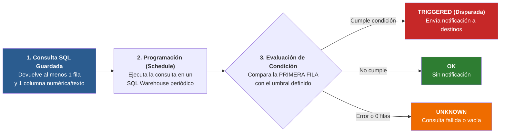

# Alertas y programación
---

## 1. Alertas en Databricks SQL (SQL Alerts)

Una **Alerta** en Databricks SQL evalúa periódicamente el resultado de una **consulta SQL guardada** y envía una notificación automática cuando los datos cumplen una condición o umbral definido por el usuario.



### Reglas críticas de funcionamiento (¡Muy preguntadas en el examen!)
1. **Dependencia de una Consulta SQL Guardada:**
   * Las alertas **NO** se crean directamente sobre un widget de un AI/BI Dashboard, sino sobre una **consulta guardada en el SQL Editor**.
   * **Parámetros:** La consulta utilizada por una alerta **no debe contener parámetros** (o debe usar valores fijos/dinámicos en SQL como `CURRENT_DATE()`), ya que se ejecuta de forma desatendida.
2. **Evaluación de la Primera Fila (*First Row Rule*):**
   * Si la consulta devuelve múltiples filas, Databricks **evalúa únicamente el valor de la columna seleccionada en la PRIMERA FILA** del resultado.
   * *Buena práctica de examen:* Diseña la consulta de alerta para que devuelva **una sola fila agregada** (ej. `SELECT COUNT(*) AS failed_jobs FROM logs WHERE status = 'ERROR'`) o usa `ORDER BY` explícito para garantizar qué fila queda primera.
3. **Los 3 Estados de una Alerta:**
   * **`OK`:** La consulta se ejecutó correctamente y la condición **no** se cumplió (estado normal).
   * **`TRIGGERED`:** La consulta se ejecutó correctamente y la condición **sí** se cumplió (dispara notificaciones).
   * **`UNKNOWN`:** La consulta falló por un error de ejecución/permisos **o devolvió cero filas** (resultado vacío).


## 2. Creación de una alerta (alertas recientes)

1. Abra **Alerts** en la barra lateral y haga clic en **Crear alerta**.
2. Escriba la consulta de la alerta en el editor, elija un SQL warehouse y ejecútela.
3. Establezca la **condición**: una columna, el valor que se va a comprobar (el valor de la primera fila o un agregado de varias filas, como `SUM` o `AVG`), un operador como `>` y un umbral (por defecto, un valor estático). Haga clic en **Probar condición**.
4. Agregue **notificaciones**: usuarios o destinos de notificación. Opcionalmente, active **Notificar en OK** y elija si desea repetir las notificaciones hasta que la alerta vuelva a OK.
5. Establezca la **programación** con los menús desplegables o con la sintaxis cron de Quartz.

```sql
-- Alert query: average sensor temperature over the last 15 minutes
SELECT AVG(temperature_c) AS avg_temp_15m
FROM iot.readings
WHERE reading_ts >= current_timestamp() - INTERVAL 15 MINUTES;
-- Condition: avg_temp_15m (first value)  >  85   →  notify #plant-alerts (Slack destination)
-- Schedule: every 5 minutes
```


## 3. Configuración de Notificaciones y Frecuencia
Cuando una alerta pasa al estado `TRIGGERED`, puedes controlar cómo y cuántas veces avisa para evitar el "ruido" (*alert fatigue*):

### Modos de notificación (*Notification Frequency*):
* **Just once (Solo una vez):** Envía una única notificación cuando el estado cambia de `OK` a `TRIGGERED`. No vuelve a enviar avisos hasta que la alerta regrese a `OK` y se dispare de nuevo. *(Opción ideal para evitar spam en alertas cada 5 minutos)*.
* **Each time alert is evaluated (Cada vez que se evalúa):** Envía una notificación en cada ejecución programada mientras la condición siga siendo verdadera.
* **At most every X hours/minutes:** Limita los avisos a un intervalo máximo (ej. máximo 1 aviso cada 4 horas mientras siga disparada).

### Destinos de Notificación (*Notification Destinations*):
* **Correo electrónico:** Por defecto notifica al creador; se pueden añadir otros usuarios de Databricks o destinos configurados.
* **Integraciones externas (requieren configuración previa del administrador del workspace):** Slack, Microsoft Teams, PagerDuty y Webhooks genéricos.

### Plantillas Personalizadas (*Custom Alert Templates*):
Permiten personalizar el asunto y cuerpo del mensaje usando variables dinámicas integradas:
* `{{ALERT_NAME}}`: Nombre de la alerta.
* `{{ALERT_STATUS}}`: Estado actual (`TRIGGERED`, `OK`).
* `{{QUERY_RESULT_VALUE}}`: El valor exacto que disparó la alerta.
* `{{QUERY_RESULT_TABLE}}`: Tabla HTML/Markdown con los resultados devueltos por la consulta.
* `{{ALERT_URL}}` / `{{QUERY_URL}}`: Enlaces directos a la alerta o consulta en Databricks.


## 4. Programación (Schedules) en Databricks SQL
La programación permite automatizar la ejecución recurrente de **Consultas**, **Alertas**, **AI/BI Dashboards**, **Vistas Materializadas** y **Tablas de Streaming**.

### Comparativa de Programación por Tipo de Objeto

| Objeto | Qué ocurre cuando se ejecuta el Schedule | Identidad de ejecución (*Credentials*) |
| :--- | :--- | :--- |
| **Consulta SQL (*Query*)** | Ejecuta la consulta en el SQL Warehouse asignado y actualiza la **Query Result Cache** (útil para precalentar datos antes de que lleguen los usuarios). | **Owner** (Propietario de la consulta). |
| **Alerta (*SQL Alert*)** | Ejecuta la consulta subyacente, evalúa la condición y envía notificaciones si pasa a `TRIGGERED`. | **Owner** (Propietario de la alerta). |
| **AI/BI Dashboard** | Refresca todos los datasets del panel publicado y envía por correo/Slack una captura visual (+ PDF opcional) a los suscriptores. | **Owner** (Propietario del panel, incluso si el panel está publicado como *Run as Viewer*). |
| **Vista Materializada / Streaming Table** | Ejecuta `REFRESH` para incorporar datos nuevos de forma incremental mediante `SCHEDULE EVERY ...` o `SCHEDULE CRON ...`. | **Owner** (Quien creó la vista/tabla). |

### Opciones de Frecuencia y Optimización de Costos
* **Interfaz visual:** Permite programar cada ciertos minutos, horas, días, semanas o meses, eligiendo la **zona horaria (*Timezone*)** exacta.
* **Expresiones CRON (Quartz Cron):** Para horarios avanzados (ej. de lunes a viernes a las 08:00 AM: `0 0 8 ? * MON-FRI`).
* **Trampa de costos en el examen:** Programar una consulta o alerta **cada 1 minuto** en un SQL Warehouse con *Auto-stop* de 10 minutos provocará que el warehouse **nunca se apague**, generando facturación 24/7. Para monitoreo frecuente, se recomienda usar **Serverless SQL Warehouse** (arranque en segundos y *auto-stop* agresivo).


## 5. Programación de un panel

1. Abra el panel y haga clic en **Programar** (arriba a la derecha).
2. Establezca la frecuencia, la hora de inicio y la zona horaria, o habilite la sintaxis cron.
3. Por defecto, la ejecución programada usa el SQL warehouse del panel; elija otro en la configuración avanzada.
4. Agregue **suscriptores**: usuarios del espacio de trabajo, listas de distribución de correo electrónico o destinos de Slack y Teams (hasta 100 suscriptores; un destino cuenta como uno).

| Tipo de suscriptor | Recibe |
| :--- | :--- |
| Correo electrónico | Instantánea en PDF y, opcionalmente, archivos adjuntos CSV, TSV o Excel |
| Slack / Microsoft Teams | Instantánea en PNG en el canal, un enlace al panel y un PDF |

Los editores necesitan al menos CAN EDIT para gestionar otros suscriptores; cualquier usuario con al menos CAN VIEW puede suscribirse a sí mismo.


## 6. Permisos sobre Alertas

| Nivel de Permiso | Capacidades del usuario |
| :--- | :--- |
| **`CAN VIEW`** | Ver la configuración de la alerta, su historial de ejecuciones y el estado actual (`OK` / `TRIGGERED`). |
| **`CAN RUN`** | Todo lo de `CAN VIEW` + ejecutar manualmente la evaluación de la alerta (`Refresh`). |
| **`CAN EDIT`** | Todo lo de `CAN RUN` + modificar la condición, el umbral, la programación y los destinos de notificación. |
| **`CAN MANAGE`** | Control total, incluido cambiar permisos y eliminar la alerta. |

> **Nota importante de seguridad:** Para que otro usuario pueda recibir notificaciones de una alerta o suscribirse, el propietario de la alerta debe tener permisos `SELECT` sobre las tablas consultadas y `CAN USE` sobre el SQL Warehouse asignado.


## 7. Preguntas Tipo Examen (Autoevaluación)

**Pregunta 1:** *Un analista crea una alerta sobre una consulta que devuelve la lista de todas las tiendas cuyas ventas diarias cayeron por debajo de 1,000 €. La consulta devuelve 15 filas, pero la alerta permanece en estado `OK` a pesar de que la fila 4 tiene ventas de 200 €. ¿Cuál es la causa?*
* **Respuesta:** Las alertas de Databricks SQL **solo evalúan la primera fila** del resultado de la consulta. Si las 3 primeras filas tenían valores superiores a 1,000 € (por ejemplo, por falta de `ORDER BY sales ASC` o por no usar una agregación `COUNT(*)`), la alerta no se disparará.

**Pregunta 2:** *Una consulta configurada para vigilar errores críticos en un pipeline devuelve `0 filas` cuando todo funciona correctamente. Sin embargo, el analista nota que el estado de la alerta aparece constantemente como `UNKNOWN` en lugar de `OK`. ¿Por qué ocurre esto?*
* **Respuesta:** Cuando una consulta de alerta **devuelve cero filas** (resultado vacío), Databricks establece su estado en **`UNKNOWN`**. Para que muestre `OK` cuando no hay errores, la consulta debe devolver siempre una fila numérica usando `SELECT COUNT(*) AS errores FROM logs WHERE status = 'ERROR'` y configurar el umbral en `> 0`.

**Pregunta 3:** *Un equipo de operaciones configura una alerta crítica para ejecutarse cada 5 minutos. Quieren recibir un aviso inmediato en Slack en cuanto ocurra una caída, pero NO quieren recibir mensajes repetidos cada 5 minutos mientras el equipo trabaja en resolverla. ¿Qué opción de notificación deben seleccionar?*
* **Respuesta:** **`Just once` (Solo una vez)**, para que notifique únicamente en la transición de `OK` a `TRIGGERED` y no vuelva a avisar hasta que el problema se resuelva y vuelva a ocurrir.

**Pregunta 4:** *Un dashboard ejecutivo está publicado con la opción `Run as Viewer` para proteger datos confidenciales por región. El propietario configura una suscripción programada (*Schedule*) todos los lunes a las 8:00 AM añadiendo a 20 gerentes regionales como suscriptores de correo. ¿Qué datos verán los gerentes en el correo semanal?*
* **Respuesta:** Todos los gerentes recibirán exactamente la misma captura con **los datos visibles para el propietario del dashboard (`Run as Owner`)**, ya que las ejecuciones programadas de suscripciones siempre se ejecutan bajo las credenciales del propietario.


## 8. Problemas y errores comunes

### La alerta nunca notifica

**Escenario:** Los datos cumplen la condición, pero nadie recibe una notificación.
**Solución:** Compruebe que la alerta tenga una programación, que la columna y la agregación de la condición coincidan con el resultado de la consulta y que las notificaciones incluyan un usuario o un destino.

### Falta el destino de Slack

**Escenario:** Un autor no encuentra un canal de Slack en la lista de notificaciones de la alerta.
**Solución:** Un administrador del espacio de trabajo debe crear primero el destino de notificación de Slack.


## 9. Consejos para el examen

- Alerta = consulta + condición (valor, operador, umbral) + programación + destino
- Las alertas consultan según una programación; elija una frecuencia menor que el tiempo de notificación requerido
- Los paneles se actualizan con **Programar**; los suscriptores reciben instantáneas
- Los administradores crean los destinos de notificación; los autores los seleccionan


## 10. Conclusiones clave

- **Estados**: OK, TRIGGERED, ERROR
- **Condición**: primer valor o un agregado (`SUM`, `AVG`, ...) frente a un umbral
- **Destinos**: usuarios, listas de correo electrónico, Slack, Teams, webhooks
- **Programaciones de panel**: frecuencia + zona horaria + SQL warehouse + suscriptores (≤ 100)
- **Vistas materializadas**: precalcular las consultas costosas de los paneles según una programación


## 11. Temas relacionados

- [AI/BI dashboards y diseño de paneles](./01-dashboards.md)
- [Visualizaciones y tipos de gráficos](./02-visualizations.md)
- [Vistas materializadas y tablas de streaming](../01-executing-queries-databricks-sql-warehouses/07-materialized-views-and-streaming-tables.md)


## 12. Documentación oficial

- [Databricks SQL alerts](https://docs.databricks.com/aws/en/sql/user/alerts/)
- [Crear una alerta](https://docs.databricks.com/aws/en/sql/user/alerts/create)
- [Programar actualizaciones periódicas de los paneles](https://docs.databricks.com/aws/en/dashboards/schedule-subscribe)

---

**[← Anterior: Visualizaciones y tipos de gráficos](./02-visualizations.md) | [↑ Volver a la sección](./README.md) | [Siguiente: Uso compartido y colaboración →](./04-sharing-collaboration.md)**
