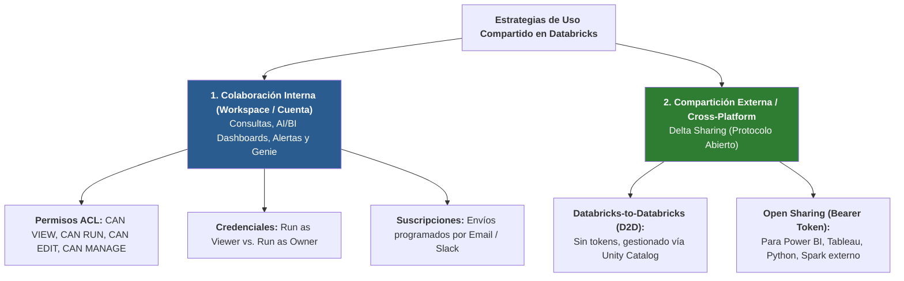

# Uso compartido y colaboración

## 1. Dos Niveles de Uso Compartido en Databricks

En la certificación de Data Analyst debes distinguir claramente entre **compartir objetos dentro de tu organización/workspace** (consultas, dashboards, alertas) y **compartir datos de forma segura con organizaciones o plataformas externas** (**Delta Sharing**):



## 2. Colaboración Interna: Consultas, Dashboards y Alertas

### A. Matriz de Permisos (ACLs) por Tipo de Objeto
El examen evalúa qué nivel de permiso mínimo necesita un compañero para realizar una acción concreta:

| Nivel de Permiso | Consultas SQL (*Queries*) | AI/BI Dashboards | Alertas (*SQL Alerts*) | SQL Warehouses |
| :--- | :--- | :--- | :--- | :--- |
| **`CAN VIEW`** | Ver el código SQL y últimos resultados guardados (no puede ejecutarla). | Ver el **panel publicado** e interactuar con filtros. | Ver la configuración, estado (`OK`/`TRIGGERED`) e historial. | *No aplica* |
| **`CAN RUN`** | Todo lo de `CAN VIEW` + **ejecutar** la consulta y cambiar parámetros. | *(Equivalente a `CAN VIEW` en AI/BI Dashboards)* | Todo lo de `CAN VIEW` + **ejecutar** evaluación manual. | *No aplica* |
| **`CAN USE`** | *No aplica* | *No aplica* | *No aplica* | **Usar** el warehouse para ejecutar consultas/dashboards. |
| **`CAN EDIT`** | Modificar el código SQL, título, descripción y programar. | Editar el **borrador (*Draft*)**, datasets y gestionar suscriptores. | Modificar condición, umbral, schedule y notificaciones. | *No aplica* |
| **`CAN MANAGE`** | Control total, cambiar permisos (`ACL`) y eliminar. | Control total, publicar, cambiar permisos y eliminar. | Control total, cambiar permisos y eliminar. | Gestionar configuración, tamaño, permisos y reiniciar. |

> **Regla de oro del examen sobre permisos:**  
> Tener permiso `CAN VIEW` en un Dashboard o `CAN RUN` en una Consulta **NO otorga automáticamente acceso a los datos**. Para que un usuario vea los datos (cuando se ejecuta como *Viewer*), también necesita:
> 1. Permiso **`CAN USE`** sobre el **SQL Warehouse**.
> 2. Privilegios de **Unity Catalog** (`USE CATALOG`, `USE SCHEMA` y `SELECT` sobre las tablas/vistas subyacentes).

### B. Compartir con Usuarios de la Cuenta (*Account-level Users*)
* Puedes compartir **AI/BI Dashboards publicados** con cualquier usuario registrado en tu **cuenta de Databricks** (a nivel de identidad corporativa/SSO), **incluso si no tienen acceso asignado al Workspace específico** donde se creó el panel.
* **Requisito clave:** Para que esos usuarios externos al workspace puedan ver los datos sin tener licencias ni acceso al compute del workspace, el panel debe publicarse con **`Run as Owner`** (o tener acceso configurado a un Serverless SQL Warehouse).

### C. Organización en Carpetas del Workspace y Git Folders
* **Carpetas compartidas (*Workspace Folders*):** Permiten agrupar consultas, dashboards y alertas por equipo o proyecto. Los permisos asignados a una carpeta se heredan automáticamente a todos los objetos contenidos en ella.
* **Databricks Git Folders (antes *Repos*):** Permiten sincronizar consultas SQL (`.sql`) y archivos con repositorios **Git** (GitHub, GitLab, Azure DevOps, Bitbucket) para control de versiones, *Pull Requests*, revisión de código entre pares y despliegue entre entornos (`Dev` -> `Staging` -> `Prod`).


## 3. Delta Sharing: Compartición Segura de Datos con Terceros (¡Clave de Examen!)

**Delta Sharing** es el primer protocolo abierto de la industria desarrollado por Databricks para **compartir datos en vivo (live data) desde el Lakehouse con otras organizaciones o herramientas externas, sin duplicar ni mover los datos** y sin obligar al destinatario a usar Databricks.

### Conceptos y Objetos Principales en SQL:
1. **`SHARE` (Recurso compartido):** Contenedor lógico en Unity Catalog donde el proveedor agrupa tablas, vistas, volúmenes o modelos que desea compartir (incluso puede compartir solo particiones específicas o versiones de Time Travel).
2. **`RECIPIENT` (Destinatario):** Identidad de la persona, departamento externo o empresa que recibirá los datos.
3. **Acceso de solo lectura:** Los destinatarios de Delta Sharing **siempre tienen acceso de solo lectura (`SELECT`)**; nunca pueden modificar ni borrar los datos del proveedor.

### Dos Modos de Compartir con Delta Sharing:

| Característica | Databricks-to-Databricks (D2D) | Open Sharing (Protocolo Abierto) |
| :--- | :--- | :--- |
| **Quién es el destinatario** | Otra organización o unidad de negocio que **también usa Databricks con Unity Catalog**. | Cualquier usuario o herramienta **fuera de Databricks** (Power BI, Tableau, Excel, Python `pandas`, Apache Spark). |
| **Autenticación** | **Sin tokens ni contraseñas.** Se vincula mediante el identificador único del Metastore (`Sharing Identifier`). | Mediante un **archivo de credenciales con Token (Bearer Token)** descargable de un solo uso/caducidad. |
| **Gobernanza en destino** | El destinatario monta el *Share* como un catálogo de solo lectura en su propio Unity Catalog. | El destinatario usa el conector nativo de Delta Sharing en su herramienta BI o código. |

### Sintaxis SQL básica de Delta Sharing (Para reconocer en el examen)
```sql
-- 1. Crear un Share y añadir una tabla Delta
CREATE SHARE ventas_partner_share COMMENT 'Datos agregados para distribuidores';
ALTER SHARE ventas_partner_share ADD TABLE sales.gold.resumen_ventas;

-- 2. Crear un destinatario (Open Sharing)
CREATE RECIPIENT distribuidor_norte;

-- 3. Otorgar acceso al Share
GRANT SELECT ON SHARE ventas_partner_share TO RECIPIENT distribuidor_norte;
```

## 4. Exportación, Enlaces Directos y Comentarios

* **Descarga de resultados:** Desde el SQL Editor o widgets de un dashboard, los usuarios pueden exportar resultados en formato **CSV**, **TSV** o **Excel (`.xlsx`)** (si el administrador no ha deshabilitado las descargas por políticas de prevención de fuga de datos / DLP).
* **Enlaces profundos (*Deep Links*):** Al compartir la URL de un AI/BI Dashboard con filtros aplicados, la URL conserva el estado de los filtros seleccionados para que el compañero abra exactamente la misma vista.
* **Metadatos y Documentación en Catalog Explorer:** Los analistas colaboran documentando tablas y columnas con descripciones claras y etiquetas (*Tags*), lo que mejora tanto la comprensión humana como la precisión de **Databricks Assistant** y **AI/BI Genie**.


## 5. Preguntas Tipo Examen (Autoevaluación)

**Pregunta 1:** *Un analista comparte una consulta SQL con un compañero asignándole el permiso `CAN RUN`. Al intentar ejecutarla, el compañero recibe un error de permisos indicando que no tiene acceso a la tabla `finance.revenue`. ¿Qué falta configurar?*
* **Respuesta:** El permiso `CAN RUN` permite ejecutar la consulta, pero (al ejecutarse como *Viewer*) el compañero también necesita privilegios **`USE CATALOG`**, **`USE SCHEMA`** y **`SELECT`** sobre la tabla `finance.revenue` en Unity Catalog (además de `CAN USE` en el SQL Warehouse).

**Pregunta 2:** *Tu empresa necesita compartir diariamente una tabla de inventario actualizada en tiempo real con un proveedor externo que utiliza Power BI y scripts de Python, pero no tiene cuenta de Databricks. No quieren construir APIs ni exportar archivos CSV a un servidor FTP. ¿Qué tecnología deben utilizar?*
* **Respuesta:** **Delta Sharing** en modo **Open Sharing** (generando un `SHARE` y un `RECIPIENT` con enlace de credenciales/token).

**Pregunta 3:** *Un equipo de analistas quiere aplicar control de versiones con revisión de código (Pull Requests) para sus consultas SQL críticas antes de pasarlas a producción. ¿Qué funcionalidad de Databricks facilita esta colaboración?*
* **Respuesta:** **Databricks Git Folders** (integración con repositorios Git como GitHub, GitLab o Azure DevOps).

**Pregunta 4:** *Quieres compartir un AI/BI Dashboard publicado con 150 directivos de la empresa que existen en el proveedor de identidad (SSO / cuenta de Databricks), pero que no tienen acceso ni licencias asignadas al workspace de ingeniería donde se construyó el panel. ¿Cómo puedes lograrlo?*
* **Respuesta:** Publicar el dashboard usando **`Run as Owner`** y compartirlo directamente con los **usuarios o grupos a nivel de cuenta (*Account-level users/groups*)**.


## 6. Problemas y errores comunes

### El panel compartido muestra "Permiso denegado"

**Escenario:** Un colega abre el enlace del panel pero no puede ver los datos.
**Solución:** Compruebe el permiso del panel (al menos CAN VIEW / CAN RUN). Si se publicó con permisos de datos individuales, el espectador también necesita `SELECT` sobre las tablas, además de `USE CATALOG` y `USE SCHEMA`.

### Todos ven todas las regiones

**Escenario:** Un filtro de filas limita a cada representante a una región, pero el panel muestra todas las regiones.
**Solución:** El panel se ejecuta con las credenciales del publicador. Vuelva a publicarlo con permisos de datos individuales.


## 7. Consejos para el examen

- Personas que están en la cuenta pero no en el espacio de trabajo → comparta con usuarios de la cuenta (CAN RUN)
- Sin cuenta de Databricks → inserción para usuarios externos con un principal de servicio
- La inserción básica sigue requiriendo inicio de sesión
- Permisos de datos compartidos (por defecto) = credenciales del publicador


## 8. Conclusiones clave

- **Niveles**: CAN VIEW/RUN, CAN EDIT, CAN MANAGE
- **Publicación**: permisos de datos compartidos frente a individuales
- **Alcance**: espacio de trabajo → usuarios de la cuenta → inserción (básica o externa)
- **Administradores**: crear destinos de notificación y superficies permitidas para la inserción


## 9. Temas relacionados

- [Control de acceso y seguridad](../07-securing-data/01-access-control.md) - Privilegios de Unity Catalog, filtros de filas y máscaras de columnas
- [AI/BI dashboards y diseño de paneles](./01-dashboards.md)
- [Uso compartido y distribución de Genie](../04-developing-sharing-maintaining-genie-spaces/03-benchmarks-monitoring-and-sharing.md)


## 10. Documentación oficial

- [Compartir un panel](https://docs.databricks.com/aws/en/dashboards/share)
- [Insertar un panel](https://docs.databricks.com/aws/en/dashboards/embed)
- [Listas de control de acceso](https://docs.databricks.com/aws/en/security/auth/access-control/)

---

**[← Anterior: Alertas y programación](./03-alerts-scheduling.md) | [↑ Volver a la sección](./README.md) | [Siguiente: Parámetros de paneles y consultas →](./05-parameters.md)**
