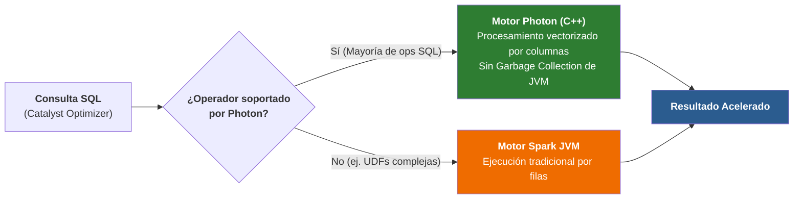
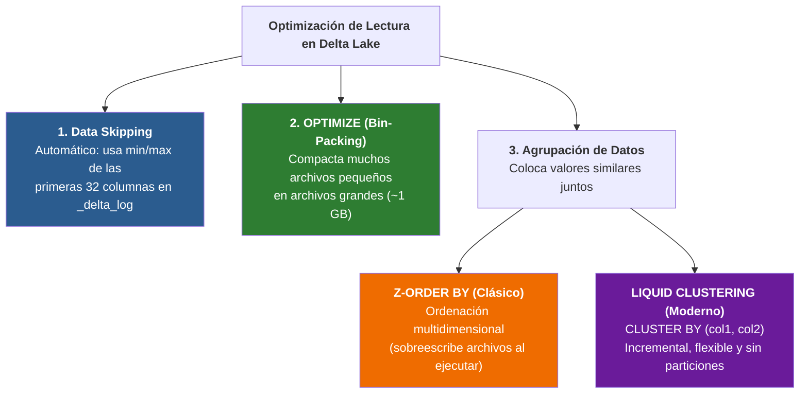

# Photon y rendimiento de consultas

## 1. ¿Qué es el Motor Photon?

**Photon** es el motor de ejecución de consultas vectorizado nativo de Databricks, escrito desde cero en **C++** y diseñado para ser **100% compatible con las APIs de Apache Spark SQL y Delta Lake**.



### ¿Por qué Photon es mucho más rápido que Spark estándar? (Claves de examen)
1. **Escrito en C++ nativo:** Evita las pausas de recolección de basura (*Garbage Collection - GC*) y la sobrecarga de memoria de la máquina virtual de Java (JVM).
2. **Procesamiento Vectorizado (*Vectorized Execution*):** En lugar de procesar datos fila por fila, procesa lotes de columnas (*batches*) simultáneamente aprovechando las instrucciones **SIMD** (*Single Instruction, Multiple Data*) de las CPUs modernas.
3. **Transparente para el analista:** No requiere reescribir tus consultas SQL. Si un operador específico no está soportado por Photon, Databricks recurre automáticamente al motor Spark tradicional sin fallar.
4. **Activo por defecto en todos los SQL Warehouses:** Está habilitado en **Serverless**, **Pro** y **Classic** SQL Warehouses.


## 2. El Optimizador Catalyst y AQE (Adaptive Query Execution)

Antes y durante la ejecución de una consulta, Databricks aplica dos capas de inteligencia:

* **Catalyst Optimizer (Optimización Estática / Compile-time):**
  * **Predicate Pushdown (Empuje de predicados):** Mueve los filtros `WHERE` lo más abajo posible para filtrar datos antes de hacer `JOIN` o leer columnas innecesarias.
  * **Column Pruning (Poda de columnas):** Lee únicamente las columnas incluidas en el `SELECT` y `WHERE` (aprovechando el almacenamiento columnar de Parquet/Delta).
* **Adaptive Query Execution — AQE (Optimización Dinámica / Runtime):**
  * Ajusta el plan de ejecución **mientras la consulta se está ejecutando** basándose en estadísticas reales de los datos intermedios:
    * Cambia dinámicamente un *Sort-Merge Join* pesado por un **Broadcast Hash Join** si descubre que una de las tablas tras filtrarse es pequeña.
    * Combina particiones pequeñas después de un *Shuffle* (*Coalesce Partitions*).
    * Mitiga automáticamente el **Data Skew** (sesgo de datos en `JOIN`).


## 3. Optimización Física en Delta Lake (¡Muy Preguntado!)

Como Data Analyst, debes saber qué comandos y técnicas aceleran las lecturas sobre tablas Delta:



### A. Data Skipping (Omitir archivos automáticamente)
* Delta Lake almacena estadísticas (`min`, `max`, `nullCount`) para las **primeras 32 columnas** de cada archivo Parquet dentro del `_delta_log`.
* Cuando ejecutas `WHERE fecha = '2026-11-20'`, Databricks lee el `_delta_log` y **salta por completo** todos los archivos cuyo rango `[min, max]` no incluya esa fecha.
* *Tip de examen:* Coloca las columnas por las que más filtras (`fecha`, `id`, `region`) entre las **primeras 32 columnas** de la tabla.

### B. `OPTIMIZE` (Compactación de archivos pequeños)
* **Problema:** Las ingestas frecuentes (*streaming* o micro-lotes) generan miles de archivos pequeños (*Small File Problem*), degradando el rendimiento por la sobrecarga de abrir/cerrar archivos.
* **Solución:** `OPTIMIZE nombre_tabla;` agrupa esos archivos pequeños en archivos Parquet óptimos (alrededor de **1 GB**) mediante una operación *Bin-Packing* idempotente.

### C. `Z-ORDER BY` vs. `LIQUID CLUSTERING` (`CLUSTER BY`)
Ambos agrupan físicamente filas con valores similares en los mismos archivos para maximizar el *Data Skipping*, pero **Liquid Clustering** es la evolución moderna recomendada:

| Característica | `Z-ORDER BY` | `Liquid Clustering` (`CLUSTER BY`) |
| :--- | :--- | :--- |
| **Sintaxis** | `OPTIMIZE tabla ZORDER BY (col1, col2);` | `CREATE TABLE t (...) CLUSTER BY (col1, col2);` + `OPTIMIZE t;` |
| **Reescritura de datos** | No incremental (reescribe archivos ya ordenados si se vuelve a ejecutar). | **Incremental** (solo organiza los datos nuevos añadidos). |
| **Cambiar columnas clave** | Requiere reescribir toda la tabla desde cero. | Permite cambiar claves con `ALTER TABLE t CLUSTER BY (nueva_col)` sin reescribir histórico. |
| **Convivencia con `PARTITIONED BY`** | Se usa junto a particiones. | **Reemplaza** tanto a `PARTITIONED BY` como a `ZORDER`. |
| **Predictive Optimization** | Manual (salvo mantenimiento). | Se ejecuta **automáticamente** en tablas gestionadas de Unity Catalog. |


## 4. Diagnóstico de Cuellos de Botella en el *Query Profile*

Cuando una consulta es lenta, el analista inspecciona el **Query Profile** en el SQL Editor o *Query History* para identificar la causa raíz y aplicar la solución exacta:

| Síntoma en el Query Profile | Causa Raíz | Solución Recomendada en el Examen |
| :--- | :--- | :--- |
| **Alto tiempo en estado `Queued`** | Alta concurrencia (muchos usuarios ejecutando consultas a la vez). | Aumentar **Max Clusters** (escalado horizontal / *Multi-cluster*). |
| **Alto `Bytes spilled to disk`** | Falta de memoria RAM en los nodos para un `JOIN`, `GROUP BY` o `ORDER BY` masivo. | Aumentar el **Cluster Size** (escalado vertical, ej. de *Small* a *Large*). |
| **Millones de archivos leídos (`Files read`)** | Problema de archivos pequeños (*Small File Problem*) o falta de agrupación. | Ejecutar **`OPTIMIZE`** (y usar `CLUSTER BY` / `ZORDER BY`). |
| **1 sola tarea tarda mucho más que las demás** | **Data Skew** (sesgo de datos: muchos registros comparten la misma clave, ej. `NULL` en un `JOIN`). | Filtrar valores `NULL` antes del `JOIN` o revisar claves de unión. |
| **Bajo porcentaje de cobertura Photon** | Uso de funciones escalares complejas o UDFs en Python no soportadas por Photon. | Reemplazar UDFs personalizadas por **funciones nativas de Databricks SQL**. |


## 5. Historial de consultas

Abre **Query History** en la barra lateral.

- Filtra por **usuario, rango de fechas, compute, duración, estado de la consulta, tipo de sentencia, ID de sentencia y etiquetas de consulta**.
- El panel de detalles muestra el estado, la duración real (wall-clock), el tiempo agregado de tareas, las filas y la E/S, con la opción **See query profile**.
- Con el compute serverless habilitado, el historial también incluye el código SQL y Python ejecutado en compute serverless para notebooks y jobs.
- Para un análisis de toda la cuenta en SQL, consulta la tabla del sistema `system.query.history` (administradores por defecto):

```sql
SELECT statement_id, executed_by, total_duration_ms, execution_status, statement_text
FROM system.query.history
WHERE start_time >= current_timestamp() - INTERVAL 1 DAY
ORDER BY total_duration_ms DESC
LIMIT 20;
```


## 6. Caché

| Caché | Ámbito | Duración |
| :--- | :--- | :--- |
| Caché de la interfaz de Databricks SQL | Por usuario, resultados mostrados en la interfaz de SQL (no en dashboards AI/BI) | Hasta 7 días |
| Caché local de resultados | En memoria, por clúster | Duración del clúster o hasta llenarse; entradas de 24 horas; se borra al detener o reiniciar |
| Caché remota de resultados | **Solo serverless**; compartida por todos los warehouses del workspace | 24 horas; sobrevive a paradas y reinicios |
| Caché de disco | SSDs locales, archivos de datos leídos del almacenamiento | Como la caché local |

- Orden de búsqueda: caché local de resultados → caché remota de resultados → ejecutar la consulta.
- Las cachés de resultados se **invalidan cuando se actualizan las tablas subyacentes**; la caché de disco se invalida cuando detecta cambios.
- Para medir el tiempo de una consulta de forma fiable, ejecuta `SET use_cached_result = false` (solo para pruebas y benchmarks).


## 7. Buenas Prácticas de Escritura SQL para Máximo Rendimiento

1. **Evita `SELECT *`:** Selecciona solo las columnas necesarias para aprovechar el *Column Pruning* y reducir el tráfico de red y memoria.
2. **Filtra lo antes posible (`WHERE`):** Aplica filtros de fecha o región antes de realizar `JOIN` o agregaciones pesadas.
3. **Usa `UNION ALL` en lugar de `UNION`:** Siempre que no necesites eliminar duplicados, evita el costo de ordenamiento/deduplicación.
4. **Usa funciones aproximadas en tablas masivas:** `APPROX_COUNT_DISTINCT()` en lugar de `COUNT(DISTINCT)` cuando una precisión del ~98% sea suficiente en dashboards exploratorios.
5. **Aprovecha las Vistas Materializadas:** Para consultas repetitivas con `JOIN` complejos y agregaciones pesadas que alimentan paneles de BI.


## 8. Preguntas Tipo Examen (Autoevaluación)

**Pregunta 1:** *Un analista ejecuta una consulta que filtra por la columna `transaction_date` sobre una tabla Delta de 50 columnas, pero nota en el Query Profile que Databricks está leyendo casi todos los archivos de la tabla en lugar de omitirlos. Al revisar la estructura de la tabla, descubre que `transaction_date` es la columna número 45. ¿Por qué no funciona el Data Skipping?*
* **Respuesta:** Porque Delta Lake recopila estadísticas (`min`/`max`) para el **Data Skipping únicamente en las primeras 32 columnas** de la tabla por defecto. Se soluciona moviendo `transaction_date` a las primeras posiciones o aplicando **Liquid Clustering (`CLUSTER BY`)**.

**Pregunta 2:** *Una tabla Delta recibe miles de inserciones pequeñas cada minuto. Con el paso de las semanas, las consultas de lectura sobre esa tabla se han vuelto muy lentas porque tienen que abrir decenas de miles de archivos diminutos. ¿Qué comando resuelve directamente este problema?*
* **Respuesta:** **`OPTIMIZE nombre_tabla;`**, que compacta los archivos pequeños en archivos más grandes y eficientes.

**Pregunta 3:** *¿Cuál es la ventaja principal del motor Photon frente al motor tradicional de ejecución de Spark en un SQL Warehouse?*
* **Respuesta:** Photon está escrito en **C++ nativo** y utiliza **ejecución vectorizada**, eliminando la sobrecarga de la JVM (*Garbage Collection*) y procesando lotes de columnas en paralelo en la CPU.

**Pregunta 4:** *Estás creando una nueva tabla Delta de varios terabytes en Unity Catalog y sabes que los analistas siempre filtrarán por `customer_id` y `order_date`, aunque en el futuro podrían cambiar los patrones de consulta. ¿Qué técnica de organización física recomienda Databricks hoy en día en lugar de particionar manualmente?*
* **Respuesta:** Liquid Clustering (CLUSTER BY (customer_id, order_date)), ya que organiza los datos de forma incremental y permite cambiar las columnas de agrupación en el futuro sin reescribir toda la tabla.


## 9. Problemas y errores comunes

### Una consulta es más lenta que las demás

**Escenario:** una consulta de un dashboard tarda minutos mientras las demás tardan segundos.
**Solución:** abre su query profile. Busca operadores con recuentos de filas enormes (exploding join) o escaneos con poca poda (full table scan).

### Los resultados del benchmark parecen demasiado buenos

**Escenario:** una consulta «se ejecuta» en milisegundos durante las pruebas.
**Solución:** acertó en una caché de resultados. Ejecuta `SET use_cached_result = false` antes de medir el tiempo.


## 10. Consejos para el examen

- Photon está activado por defecto en los SQL warehouses; las UDFs recurren a Spark
- Historial de consultas = lista y filtros; query profile = una consulta en detalle
- Caché remota de resultados: solo serverless, compartida entre warehouses, sobrevive a reinicios
- Las cachés se invalidan cuando cambian las tablas


## 11. Puntos clave

- **Photon** acelera joins, agregaciones, escaneos y escrituras sin cambios en el código
- El **historial de consultas** y `system.query.history` permiten encontrar consultas problemáticas
- El **query profile** y los performance insights las explican
- Las **cachés** reducen la latencia de consultas repetidas y sin cambios


## 12. Temas relacionados

- [SQL Warehouses](../01-executing-queries-databricks-sql-warehouses/01-sql-warehouses.md)
- [Historial de Delta y liquid clustering](./02-delta-history-and-liquid-clustering.md)
- [Corrección de consultas](./03-fixing-queries.md)


## 13. Documentación oficial

- [¿Qué es Photon?](https://docs.databricks.com/aws/en/compute/photon)
- [Historial de consultas](https://docs.databricks.com/aws/en/sql/user/queries/query-history)
- [Query profile](https://docs.databricks.com/aws/en/sql/user/queries/query-profile)
- [Caché de consultas](https://docs.databricks.com/aws/en/sql/user/queries/query-caching)

---

**[↑ Volver a la sección](./README.md) | [Siguiente: Historial de Delta y liquid clustering →](./02-delta-history-and-liquid-clustering.md)**
