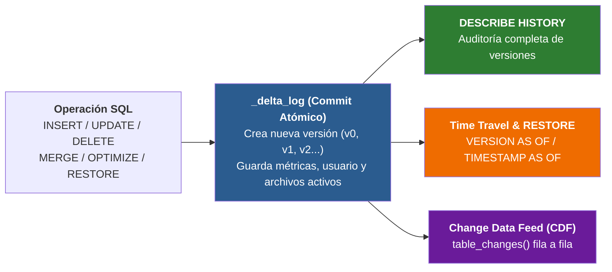

# Historial de Delta y liquid clustering

## 1. El Registro de Transacciones (`_delta_log`) e Historial de Delta
Cada tabla Delta Lake almacena sus datos en archivos Parquet y mantiene un registro ordenado secuencialmente de cada cambio en la subcarpeta **`_delta_log`** (compuesto por archivos JSON numerados `000000.json`, `000001.json`... y *checkpoints* periódicos en Parquet cada 10 commits por defecto).



### A. Consultar el Historial (`DESCRIBE HISTORY`)
El comando `DESCRIBE HISTORY` muestra la auditoría completa de todas las transacciones confirmadas sobre una tabla Delta:

```sql
-- Ver todo el historial de versiones de la tabla
DESCRIBE HISTORY sales.gold.orders;

-- Ver únicamente las últimas 5 operaciones
DESCRIBE HISTORY sales.gold.orders LIMIT 5;
```

#### Columnas clave del historial que evalúa el examen:
* **`version`:** Número entero secuencial (`0, 1, 2...`).
* **`timestamp`:** Fecha y hora exacta en que se confirmó la transacción.
* **`userId` / `userName`:** Identidad del usuario o *Service Principal* que ejecutó el cambio.
* **`operation`:** Tipo de operación realizada (`CREATE TABLE`, `WRITE`, `MERGE`, `UPDATE`, `DELETE`, `OPTIMIZE`, `VACUUM START/END`, `RESTORE`, `SET TBLPROPERTIES`).
* **`operationParameters`:** Detalles de la ejecución (ej. predicados del `WHERE` en un `DELETE`, columnas de `ZORDERBY` o modo `Append`/`Overwrite`).
* **`operationMetrics`:** Estadísticas reales de impacto (`numOutputRows`, `numTargetRowsUpdated`, `numRemovedFiles`, `numAddedFiles`).
* **`readVersion`:** Sobre qué versión base se ejecutó la operación (útil para detectar concurrencia).

---

### B. Change Data Feed (CDF) vs. Historial de Delta (¡Diferencia de Examen!)
* **`DESCRIBE HISTORY`:** Muestra metadatos a nivel de **transacción/operación** (quién hizo qué y cuándo).
* **Change Data Feed (`delta.enableChangeDataFeed = true`):** Registra los **cambios a nivel de fila** (`insert`, `update_preimage`, `update_postimage`, `delete`) entre versiones, permitiendo consultar exactamente qué filas cambiaron mediante la función **`table_changes('tabla', version_inicio, version_fin)`**.

```sql
-- Habilitar Change Data Feed en una tabla existente
ALTER TABLE sales.gold.orders SET TBLPROPERTIES (delta.enableChangeDataFeed = true);

-- Consultar exactamente qué filas cambiaron entre la versión 2 y la 5
SELECT * FROM table_changes('sales.gold.orders', 2, 5);
```


## 2. Liquid Clustering: La Evolución Moderna de Organización de Datos
**Liquid Clustering** es la técnica recomendada por Databricks para optimizar la disposición física de los datos en tablas Delta, **reemplazando tanto al particionamiento tradicional (`PARTITIONED BY`) como a `Z-ORDER BY`**.

### ¿Por qué reemplaza a Particiones y Z-ORDER? (Problemas que resuelve)
1. **Elimina la sobre-partición (*Over-partitioning*):** Particionar por columnas de alta cardinalidad (como `customer_id` o `order_id`) creaba millones de archivos diminutos. Liquid Clustering maneja cualquier cardinalidad sin fragmentar archivos.
2. **Elimina el sesgo de particiones (*Partition Skew*):** Evita tener particiones gigantes para un país/fecha y particiones vacías para otros.
3. **Agrupación incremental:** A diferencia de `Z-ORDER`, que debía reescribir bloques enteros cada vez, Liquid Clustering organiza **únicamente los datos nuevos** que aún no están agrupados.
4. **Flexibilidad total sin reescribir la tabla:** Si cambian los patrones de consulta de los analistas, puedes cambiar las columnas clave de clustering con `ALTER TABLE` sin tener que migrar ni reescribir los datos históricos.


## 3. Sintaxis y Operaciones con Liquid Clustering

### A. Crear una tabla con Liquid Clustering (`CLUSTER BY`)
* Puedes especificar hasta **4 columnas** de clustering.
* **Regla obligatoria:** Una tabla con `CLUSTER BY` **NO puede** usar `PARTITIONED BY` ni `ZORDER BY` (son mutuamente excluyentes).
* **Automatic Liquid Clustering (`CLUSTER BY AUTO`):** Disponible en tablas gestionadas de Unity Catalog con *Predictive Optimization*; Databricks analiza las consultas históricas y elige automáticamente las mejores columnas de clustering.

```sql
-- 1. Crear tabla especificando hasta 4 columnas clave
CREATE TABLE sales.gold.transactions (
    transaction_id STRING,
    customer_id INT,
    store_id INT,
    transaction_date DATE,
    amount DECIMAL(10, 2)
)
CLUSTER BY (customer_id, transaction_date);

-- 2. Crear tabla desde CTAS con Liquid Clustering
CREATE TABLE sales.gold.transactions_summary
CLUSTER BY (store_id, transaction_date)
AS SELECT * FROM sales.silver.transactions;

-- 3. Clustering automático gestionado por Databricks (Unity Catalog)
CREATE TABLE sales.gold.events (
    event_id STRING,
    user_id BIGINT,
    event_ts TIMESTAMP
)
CLUSTER BY AUTO;
```

### B. Activar o cambiar columnas en una tabla existente (`ALTER TABLE`)
```sql
-- Cambiar las columnas de clustering en el futuro (solo afecta a futuras ejecuciones de OPTIMIZE)
ALTER TABLE sales.gold.transactions CLUSTER BY (store_id, transaction_date);

-- Desactivar Liquid Clustering
ALTER TABLE sales.gold.transactions CLUSTER BY NONE;
```

### C. Ejecutar la agrupación física (`OPTIMIZE`)
Al insertar datos nuevos (`INSERT`, `MERGE`), los datos llegan sin agrupar. Para aplicar el clustering físico:
* **De forma manual:** Ejecutando **`OPTIMIZE nombre_tabla;`** (en Databricks Runtime 13.3+ / SQL Warehouses, `OPTIMIZE` dispara el clustering incremental). *(Nota: En tablas gestionadas de Unity Catalog con **Predictive Optimization** activado, Databricks ejecuta `OPTIMIZE` y `VACUUM` automáticamente en segundo plano sin intervención manual).*


## 4. Comparativa Definitiva para el Examen: Particiones vs. Z-ORDER vs. Liquid Clustering

| Característica | Particionamiento (`PARTITIONED BY`) | `Z-ORDER BY` | `Liquid Clustering` (`CLUSTER BY`) |
| :--- | :--- | :--- | :--- |
| **Granularidad física** | Crea carpetas físicas por cada valor único. | Ordena datos dentro de archivos Parquet existentes. | Agrupa datos en bloques líquidos dinámicos dentro de archivos. |
| **Cardinalidad recomendada** | Solo **baja cardinalidad** (ej. `year`, `country`) y tablas > 1 TB. | Alta cardinalidad (ej. `user_id`, `timestamp`). | **Cualquier cardinalidad** (baja o alta, hasta 4 columnas). |
| **¿Es incremental?** | Sí (por partición). | ❌ No (reescribe archivos ya ordenados en cada ejecución). | ✅ **Sí** (solo agrupa datos nuevos sin tocar lo ya optimizado). |
| **Cambiar claves en el futuro** | Requiere recrear y reescribir toda la tabla. | Requiere reejecutar sobre toda la tabla. | ✅ **Instantáneo con `ALTER TABLE`** (sin reescribir histórico). |
| **Compatibilidad entre sí** | Compatible con `Z-ORDER`. | Compatible con `PARTITIONED BY`. | **Excluyente:** No se combina con `PARTITIONED BY` ni `ZORDER`. |


## 5. Preguntas Tipo Examen (Autoevaluación)

**Pregunta 1:** *Un analista necesita auditar quién ejecutó una operación `MERGE` que modificó 50,000 filas ayer por la tarde en la tabla `finance.ledger`, así como obtener el número de versión exacto anterior al cambio para realizar un `RESTORE`. ¿Qué comando SQL debe ejecutar?*
* **Respuesta:** **`DESCRIBE HISTORY finance.ledger;`**, revisando las columnas `version`, `timestamp`, `userName`, `operation` y `operationMetrics`.

**Pregunta 2:** *Tienes una tabla Delta de 5 TB particionada por `customer_id` (con 10 millones de clientes distintos). Las consultas son extremadamente lentas debido a la creación de millones de archivos diminutos y metadatos gigantescos en el `_delta_log`. ¿Cuál es la mejor práctica moderna de Databricks para rediseñar esta tabla?*
* **Respuesta:** Eliminar el particionamiento por `customer_id` y utilizar **Liquid Clustering (`CLUSTER BY (customer_id)`)**, que soporta columnas de alta cardinalidad sin generar el problema de archivos pequeños (*Small File Problem*).

**Pregunta 3:** *Una tabla de hechos fue creada hace un año con `CLUSTER BY (region, product_id)`. Hoy en día, el 90% de los nuevos dashboards filtran por `order_date` y `store_id`. El equipo quiere optimizar las futuras consultas sin pagar el costo de reescribir los 10 TB de datos históricos. ¿Qué acción deben tomar?*
* **Respuesta:** Ejecutar **`ALTER TABLE tabla CLUSTER BY (order_date, store_id);`** y luego **`OPTIMIZE tabla;`** para que los nuevos datos se agrupen según las nuevas claves.

**Pregunta 4:** *Un ingeniero intenta ejecutar `OPTIMIZE sales.orders ZORDER BY (customer_id);` sobre una tabla que fue creada con `CLUSTER BY (order_date)`, y recibe un error. ¿Por qué falla la sentencia?*
* **Respuesta:** Porque **Liquid Clustering es incompatible con `Z-ORDER BY` y `PARTITIONED BY`**. Para agrupar físicamente una tabla con Liquid Clustering basta con ejecutar **`OPTIMIZE sales.orders;`** sin cláusula `ZORDER BY`.


## 6. Problemas y errores comunes

### No se puede agrupar una tabla particionada

**Escenario:** `ALTER TABLE ... CLUSTER BY` falla en una tabla particionada.
**Solución:** el liquid clustering no es compatible con el particionamiento. Convierte la tabla (consulta la nota anterior) o vuelve a crearla con `CLUSTER BY`.

### Las nuevas claves parecen no ayudar

**Escenario:** tras cambiar las claves de agrupación, las consultas no son más rápidas.
**Solución:** el `ALTER` no reescribe los datos existentes. Ejecuta `OPTIMIZE` (o `OPTIMIZE ... FULL`) o deja que lo haga predictive optimization.


## 7. Consejos para el examen

- `DESCRIBE HISTORY` = quién, qué, cuándo y con métricas
- Time travel + `EXCEPT` comparan dos versiones
- Liquid clustering: `CLUSTER BY`, hasta cuatro claves de columnas de filtrado habituales, recomendado para todas las tablas nuevas
- `CLUSTER BY AUTO` necesita predictive optimization


## 8. Puntos clave

- El **historial** permite la auditoría, la validación y la reversión (`RESTORE`)
- El **liquid clustering** reemplaza el particionamiento y `ZORDER`
- **OPTIMIZE** aplica la agrupación de forma incremental


## 9. Temas relacionados

- [Photon y rendimiento de consultas](./01-photon-and-query-performance.md)
- [Creación de tablas y Delta Time Travel](../01-executing-queries-databricks-sql-warehouses/06-creating-tables-and-time-travel.md)
- [Hoja de referencia de comandos de Delta Lake](../../../shared/cheat-sheets/delta-lake-commands.md)


## 10. Documentación oficial

- [Trabajar con el historial de tablas](https://docs.databricks.com/aws/en/delta/history)
- [Usar liquid clustering para tablas](https://docs.databricks.com/aws/en/delta/clustering)

---

**[← Anterior: Photon y rendimiento de consultas](./01-photon-and-query-performance.md) | [↑ Volver a la sección](./README.md) | [Siguiente: Corrección de consultas →](./03-fixing-queries.md)**
