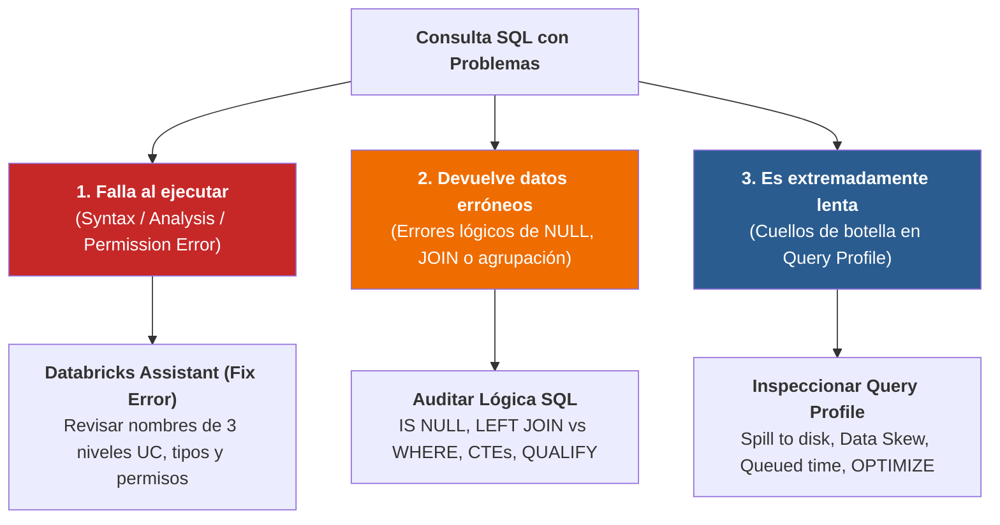

# Corrección de consultas

## 1. Los 3 Tipos de Problemas en Consultas SQL (Enfoque del Examen)
En la certificación de Data Analyst, la "corrección de consultas" abarca tres frentes claros:
1. **Errores de sintaxis, esquema y tipos de datos** (la consulta falla y no devuelve resultados).
2. **Errores lógicos / resultados silenciosamente incorrectos** (la consulta funciona, pero devuelve filas duplicadas, `NULL` inesperados o totales erróneos).
3. **Problemas de rendimiento / cuellos de botella** (la consulta tarda demasiado o agota memoria).

## 2. Errores Frecuentes de Ejecución y Cómo Corregirlos

| Mensaje / Tipo de Error | Causa Más Probable en Databricks SQL | Solución Exacta |
| :--- | :--- | :--- |
| **`TABLE_OR_VIEW_NOT_FOUND`** | Estás en el catálogo/esquema equivocado o escribiste mal el nombre. | Usa la ruta completa de 3 niveles (`catalogo.esquema.tabla`) o selecciona el contexto correcto arriba en el SQL Editor. |
| **`UNRESOLVED_COLUMN` / `COLUMN_NOT_FOUND`** | La columna no existe, cambió de nombre o intentas usar un **alias del `SELECT`** dentro del `WHERE` o `GROUP BY`. | Verifica el esquema en Catalog Explorer y repite la expresión original en `WHERE` (no el alias). |
| **`MISSING_GROUP_BY` / `GROUPING_COLUMN_MISMATCH`** | Mezclaste columnas normales con funciones de agregación (`SUM`, `COUNT`) sin incluir todas las columnas no agregadas en `GROUP BY`. | Añade todas las columnas no agregadas del `SELECT` dentro de la cláusula `GROUP BY`. |
| **`WINDOW_FUNCTION_WITHOUT_OVER_CLAUSE` o en `WHERE`** | Usaste `ROW_NUMBER()` o `RANK()` sin `OVER(...)` o intentaste filtrarla en el `WHERE`. | Añade `OVER (...)` y usa la cláusula **`QUALIFY`** (o una CTE) en lugar de `WHERE`. |
| **`INSUFFICIENT_PERMISSIONS` / `PERMISSION_DENIED`** | Falta `SELECT` en la tabla, `USE SCHEMA`, `USE CATALOG` o `CAN USE` en el SQL Warehouse. | Solicita los privilegios mínimos de la jerarquía de Unity Catalog al propietario de los datos. |
| **`CAST_INVALID_INPUT` / Error de tipo de dato** | Intentas convertir un texto inválido (ej. `'N/A'`) a número/fecha con `CAST()`, o comparas `STRING` con `INT`. | Usa **`TRY_CAST(col AS INT)`** (devuelve `NULL` en lugar de romper la consulta si falla la conversión). |
| **`DIVIDE_BY_ZERO`** | División entre cero en modo ANSI SQL (activo por defecto en Databricks SQL). | Usa **`NULLIF(denominador, 0)`** (`ingresos / NULLIF(visitas, 0)`) o la función segura **`TRY_DIVIDE(a, b)`**. |

### El papel de **Databricks Assistant** en la corrección rápida
* Cuando una consulta falla en el SQL Editor, aparece el botón **`Fix error`**.
* Databricks Assistant lee el mensaje de error exacto y los metadatos de Unity Catalog para sugerir una corrección *diff* (antes/después) lista para aceptar con un clic.

## 3. Errores Lógicos Silenciosos (¡Trampas Favoritas del Examen!)
Estas consultas **no dan error de sintaxis**, pero producen métricas falsas en los dashboards:

### Trampa 1: Comparar contra `NULL` con `=` o `!=`
* ❌ **Incorrecto:** `SELECT * FROM clientes WHERE telefono != '555-1234';` *(Excluye silenciosamente a todos los clientes cuyo teléfono es `NULL`)*.
* ✅ **Correcto:** `SELECT * FROM clientes WHERE telefono != '555-1234' OR telefono IS NULL;` (o usar `telefono IS DISTINCT FROM '555-1234'`).

### Trampa 2: `NOT IN` cuando la subconsulta contiene un `NULL`
* ❌ **Incorrecto:** `SELECT * FROM productos WHERE id NOT IN (SELECT prod_id FROM ventas);` *(Si `ventas.prod_id` tiene un solo `NULL`, la consulta devuelve **0 filas**)*.
* ✅ **Correcto:** Usar **`LEFT ANTI JOIN`** o `WHERE NOT EXISTS (...)`, que manejan los valores `NULL` de forma segura.

### Trampa 3: Filtrar la tabla derecha en el `WHERE` de un `LEFT JOIN`
* ❌ **Incorrecto:** `FROM clientes c LEFT JOIN pedidos p ON c.id = p.cliente_id WHERE p.estado = 'COMPLETADO'` *(Convierte el `LEFT JOIN` en un `INNER JOIN` y elimina clientes sin pedidos)*.
* ✅ **Correcto:** Mover la condición sobre la tabla derecha a la cláusula **`ON`**: `LEFT JOIN pedidos p ON c.id = p.cliente_id AND p.estado = 'COMPLETADO'`.

### Trampa 4: Multiplicación de filas (Fan-out / Producto cartesiano accidental) en `JOIN`
* **Síntoma:** Al unir `pedidos` con `detalles_envio`, el `SUM(importe_pedido)` se duplica o triplica porque un pedido tiene varios envíos.
* ✅ **Correcto:** Pre-agregar cada tabla en su propia **CTE (`WITH`)** al mismo nivel de granularidad antes de hacer el `JOIN`, o usar `LEFT SEMI JOIN` si solo necesitas comprobar existencia.

### Trampa 5: Rango de fechas con `BETWEEN` sobre columnas `TIMESTAMP`
* ❌ **Incorrecto:** `WHERE fecha_hora BETWEEN '2026-11-01' AND '2026-11-23'` *(Excluye todo lo ocurrido el 23 de noviembre después de las `00:00:00`)*.
* ✅ **Correcto:** `WHERE fecha_hora >= '2026-11-01' AND fecha_hora < '2026-11-24'`.

## 4. Diagnóstico y Corrección de Rendimiento con el *Query Profile*
Cuando una consulta funciona pero es lenta, debes abrir el **Query Profile** (desde el panel inferior de resultados o en *Query History*) y corregir el operador cuello de botella:

| Métrica / Operador Crítico | Qué significa | Acción Correctiva |
| :--- | :--- | :--- |
| **`Bytes spilled to disk > 0`** | La memoria RAM de los nodos se llenó durante un `JOIN`, `GROUP BY` o `Sort` y escribió datos temporales en disco. | **Escalar verticalmente (*Scale Up*):** Aumentar el **Cluster Size** del SQL Warehouse (ej. de *Small* a *Large*) y filtrar columnas innecesarias (`SELECT *`). |
| **`Queued time` alto** | Demasiadas consultas simultáneas compitiendo por el mismo clúster. | **Escalar horizontalmente (*Scale Out*):** Aumentar el número máximo de clústeres (**Max Clusters**) en el SQL Warehouse. |
| **`Data Skew` (1 tarea lenta vs 199 rápidas)** | Una clave de `JOIN` o `GROUP BY` concentra millones de registros (ej. `user_id = NULL` o `-1`). | Filtrar valores `NULL`/por defecto antes del `JOIN` (`WHERE user_id IS NOT NULL`) o separar su procesamiento. |
| **`Scan` leyendo demasiados archivos/filas** | Faltan estadísticas de *Data Skipping* o hay miles de archivos pequeños. | Aplicar filtros `WHERE` en columnas de clustering/partición, ejecutar **`OPTIMIZE`** y evitar funciones sobre columnas filtradas (ej. usar `fecha >= '2026-01-01'` en vez de `YEAR(fecha) = 2026`). |
| **`Nested Loop Join` inesperado** | El `JOIN` no usa una igualdad (`=`) o tiene una condición `OR` compleja. | Reescribir la condición de unión como igualdad exacta (`ON a.id = b.id`) siempre que sea posible. |

## 5. Preguntas Tipo Examen (Autoevaluación)

**Pregunta 1:** *Un analista ejecuta `SELECT customer_id, SUM(amount) / COUNT(sessions) AS avg_per_session FROM web_metrics GROUP BY customer_id;` y la consulta falla con el error `DIVIDE_BY_ZERO` porque algunos clientes tienen `0` sesiones. ¿Cómo debe corregir la consulta manteniendo SQL limpio y estándar?*
* **Respuesta:** Reemplazar `COUNT(sessions)` por **`NULLIF(COUNT(sessions), 0)`** (o usar **`TRY_DIVIDE(SUM(amount), COUNT(sessions))`**) para devolver `NULL` en lugar de lanzar una excepción.

**Pregunta 2:** *Una consulta une `ventas` con `productos` usando `WHERE YEAR(venta_fecha) = 2026`. Al revisar el Query Profile, notas que Databricks está escaneando todos los archivos históricos de los últimos 5 años en lugar de aprovechar el Data Skipping de Delta Lake. ¿Cómo debes reescribir el filtro para corregirlo?*
* **Respuesta:** Evitar envolver la columna en una función escalar y cambiarlo por un rango directo: **`WHERE venta_fecha >= '2026-01-01' AND venta_fecha < '2027-01-01'`**, permitiendo el *Predicate Pushdown* y *Data Skipping*.

**Pregunta 3:** *Un informe mensual muestra ingresos inflados exactamente al doble para ciertos pedidos. Al revisar la consulta, ves que une la tabla `pedidos` (1 fila por pedido) con `pagos` (donde algunos pedidos se pagaron en 2 plazos) antes de hacer `SUM(pedidos.total)`. ¿Cuál es la forma correcta de arreglar el error?*
* **Respuesta:** **Pre-agregar la tabla `pagos` en una CTE** (`WITH pagos_agregados AS (SELECT pedido_id, SUM(monto) ... GROUP BY pedido_id)`) antes de unirla con `pedidos`, evitando el *fan-out* (multiplicación de filas).

**Pregunta 4:** *Una consulta de ingestión falla porque una columna de texto llamada `edad_cliente` contiene ocasionalmente la palabra `'Desconocido'`, provocando un error al hacer `CAST(edad_cliente AS INT)`. ¿Qué función de Databricks SQL permite convertir los números válidos y transformar los textos inválidos en `NULL` sin detener la consulta?*
* **Respuesta:** **`TRY_CAST(edad_cliente AS INT)`**.

## 6. Problemas y errores comunes

### La consulta se ejecuta pero los números son incorrectos

**Escenario:** no hay errores, pero los totales son demasiado altos.
**Solución:** comprueba la cardinalidad del join: las claves duplicadas en el lado derecho multiplican las filas.

### La consulta falla con un error de análisis

**Escenario:** el error menciona una columna que no está agrupada o un agregado mal ubicado.
**Solución:** alinea `GROUP BY` con la lista `SELECT`; mueve las condiciones de agregado a `HAVING`.

## 7. Consejos para el examen

- Recuento «por X» → `GROUP BY X`
- `WHERE` (filas) → `HAVING` (grupos) → `QUALIFY` (resultados de ventana)
- NULL requiere `IS NULL`
- Join externo + `WHERE` sobre la tabla externa = inner join

## 8. Puntos clave

- La mayoría de los items de «corregir la consulta» son errores de agrupación, NULL, join o orden de filtrado
- Elige el cambio más pequeño que produzca el resultado indicado

## 9. Temas relacionados

- [Agregaciones, ordenación y filtrado](../01-executing-queries-databricks-sql-warehouses/04-aggregations-grouping.md)
- [Joins y operaciones de conjuntos](../01-executing-queries-databricks-sql-warehouses/03-joins-and-set-operations.md)
- [Funciones de ventana y análisis](../01-executing-queries-databricks-sql-warehouses/05-window-functions.md)

## 10. Documentación oficial

- [SELECT](https://docs.databricks.com/aws/en/sql/language-manual/sql-ref-syntax-qry-select)
- [Cláusula GROUP BY](https://docs.databricks.com/aws/en/sql/language-manual/sql-ref-syntax-qry-select-groupby)
- [Cláusula QUALIFY](https://docs.databricks.com/aws/en/sql/language-manual/sql-ref-syntax-qry-select-qualify)

---

**[← Anterior: Historial de Delta y liquid clustering](./02-delta-history-and-liquid-clustering.md) | [↑ Volver a la sección](./README.md)**
