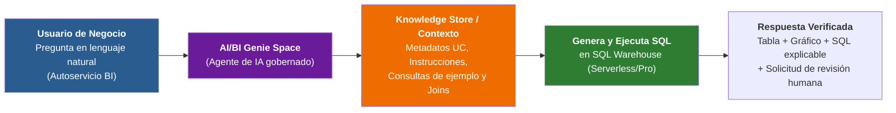

# Descripción general de los Genie Agents (Genie Spaces)

## 1. ¿Qué es AI/BI Genie?

**AI/BI Genie** es una interfaz conversacional impulsada por Inteligencia Artificial generativa (Compound AI System) dentro de Databricks que permite a los **usuarios de negocio no técnicos** hacer preguntas sobre sus datos en **lenguaje natural** (ej. *"¿Cuáles fueron los 5 productos más vendidos en España el mes pasado?"*) y obtener al instante consultas SQL verificadas, tablas de resultados y visualizaciones automáticas.

### Diferencia clave en el examen: **Databricks Assistant** vs. **AI/BI Genie**
Aunque ambos usan IA generativa en Databricks, están diseñados para **audiencias y flujos distintos**:

| Característica | Databricks Assistant | AI/BI Genie (Genie Spaces) |
| :--- | :--- | :--- |
| **Audiencia principal** | **Usuarios técnicos** (Data Analysts, Data Engineers, Scientists) dentro del SQL Editor o Notebooks. | **Usuarios de negocio / no técnicos** que necesitan explorar datos sin escribir código. |
| **Enfoque** | Copiloto de productividad para escribir, explicar, optimizar y depurar código SQL/Python. | **Espacio curado de autoservicio** sobre un subconjunto específico de tablas con reglas de negocio predefinidas. |
| **Curación y entrenamiento** | Usa el contexto general del workspace y Unity Catalog. | El analista **entrena y cura explícitamente el espacio** con instrucciones de negocio, ejemplos SQL verificados y benchmarks. |

### La familia Genie (octubre de 2026)

Databricks usa actualmente "Genie" para tres productos diferentes. Solo el primero está dentro del alcance del examen de Data Analyst.

| Producto | Para quién es | Qué hace |
| :--- | :--- | :--- |
| **Genie Agents** (antes Genie spaces) | Los analistas seleccionan y curan; los usuarios empresariales consumen | Preguntas y respuestas en lenguaje natural sobre un conjunto seleccionado de datos de UC |
| **Genie One** | Usuarios empresariales | Una única interfaz de chat para activos de datos, paneles y aplicaciones |
| **Genie Code** (antes Databricks Assistant, renombrado el 11 de marzo de 2026) | Desarrolladores y profesionales técnicos | Agente de codificación que escribe código, canalizaciones y paneles; también sugiere descripciones de tablas y consultas de ejemplo al crear un Genie Agent |

## 2. Componentes de un Genie Space (El Rol del Data Analyst)

En la certificación, el Data Analyst actúa como el **creador y curador** del *Genie Space* para garantizar que las respuestas de la IA sean precisas y consistentes:

1. **Tablas Seleccionadas (*Curated Tables / Views*):**
   * Un Genie Space no lee todo el Lakehouse a ciegas; el analista selecciona un **conjunto acotado y limpio de tablas o vistas** (idealmente de la capa **Gold** o vistas desnormalizadas) relacionadas con un dominio de negocio específico (ej. *Ventas Retail* o *Soporte Técnico*).
2. **Metadatos de Unity Catalog (Comentarios y Etiquetas):**
   * Genie lee los comentarios a nivel de **tabla** y de **columna** (`COMMENT ON TABLE / COLUMN`) registrados en Unity Catalog para entender qué significa cada campo y qué valores contiene.
3. **Instrucciones Generales (*General Instructions*):**
   * Reglas en texto plano que definen la lógica y terminología específica de la empresa (ej. *"Nuestro año fiscal comienza el 1 de febrero"*, *"Un cliente activo es aquel con al menos 1 pedido en los últimos 90 días"*, *"Excluye siempre los pedidos con `status = 'TEST'`"*).
4. **Consultas SQL de Ejemplo (*Example SQL Queries*) y Funciones:**
   * El analista añade consultas SQL reales y validadas para preguntas frecuentes o cálculos complejos. Genie aprende de estos ejemplos (incluido cómo hacer los `JOIN` correctos entre tablas) para resolver preguntas similares.
   * También permite registrar **Trusted Assets** (consultas parametrizadas o funciones SQL certificadas) que marcan la respuesta como **"Verified / Trusted"** cuando un usuario hace esa pregunta.
5. **SQL Warehouse Asociado:**
   * Cada Genie Space requiere un **SQL Warehouse** (preferiblemente **Serverless** o **Pro**) para ejecutar las consultas generadas por la IA.

## 3. Crear un Genie Agent (interfaz actual)

1. Haz clic en **Genie Agents** en la barra lateral.
2. Haz clic en **New** (arriba a la derecha).
3. Selecciona las fuentes de datos y haz clic en **Create**.
4. **Genie Code** se inicia automáticamente y sugiere descripciones de tablas y consultas de ejemplo: acepta o edita cada sugerencia.
5. Abre **Configure** para gestionar los datos y la configuración:
   - **Configure → Data**: **Add** tablas, elimínalas con el icono de la papelera y haz clic en un nombre de tabla para ver sus pestañas **Overview** y **Sample data**.
   - **Configure → Settings**: los campos que se indican a continuación.
6. Cuando Genie encuentra consultas existentes del workspace relevantes, aparece una notificación en la pestaña **Data** del panel **Instructions**: haz clic en **Review** para aceptar o rechazar cada una.

| Configuración | Finalidad |
| :--- | :--- |
| **Title** | Nombre que ven los usuarios |
| **Default warehouse** | Warehouse que ejecuta el SQL generado (pro o serverless) |
| **Tags** (en General) | Organizar y encontrar agentes |
| **Thumbnail** | Identidad visual |
| **Description** | Texto Markdown que explica qué cubre el agente |
| **Common questions** | Preguntas de ejemplo que se muestran en la página de inicio para guiar a los usuarios |

## 4. Modo Chat frente a modo Agent

| | Modo Chat | Modo Agent |
| :--- | :--- | :--- |
| **Datos** | Solo datos estructurados | Datos estructurados más archivos no estructurados en volumes (Beta) |
| **Cómo responde** | Una sola consulta SQL por pregunta | Construye un plan de investigación y ejecuta varias consultas SQL |
| **Salida** | Tabla de resultados, visualización, texto | Un informe con citas y visualizaciones |
| **Puntuación de benchmarks** | Compara los resultados con el SQL de referencia | Un juez LLM evalúa las respuestas usando tus notas de evaluación |
| **Opciones** | **Inspect** (Public Preview) revisa y puede mejorar el SQL generado antes de devolverlo | **Flash** (Beta) prioriza respuestas más rápidas para preguntas más simples |

El modo Agent también tiene su propio endpoint de API de streaming: consulta [Genie API and Integrations](./04-genie-api-and-integrations.md).

## 5. Ciclo de Mejora Continua y Gobernanza

### A. Revisión Humana y Retroalimentación (*Monitoring & Feedback Loop*)
* **Pulgar arriba / abajo (👍 / 👎):** Los usuarios de negocio califican las respuestas recibidas.
* **Request Review (Solicitar revisión):** Si un usuario duda de un resultado, puede pulsar un botón para solicitar revisión. El analista ve la pregunta exacta y el SQL que generó Genie en la pestaña **Monitoring**, pudiendo corregir la consulta y añadirla como un nuevo ejemplo para que Genie acierte en el futuro.
* **Benchmarks (Pruebas de referencia):** El analista puede crear una batería de preguntas y respuestas SQL esperadas (*Benchmarks*) para evaluar la precisión del Genie Space cada vez que actualiza instrucciones o tablas.

### B. Seguridad y Permisos en Genie Spaces (¡Muy Preguntado!)
* **Respeta estrictamente Unity Catalog:** Genie **nunca muestra datos a los que el usuario no tenga acceso**. Las consultas generadas por Genie se ejecutan **siempre con las credenciales del usuario que hace la pregunta** (respetando permisos `SELECT`, vistas dinámicas y seguridad a nivel de fila/columna).
* **Permisos sobre el Genie Space:**
  * **`CAN VIEW`:** Puede interactuar con el espacio, hacer preguntas en lenguaje natural y ver los resultados (necesita además `CAN USE` en el SQL Warehouse y `SELECT` en las tablas subyacentes).
  * **`CAN RUN`:** Igual que `CAN VIEW` (permite ejecutar preguntas en el espacio).
  * **`CAN EDIT`:** Puede añadir/quitar tablas, editar instrucciones de negocio, añadir consultas de ejemplo y revisar el historial de monitoreo.
  * **`CAN MANAGE`:** Control total, incluidos permisos y eliminación del espacio.

### C. Integración con AI/BI Dashboards
* Puedes activar Genie directamente dentro de un **AI/BI Dashboard publicado**.
* Esto permite que los ejecutivos que ven un gráfico estático en el panel abran el chat de Genie ahí mismo para hacer preguntas de seguimiento (*drill-down* conversacional) sobre los datasets del dashboard.

## 6. Buenas Prácticas para Configurar un Genie Space (Preguntas de Escenario)

1. **Mantén el alcance pequeño y enfocado:** Incluye solo las tablas estrictamente necesarias para ese caso de uso (idealmente menos de 10-15 tablas bien modeladas) en lugar de añadir cientos de tablas crudas.
2. **Documenta columnas clave en Unity Catalog:** Asegúrate de que las columnas con códigos crípticos (ej. `st_cd = 1, 2, 3`) tengan comentarios descriptivos explicando qué significa cada código.
3. **Usa Vistas o Tablas Gold pre-unidas:** Si dos tablas requieren una lógica de `JOIN` muy compleja, crea una vista limpia en Unity Catalog y dásela a Genie en lugar de obligar a la IA a deducir el cruce cada vez.
4. **Escribe instrucciones concisas y sin contradicciones:** Evita párrafos largos o reglas contradictorias; usa viñetas claras para definiciones de KPIs y filtros por defecto.

## 7. Preguntas Tipo Examen (Autoevaluación)

**Pregunta 1:** *El equipo de ventas quiere que los gerentes comerciales puedan hacer preguntas ad-hoc en lenguaje natural sobre los ingresos de su región sin depender constantemente del equipo de analistas para crear nuevos gráficos. Sin embargo, cada gerente solo debe ver los datos de su propia región según las políticas de seguridad a nivel de fila ya configuradas en Unity Catalog. ¿Qué solución de Databricks cumple ambos requisitos?*
* **Respuesta:** Crear un **AI/BI Genie Space** sobre las tablas de ventas y otorgar permiso `CAN VIEW` / `CAN RUN` a los gerentes, ya que Genie ejecuta todas las consultas respetando los permisos y políticas de **Unity Catalog** del usuario que pregunta.

**Pregunta 2:** *Un analista observa en la pestaña Monitoring de un Genie Space que Genie está calculando mal el "Margen Neto" porque utiliza una fórmula genérica en lugar de restar los costos logísticos específicos de la empresa. ¿Cuál es la mejor forma de corregir este comportamiento de forma permanente?*
* **Respuesta:** Añadir una **instrucción general (*General Instruction*)** explicando la fórmula del Margen Neto y registrar una **consulta SQL de ejemplo (*Example SQL Query*)** que muestre el cálculo exacto.

**Pregunta 3:** *¿Cuál es la diferencia fundamental entre Databricks Assistant y AI/BI Genie?*
* **Respuesta:** **Databricks Assistant** es un copiloto integrado en los editores de código (SQL Editor, Notebooks) para ayudar a perfiles técnicos a escribir y depurar código, mientras que **AI/BI Genie** ofrece espacios conversacionales curados para que usuarios de negocio consulten datos en lenguaje natural sin ver ni escribir código.

**Pregunta 4:** *Un usuario de negocio obtiene una respuesta en un Genie Space, pero no está seguro de si el número es correcto y quiere que el equipo de datos lo valide. ¿Qué funcionalidad integrada en Genie debe utilizar?*
* **Respuesta:** La opción **Request Review (Solicitar revisión)** en la respuesta del chat, lo que marca la conversación en la pestaña *Monitoring* para que el analista pueda auditar el SQL generado y validar o corregir el resultado.

## 8. Problemas y errores comunes

- **Los usuarios ven el icono de la barra lateral pero no pueden abrir ningún agente**: las funciones de IA con tecnología de socios no están habilitadas a nivel de cuenta y de workspace
- **Se selecciona un SQL warehouse clásico**: Genie necesita un warehouse pro o serverless
- **El consumidor obtiene resultados vacíos o parciales**: le falta `SELECT` sobre una tabla subyacente, o un filtro de filas excluye sus filas; UC está funcionando según lo previsto
- **Demasiadas tablas**: las respuestas unen las tablas equivocadas; reduce a cinco o menos, o preune en una vista o vista de métricas
- **Probar solo como el autor**: los permisos del autor pueden ocultar problemas de permisos; prueba como un consumidor típico
- **Tratar las columnas ocultas como si estuvieran enmascaradas**: las columnas ocultas siguen siendo legibles mediante acceso directo a la tabla

## 9. Consejos para el examen

> [!tip]
>
> - **Genie respeta los permisos de UC**: el error más frecuente. Genie escribe el SQL; UC aplica el acceso en la ejecución, por usuario que pregunta.
> - Genie necesita un SQL warehouse **pro o serverless**; los consumidores **no** necesitan permisos de warehouse.
> - La respuesta proviene de **SQL generado y ejecutado en un warehouse**, no del modelo leyendo los datos.
> - Espera que el examen diga "Genie space". La interfaz actual dice "Genie Agent": son el mismo objeto.

## 10. Conclusiones clave

- Un Genie Agent (Genie space) son datos de UC seleccionados más contexto empresarial, asociados a un SQL warehouse pro o serverless
- El SQL generado es de solo lectura, se atribuye al usuario final y se comprueba con los permisos de UC de ese usuario
- Mantén cada agente enfocado —cinco tablas o menos— y preune cuando un tema requiera más
- Modo Chat = una consulta SQL; modo Agent = investigación en varios pasos con un informe con citas

## 11. Temas relacionados

- [Ajuste de Genie Agents](./02-tuning-genie-spaces.md)
- [Benchmarks, supervisión y uso compartido](./03-benchmarks-monitoring-and-sharing.md)
- [Unity Catalog (dominio de plataforma)](../05-understanding-databricks-platform/01-unity-catalog.md)
- [Protección de datos](../07-securing-data/01-access-control.md)
- [Creación de paneles](../02-creating-dashboards-and-visualizations/README.md)

## 12. Documentación oficial

- [Descripción general de Genie Agents](https://docs.databricks.com/aws/en/genie-agents/)
- [Conceptos de Genie Agents](https://docs.databricks.com/aws/en/genie-agents/concepts)
- [Crear y gestionar un Genie Agent](https://docs.databricks.com/aws/en/genie-agents/set-up)
- [Seleccionar y curar un Genie Agent eficaz](https://docs.databricks.com/aws/en/genie-agents/best-practices)
- [Nota de versión: Genie Spaces renombrados a Genie Agents (julio de 2026)](https://docs.databricks.com/aws/en/release-notes/product/2026/july)

---

**[↑ Volver a la sección](./README.md) | [Siguiente: Ajuste de Genie Agents →](./02-tuning-genie-spaces.md)**
