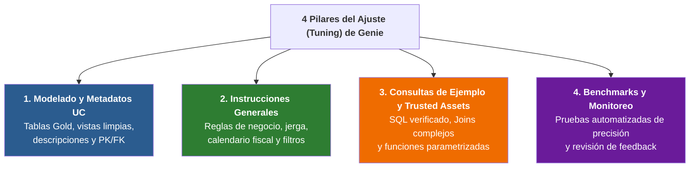

# Ajuste de los Genie Agents (Genie Spaces)

## 1. ¿Por qué y cómo se "ajusta" un Genie Space?
Un **Genie Space** no se ajusta reentrenando pesos de un modelo LLM (*fine-tuning* tradicional), sino mediante **Ingeniería de Contexto y Curación Semántica** dentro de su **Knowledge Store (Almacén de Conocimiento)**. El objetivo del Data Analyst es eliminar ambigüedades para que Genie traduzca el lenguaje natural a SQL determinista y preciso.




## 2. Pilar 1: Preparación del Modelo de Datos y Metadatos en Unity Catalog
La calidad de las respuestas de Genie depende en un **80%** de cómo estén estructuradas y documentadas las tablas antes de añadirlas al espacio:

* **Curación del alcance (Menos es más):**
  * Añade únicamente las tablas o vistas estrictamente necesarias para el dominio de negocio (idealmente **entre 1 y 15 tablas**).
  * **Oculta columnas irrelevantes:** Dentro de la configuración de datos del Genie Space, oculta columnas técnicas internas (ej. `_rescued_data`, `ingestion_timestamp`, hashes o IDs duplicados) que puedan confundir a la IA.
* **Prefiere Vistas o Tablas de la capa Gold:**
  * Si responder preguntas habituales requiere unir 6 tablas normalizadas con lógica compleja, crea una **Vista (`VIEW`)** o tabla desnormalizada en Unity Catalog y dásela a Genie.
* **Comentarios descriptivos en Unity Catalog (`COMMENT`):**
  * Genie lee automáticamente los comentarios de tablas y columnas. Documenta qué representa cada campo, su unidad de medida (ej. *"Importe neto en EUR sin IVA"*) y el significado de códigos crípticos (ej. *"1 = Activo, 2 = Suspendido, 3 = Cancelado"*).
* **Definición de Claves Primarias y Foráneas (`PRIMARY KEY` / `FOREIGN KEY`):**
  * Aunque en Delta Lake son informativas (`RELY` / `NOT ENFORCED`), declarar las restricciones `PK` y `FK` en Unity Catalog ayuda a Genie a **deducir automáticamente las rutas de `JOIN` correctas** entre tablas sin tener que explicárselo en texto.
* **Column Sampling y Value Dictionaries (Muestreo de valores):**
  * Genie indexa valores de ejemplo de columnas categóricas con baja cardinalidad (ej. nombres de regiones, categorías de producto) para saber que cuando un usuario escribe *"EEUU"* o *"USA"*, en la tabla está guardado como `'United States'`.

```sql
COMMENT ON TABLE main.sales.orders IS 'One row per customer order. Join to customers on customer_id.';
ALTER TABLE main.sales.orders ALTER COLUMN status COMMENT 'Order status: OPEN, SHIPPED, CANCELLED.';
```


## 3. Pilar 2: Redacción de Instrucciones Generales (*General Instructions*)
Las **Instrucciones Generales** son indicaciones en lenguaje natural que se inyectan en cada conversación para guiar el comportamiento de Genie.

### Qué incluir en las Instrucciones (Buenas prácticas de examen):
1. **Definiciones de negocio y KPIs ambiguos:**
   * *"El 'Margen Bruto' se calcula siempre como `(ingresos - coste_producto) / ingresos`."*
   * *"Un 'Cliente Recurrente' es aquel que ha realizado 2 o más pedidos completados en los últimos 12 meses."*
2. **Filtros por defecto obligatorios:**
   * *"Excluye siempre las filas donde `is_test_account = true` o `order_status = 'CANCELLED'` a menos que el usuario pida explícitamente pedidos cancelados."*
3. **Calendario fiscal y zonas horarias:**
   * *"Nuestro año fiscal comienza el 1 de febrero (Q1 = Feb-Abr, Q2 = May-Jul, Q3 = Ago-Oct, Q4 = Nov-Ene)."*
4. **Mapeo de sinónimos y jerga interna:**
   * *"Cuando los usuarios pregunten por 'ARR', utiliza la columna `annual_recurring_revenue` de la tabla `gold.subscriptions`."*
5. **Preferencias de formato y visualización:**
   * *"Formatea siempre las tasas de conversión como porcentajes con 2 decimales y ordena los rankings de mayor a menor."*

### Qué EVITAR al escribir instrucciones:
* ❌ Instrucciones largas tipo ensayo (más de 15-20 líneas densas). Usa **viñetas cortas, directas y sin contradicciones**.
* ❌ Repetir información que ya está documentada en los comentarios de columnas de Unity Catalog.


## 4. Pilar 3: Consultas SQL de Ejemplo y *Trusted Assets*

### A. Consultas de SQL de ejemplo

Configure → **Examples**. Las consultas de ejemplo son las que Genie selecciona para responder preguntas habituales.

- **Title** — usa la formulación más típica de la pregunta del usuario; ayuda a Genie a hacer coincidir las solicitudes.
- **Focus** — cubre lógica exclusiva de tu organización y tus datos, no cosas que Genie ya hace bien.
- **Usage guidance** — abre una consulta, haz clic en **Usage guidance** y describe cuándo se aplica.

#### Consultas de ejemplo parametrizadas

Haz clic en **Add parameter** o escribe dos puntos seguidos de un nombre en el editor: la sintaxis es **`:parameter_name`** (nombre predeterminado `parameter`).

```sql
-- Title: What is the total revenue for a region?
SELECT r.region_name, SUM(o.invoice_total) AS revenue
FROM main.sales.orders o
JOIN main.sales.regions r ON o.region_id = r.region_id
WHERE r.region_name = :region_name
GROUP BY r.region_name
```

Haz clic en el icono de engranaje de un parámetro para configurar:

- **Keyword** — editable solo en el texto de la consulta
- **Data type** — String (predeterminado), Date, Date and Time, Decimal o Integer
- **Comment** — valores válidos o límites ("Nombre completo de la región, p. ej. EMEA")

> [!warning]
> Un valor que no coincida con el tipo de datos seleccionado puede producir resultados inexactos. Elige el tipo deliberadamente.

### B. Funciones SQL

Registra una función **escalar o con valores de tabla** en Unity Catalog y añádela al agente. Usa funciones para lógica demasiado compleja para una consulta estática o parametrizada. Genie puede **llamar** a la función, pero **no puede ver ni modificar** su SQL. Los usuarios necesitan `EXECUTE` sobre la función.

```sql
CREATE OR REPLACE FUNCTION main.sales.at_risk_accounts(min_days_overdue INT COMMENT 'Minimum days overdue')
RETURNS TABLE (account_id STRING, region_name STRING, overdue_amount DECIMAL(18, 2), days_overdue INT)
COMMENT 'Accounts with an invoice overdue by at least min_days_overdue days. Use for collections and credit-risk questions.'
RETURN
  SELECT a.account_id, r.region_name, SUM(i.amount_due), MAX(i.days_overdue)
  FROM main.sales.invoices i
  JOIN main.sales.accounts a ON i.account_id = a.account_id
  JOIN main.sales.regions r ON a.region_id = r.region_id
  WHERE i.days_overdue >= min_days_overdue
  GROUP BY a.account_id, r.region_name;
```

### C. Activos de confianza y respuestas verificadas

Los **activos de confianza** son "consultas de ejemplo parametrizadas y funciones SQL cuya lógica exacta ha verificado un autor del agente". Las respuestas que los usan provienen de esa lógica verificada, de modo que los usuarios pueden distinguir una respuesta revisada de una recién generada. En modo Chat, aparece una respuesta verificada cuando se usa el texto exacto de una consulta parametrizada.

- Los autores necesitan al menos `CAN EDIT` para añadir o quitar activos de confianza.
- Los usuarios necesitan `EXECUTE` sobre cualquier función que use el agente.

> [!important]
> Los activos de confianza son un concepto formal de la documentación actual, no una expresión informal de la comunidad. Las expresiones SQL (Filter / Measure / Field) son entradas del **almacén de conocimiento**, no activos de confianza.

### D. Instrucciones de texto

Configure → **Text**. Las instrucciones de texto son "solo para contexto que deba aplicarse globalmente": términos de la empresa, calendarios fiscales, reglas de formato. Las reglas que se aplican solo a algunas preguntas corresponden a SQL de ejemplo, funciones, expresiones SQL o comentarios de tablas.

| Patrón | Ejemplo |
| :--- | :--- |
| **Definir un término empresarial** | `"Cliente activo" significa status = 'ACTIVE' y deleted_at is null.` (mejor como expresión SQL de tipo Filter) |
| **Semántica de fechas** | `"Último trimestre" significa el trimestre natural completo anterior, no los últimos 90 días.` |
| **Calendario fiscal** | `El ejercicio fiscal comienza el 1 de febrero.` |
| **Moneda** | `Los importes están en la moneda de la cuenta; nunca sumes USD y EUR juntos.` |
| **Formato** | `Muestra el dinero con dos decimales y el código de moneda.` |
| **Idioma** | `Responde en el idioma de la pregunta.` |

Todo el bloque de **General instructions** cuenta como **una** de las 100 instrucciones.


## 5. Pilar 4: Evaluación y Ajuste Iterativo (*Benchmarks* y *Monitoring*)

El ajuste de un Genie Space es un proceso continuo guiado por métricas:

   ```mermaid
flowchart LR
    B["<b>1. Crear Benchmarks</b><br/>Batería de preguntas clave<br/>+ SQL esperado"] --> R["<b>2. Ejecutar Evaluación</b><br/>Genie compara su SQL/resultado<br/>contra la respuesta esperada"]
    R --> M["<b>3. Revisar Monitoring</b><br/>Auditar pulgares abajo<br/>y solicitudes de revisión"]
    M --> A["<b>4. Ajustar Knowledge Store</b><br/>Refinar instrucciones, ocultar cols<br/>o añadir Example SQL"]
    A --> B

    style B fill:#2b5c8f,color:#fff
    style R fill:#ef6c00,color:#fff
    style M fill:#c62828,color:#fff
    style A fill:#2e7d32,color:#fff
```

### Herramientas de evaluación en Genie:
1. **Benchmarks (Pruebas de referencia):**
   * Permiten al analista definir un conjunto de preguntas frecuentes de negocio junto con su consulta SQL de referencia (*Ground Truth*).
   * Al ejecutar los *Benchmarks*, Databricks compara automáticamente los resultados devueltos por Genie frente a los de la consulta de referencia y calcula una **puntuación de precisión (% Accuracy)**.
   * **Cuándo ejecutarlos:** Antes de publicar el espacio a usuarios finales y cada vez que modifiques instrucciones o tablas para asegurarte de que no has degradado respuestas que antes funcionaban (*regression testing*).
2. **Pestaña `Monitoring` (Historial de conversaciones y Feedback):**
   * Muestra todas las preguntas hechas por los usuarios, el SQL generado por Genie, las valoraciones (`👍` / `👎`) y las solicitudes de revisión manual (*Request Review*).
   * Permite al analista detectar patrones de fallo (ej. *"Todos fallan al preguntar por ventas netas porque Genie usa la columna `gross_sales`"*), corregir la consulta y promoverla con un clic a *Example SQL Query*.


## 6. Resumen Rápido para el Examen: ¿Qué acción tomar según el problema?

| Problema detectado en Genie | Solución óptima de ajuste (*Tuning*) |
| :--- | :--- |
| Genie inventa o se equivoca al unir dos tablas (`JOIN` incorrecto) | Definir claves **`PRIMARY KEY` / `FOREIGN KEY`** en Unity Catalog o añadir una **Example SQL Query** mostrando el `JOIN` correcto. |
| Genie confunde dos columnas con nombres parecidos (ej. `amount` vs `net_amount`) | **Ocultar** la columna no deseada en la configuración de datos del espacio o mejorar los **comentarios (`COMMENT`)** en Unity Catalog. |
| Genie no aplica una regla de negocio específica (ej. excluir pedidos de prueba o calendario fiscal) | Añadir la regla de forma clara y concisa en las **General Instructions**. |
| La dirección exige que el cálculo del "EBITDA" o "Churn" sea 100% determinista y certificado | Crear una **consulta parametrizada o Función SQL de Unity Catalog** y registrarla como **Trusted Asset**. |
| Quieres medir objetivamente si un cambio en las instrucciones mejoró o empeoró las respuestas | Ejecutar la suite de **Benchmarks** antes y después del cambio. |


## 7. Preguntas Tipo Examen (Autoevaluación)

**Pregunta 1:** *Un analista ha creado un Genie Space con 8 tablas para el departamento de finanzas. Los directivos piden que, siempre que pregunten por los "Ingresos Oficiales", Genie ejecute exactamente una fórmula auditada sin variaciones generadas por la IA y muestre una etiqueta de validación. ¿Qué característica de ajuste debe configurar el analista?*
* **Respuesta:** Registrar una consulta SQL parametrizada o una función SQL de Unity Catalog como un **Trusted Asset** dentro del Genie Space.

**Pregunta 2:** *Al revisar la pestaña Monitoring de un Genie Space, notas que Genie suele equivocarse al cruzar la tabla `orders` con `shipments` porque intenta unirlas por `id` en lugar de `order_tracking_number`. ¿Cuál es la forma más limpia de resolver esto a nivel de metadatos para que Genie siempre conozca la relación?*
* **Respuesta:** Definir las restricciones PRIMARY KEY y FOREIGN KEY correspondientes en Unity Catalog (o añadir una consulta de ejemplo con el JOIN correcto).

Pregunta 3: Tras añadir nuevas instrucciones generales para mejorar las respuestas sobre devoluciones, el analista quiere verificar rápidamente que los cambios no han roto las preguntas sobre ventas que ya funcionaban correctamente la semana pasada. ¿Qué herramienta integrada debe utilizar?
* **Respuesta:** Ejecutar los Benchmarks configurados en el Genie Space para comparar la precisión antes y después del ajuste.

Pregunta 4: Una tabla añadida a un Genie Space contiene 60 columnas, de las cuales 35 son metadatos técnicos de auditoría ETL (_etl_batch_id, _raw_hash, etc.) que provocan que Genie seleccione columnas erróneas. ¿Cuál es la recomendación de ajuste más directa?
* **Respuesta:**  Ocultar las columnas técnicas irrelevantes dentro de la pestaña Data del Genie Space (o crear una vista curada que exponga únicamente las 25 columnas de negocio).


## Problemas y errores comunes

- **Codificar reglas como instrucciones de texto largas**: más difíciles de mantener y menos fiables que las expresiones SQL o el SQL de ejemplo
- **Contradicciones** entre instrucciones, ejemplos y expresiones SQL: Genie puede seguir cualquiera de ellas; mantén una sola definición por regla
- **Desajuste del tipo de parámetro**: un parámetro String comparado con una columna de fecha da resultados incorrectos
- **Correspondencia de entidades en vistas sobre tablas enmascaradas o con filtros de filas**: desactívala en esos casos
- **Alcanzar el límite de 100 instrucciones**: cada ejemplo y cada función cuentan; consolida en lugar de añadir casi duplicados
- **Curación obsoleta tras un cambio de esquema**: vuelve a ejecutar los benchmarks después de cada cambio de tabla


## Prácticas recomendadas

- Sé el primer usuario del agente: formula las preguntas que harán tus usuarios antes de compartirlo
- Empieza poco a poco: instrucciones mínimas, algunos ejemplos sólidos y añade más a medida que la supervisión detecte fallos
- Coloca las definiciones que también necesiten otras herramientas en **UC** (comentarios, vistas de métricas); conserva la redacción exclusiva del agente en el almacén de conocimiento
- Vuelve a ejecutar los benchmarks después de cada cambio de curación


## Consejos para el examen

> [!tip]
>
> - **Prefiere las expresiones SQL y el SQL de ejemplo antes que las instrucciones de texto**: las instrucciones de texto son el *último recurso* documentado.
> - **Activos de confianza** = SQL de ejemplo parametrizado + funciones SQL de UC → respuestas verificadas.
> - La sintaxis de los parámetros en SQL de ejemplo es **`:name`**, no `?` ni `{{name}}`.
> - La curación guía la *interpretación*; nunca concede ni retira *acceso*: eso lo hace UC.


## Conclusiones clave

- Corrige primero los metadatos de UC; el almacén de conocimiento añade contexto propio del agente sin sobrescribir UC
- Las expresiones SQL (Filter / Measure / Field) y el SQL de ejemplo superan a las instrucciones en prosa
- Los activos de confianza ofrecen respuestas verificadas; Genie puede llamar a funciones, pero no ver su SQL
- Vigila los límites: 100 instrucciones, 200 fragmentos del almacén de conocimiento, correspondencia de entidades 120 × 1.024


## Temas relacionados

- [Descripción general de los Genie Agents](./01-genie-spaces-overview.md)
- [Benchmarks, supervisión y uso compartido](./03-benchmarks-monitoring-and-sharing.md)
- [Análisis de consultas](../03-analyzing-queries/README.md)
- [Modelado de datos con Databricks SQL](../09-data-modeling-with-databricks-sql/README.md) — vistas y vistas de métricas para preunir datos para Genie


## Documentación oficial

- [Ajustar la calidad de un Genie Agent](https://docs.databricks.com/aws/en/genie-agents/tune-quality)
- [Seleccionar y curar un Genie Agent eficaz](https://docs.databricks.com/aws/en/genie-agents/best-practices)
- [Conceptos de Genie Agents](https://docs.databricks.com/aws/en/genie-agents/concepts)

---

**[← Anterior: Descripción general de los Genie Agents](./01-genie-spaces-overview.md) | [↑ Volver a la sección](./README.md) | [Siguiente: Benchmarks, supervisión y uso compartido →](./03-benchmarks-monitoring-and-sharing.md)**
