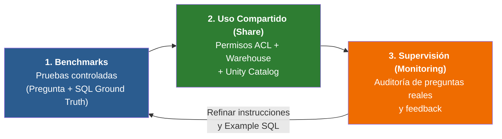

# Benchmarks, supervisión y uso compartido de Genie

## 1. Ciclo de Vida de Calidad en AI/BI Genie

Para que un **Genie Space** sea confiable en producción, el Data Analyst gestiona tres procesos clave después de la configuración inicial: **evaluar** su precisión con *Benchmarks*, **supervisar** el uso real de los usuarios en *Monitoring* y **compartir** el espacio aplicando el principio de mínimo privilegio.

## 2. Benchmarks en Genie (Evaluación Automatizada de Precisión)

Los **Benchmarks** son una suite de pruebas integradas en el Genie Space que permiten medir de forma objetiva y repetible qué tan bien responde Genie a las preguntas críticas del negocio.

### Cómo funcionan (¡Clave para el examen!):
1. **Creación de casos de prueba (*Benchmark Questions*):**
   * El analista redacta una **pregunta en lenguaje natural** (ej. *"¿Cuál fue el ticket medio por país en el último trimestre?"*) y proporciona la **consulta SQL de referencia (*Ground Truth SQL*)** que devuelve el resultado exacto esperado.
   * *Tip práctico:* Puedes añadir preguntas directamente desde la pestaña *Monitoring* a partir de preguntas reales que hicieron los usuarios.
2. **Ejecución de la evaluación (`Run Benchmarks`):**
   * Genie toma cada pregunta del benchmark, genera su propia consulta SQL, ejecuta tanto su consulta como la de referencia y **compara los resultados devueltos** (no compara el texto SQL literal, ya que dos consultas SQL distintas pueden producir exactamente la misma tabla de resultados).
3. **Puntuación de Precisión (*Accuracy Score*):**
   * Clasifica cada prueba como **Correcta (*Passed*)** o **Incorrecta (*Failed*)** y calcula un porcentaje global de precisión.
4. **Uso como pruebas de regresión (*Regression Testing*):**
   * Siempre que añadas nuevas tablas, modifiques las *General Instructions* o cambies metadatos en Unity Catalog, debes volver a ejecutar los **Benchmarks** para verificar que no has roto preguntas que antes funcionaban bien.

## 3. Supervisión (Monitoring) y Bucle de Retroalimentación

La pestaña **`Monitoring`** es el centro de observabilidad donde los autores y editores auditan cómo interactúan los usuarios de negocio con el Genie Space.

### Qué puedes inspeccionar y gestionar en `Monitoring`:
* **Historial completo de preguntas y respuestas:** Muestra qué preguntó cada usuario, la marca de tiempo, el código SQL exacto que generó Genie y si la consulta falló o tuvo éxito.
* **Indicadores de valoración (*User Feedback*):**
  * **Pulgar arriba (`👍`):** Confirma que el usuario consideró útil y precisa la respuesta.
  * **Pulgar abajo (`👎`):** Señala respuestas incorrectas, malinterpretaciones de columnas o errores de lógica.
* **Solicitudes de revisión (*Request Review*):**
  * Cuando un usuario no está seguro de la validez de un dato generado por IA, pulsa *Request Review*.
  * El analista filtra estas solicitudes en *Monitoring*, revisa el SQL generado, escribe la respuesta/consulta corregida y puede **promover esa corrección directamente al Knowledge Store** (como una *Example SQL Query*) o añadirla a los *Benchmarks*.
* **Privacidad de conversaciones:**
  * Los usuarios solo ven su propio historial de chat en la interfaz conversacional, mientras que los usuarios con permiso **`CAN EDIT` o `CAN MANAGE`** pueden auditar todas las interacciones del espacio desde la pestaña *Monitoring* para mejorar el sistema.

## 4. Uso Compartido y Modelo de Seguridad de Genie (¡Muy Preguntado!)

Compartir un Genie Space involucra **tres capas de permisos independientes**. Si falta alguna, el usuario de negocio no podrá obtener respuestas:

### Capa 1: Permisos sobre el propio Genie Space (ACLs)

| Nivel de Permiso | Qué puede hacer el usuario en el Genie Space |
| :--- | :--- |
| **`CAN VIEW`** | Abrir el espacio, escribir preguntas en lenguaje natural, ver gráficos/tablas generadas y enviar feedback (`👍`/`👎` o *Request Review*). **No** ve la configuración interna ni *Monitoring* global. |
| **`CAN RUN`** | Mismas capacidades operativas que `CAN VIEW` para ejecutar consultas en el espacio. |
| **`CAN EDIT`** | Todo lo anterior + añadir/quitar tablas, ocultar columnas, editar *General Instructions*, gestionar *Example SQL Queries*, ejecutar *Benchmarks* y auditar *Monitoring*. |
| **`CAN MANAGE`** | Control total, incluida la gestión de permisos (`Share`), cambio de SQL Warehouse asignado y eliminación del espacio. |

### Capa 2: Permiso sobre el SQL Warehouse
* El usuario (o grupo) debe tener permiso **`CAN USE`** sobre el **SQL Warehouse** (Serverless o Pro) asociado al Genie Space para poder ejecutar las consultas que Genie genera.

### Capa 3: Gobernanza de Datos en Unity Catalog (¡Regla de Oro!)
* **Ejecución con identidad del espectador:** Genie **siempre ejecuta las consultas usando las credenciales y permisos de Unity Catalog del usuario que hace la pregunta** (no existe el modo *Run as Owner* en Genie Spaces).
* **Privilegios mínimos requeridos:** El usuario debe tener **`USE CATALOG`**, **`USE SCHEMA`** y **`SELECT`** sobre las tablas/vistas incluidas en el espacio (y `EXECUTE` si el espacio utiliza funciones SQL de Unity Catalog como *Trusted Assets*).
* **Seguridad granular automática:** Si una tabla tiene políticas de seguridad a nivel de fila (*Row-level security*) o enmascaramiento de columnas (*Column masking*) en Unity Catalog, Genie las aplica automáticamente para cada usuario.

## 5. Resumen de Problemas Comunes de Acceso y Soluciones

| Error o Problema al Compartir Genie | Causa Raíz | Solución |
| :--- | :--- | :--- |
| Un usuario abre el enlace del Genie Space pero recibe error `PERMISSION_DENIED` al lanzar cualquier pregunta | Tiene `CAN VIEW` en Genie, pero le falta permiso en el cómputo o en los datos. | Otorgar **`CAN USE`** en el SQL Warehouse y **`USE CATALOG` + `USE SCHEMA` + `SELECT`** en Unity Catalog. |
| Un usuario de negocio no encuentra el Genie Space | No se ha compartido el espacio con su usuario o grupo de identidad. | Añadir su grupo corporativo con permiso **`CAN VIEW`** (o `CAN RUN`) en el botón *Share* del espacio. |
| Dos usuarios hacen exactamente la misma pregunta en el mismo Genie Space y obtienen cifras diferentes | No es un fallo: tienen distintos permisos a nivel de fila (*Row Filters*) en Unity Catalog. | Comportamiento esperado por diseño de gobernanza en Unity Catalog. |

## 6. Distribución de un agente

| Canal | Cómo | Requisitos |
| :--- | :--- | :--- |
| **Enlace directo** | **Share → Copy link** | El destinatario tiene acceso al agente y a los datos |
| **iframe incrustado** | **Share → Embed space**, copia el código iframe en un portal interno; añade `allow="clipboard-write"` para que los usuarios puedan copiar datos CSV y enlaces de conversación | Un administrador del workspace añade el host a las superficies de incrustación permitidas en la configuración de **Genie access management**; el autor tiene `CAN MANAGE`; los usuarios finales tienen acceso explícito al agente y a los datos (a los usuarios no autenticados se les pide que inicien sesión); los usuarios del embed pueden preguntar, pero no editar |
| **OpenSharing** (Beta, 17 de junio de 2026) | Compartir un Genie Agent con usuarios **fuera de tu organización** mediante OpenSharing (antes Delta Sharing) | Configuración de OpenSharing en el lado del proveedor; consulta las [notas de versión de junio de 2026](https://docs.databricks.com/aws/en/release-notes/product/2026/june) |
| **Integraciones externas con aplicaciones** | Llama a la **Genie Conversation API** desde tu propia aplicación, o añade el agente como recurso de una **Databricks App** | Consulta [Genie API and Integrations](./04-genie-api-and-integrations.md) |

> [!warning]
> Añade a la lista de permitidos de incrustación solo dominios de confianza: un embed expone el agente en cualquier lugar donde se pueda acceder a la página de host.

## 7. Preguntas Tipo Examen (Autoevaluación)

**Pregunta 1:** *Un analista comparte un Genie Space con el equipo de marketing asignándoles el permiso `CAN VIEW`. Cuando los miembros de marketing intentan hacer preguntas, reciben un error indicando que no tienen acceso a las tablas subyacentes. ¿Por qué ocurre esto?*
* **Respuesta:** Porque Genie ejecuta todas las consultas bajo la identidad del usuario que formula la pregunta; además de `CAN VIEW` en el Genie Space y `CAN USE` en el SQL Warehouse, el equipo de marketing necesita privilegios **`USE CATALOG`**, **`USE SCHEMA`** y **`SELECT`** sobre las tablas en Unity Catalog.

**Pregunta 2:** *Un analista quiere asegurarse de que un Genie Space responda con al menos un 95% de precisión a las 25 preguntas más importantes del comité de dirección antes de lanzarlo a producción, y poder repetir esa validación cada vez que modifique las instrucciones del espacio. ¿Qué funcionalidad debe utilizar?*
* **Respuesta:** **Benchmarks**, definiendo las 25 preguntas junto con sus consultas SQL de referencia (*Ground Truth*) para medir la precisión y ejecutar pruebas de regresión.

**Pregunta 3:** *Un usuario de negocio recibe una respuesta en Genie sobre ventas trimestrales, pero sospecha que el cálculo no excluye las devoluciones. Pulsa el botón "Request Review". ¿Dónde debe acudir el Data Analyst para auditar el SQL generado por Genie y corregir el comportamiento para futuras preguntas?*
* **Respuesta:** A la pestaña **`Monitoring`** del Genie Space, donde puede revisar la consulta generada, corregirla y guardarla como una **Example SQL Query** en el *Knowledge Store*.

**Pregunta 4:** *Al evaluar un Benchmark en Genie, la consulta generada por la IA utiliza una `CTE` mientras que la consulta de referencia (*Ground Truth*) utiliza una subconsulta, pero ambas devuelven exactamente las mismas filas y valores. ¿Cómo calificará Genie esta prueba?*
* **Respuesta:** Como **Correcta (*Passed*)**, ya que los Benchmarks de Genie comparan la **equivalencia de los resultados devueltos**, no la coincidencia textual exacta del código SQL.

## 8. Problemas y errores comunes

- **Agente compartido, pero los usuarios no ven datos**: tienen acceso al agente, pero les falta `SELECT` sobre los objetos de UC
- **El embed muestra un marco en blanco**: el dominio de host no está en la lista de permitidos de incrustación de Genie, o al autor le falta `CAN MANAGE`
- **Benchmark marcado como Bad aunque la respuesta es correcta**: columnas adicionales o diferencias en el orden de filas; revisa y vuelve a etiquetar
- **Los benchmarks pasan, pero los usuarios siguen quejándose**: el conjunto de benchmarks no refleja las preguntas reales; incorpóralas desde la pestaña Monitor
- **La precisión cae tras un cambio de esquema**: descripciones y valores de correspondencia de solicitudes obsoletos; actualiza los metadatos de UC y la correspondencia de solicitudes y vuelve a ejecutar los benchmarks

## 9. Prácticas recomendadas

- Alimenta los benchmarks con preguntas reales de la pestaña Monitor, no solo con las que el autor imaginó
- Dale a cada benchmark una SQL Answer en modo Chat: las preguntas sin ella requieren revisión manual
- Mantén a pocos curadores (`CAN EDIT`) y que estén identificados; da a los demás `CAN RUN` o `CAN VIEW`
- Revisa "Corregir" y las solicitudes de revisión con una cadencia fija (por ejemplo, semanalmente con el resumen)

## 10. Consejos para el examen

> [!tip]
>
> - Cuatro niveles de permiso: **CAN MANAGE / CAN EDIT / CAN RUN / CAN VIEW** — y compartir el agente nunca concede acceso a los datos.
> - Distribución = **Copy link**, **incrustación iframe** (lista de permitidos del administrador + `CAN MANAGE`) e **integraciones externas con aplicaciones** mediante la API.
> - Los benchmarks puntúan la precisión; por sí solos **no** mejoran las respuestas de Genie.
> - Optimizar = supervisar preguntas y comentarios → actualizar instrucciones / activos de confianza → actualizar metadatos de UC → revalidar con benchmarks.

## 11. Conclusiones clave

- Compartir tiene dos mitades: el nivel de permiso del agente y el acceso propio del usuario a los datos de UC
- Los benchmarks son una prueba de regresión; el modo Chat compara resultados y el modo Agent usa un juez LLM
- La pestaña Monitor, los comentarios de los usuarios y el resumen semanal indican qué curar a continuación
- Corrige las definiciones en Unity Catalog cuando pertenezcan a los datos; conserva la redacción exclusiva del agente en el almacén de conocimiento

## 12. Temas relacionados

- [Descripción general de los Genie Agents](./01-genie-spaces-overview.md)
- [Ajuste de los Genie Agents](./02-tuning-genie-spaces.md)
- [Genie API and Integrations](./04-genie-api-and-integrations.md)
- [Protección de datos](../07-securing-data/01-access-control.md)

## 13. Documentación oficial

- [Probar y supervisar un Genie Agent](https://docs.databricks.com/aws/en/genie-agents/monitor)
- [Crear y gestionar un Genie Agent — uso compartido](https://docs.databricks.com/aws/en/genie-agents/set-up)
- [Incrustar un Genie Agent en una aplicación externa](https://docs.databricks.com/aws/en/genie-agents/embed)
- [Notas de versión, junio de 2026 — compartir Genie Agents externamente con OpenSharing](https://docs.databricks.com/aws/en/release-notes/product/2026/june)

---

**[← Anterior: Ajuste de los Genie Agents](./02-tuning-genie-spaces.md) | [↑ Volver a la sección](./README.md) | [Siguiente: Genie API and Integrations →](./04-genie-api-and-integrations.md)**
