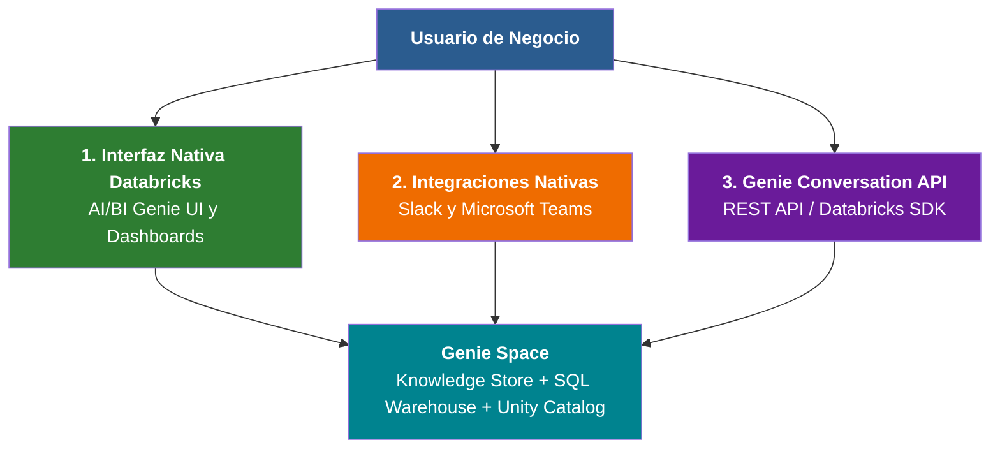
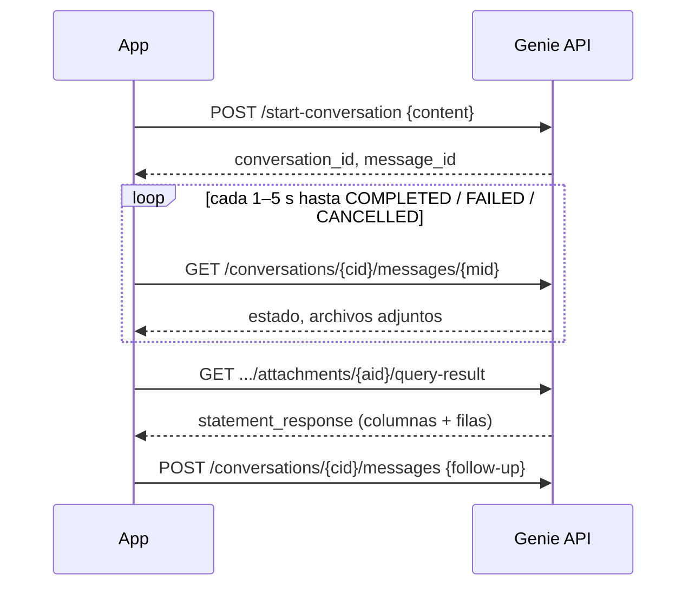

# Genie API e integraciones

##  1. ¿Para qué sirven la Genie API y sus Integraciones?

Aunque los usuarios de negocio pueden interactuar con **AI/BI Genie** directamente desde la interfaz web de Databricks, muchas empresas necesitan **llevar las capacidades conversacionales de Genie allí donde ya trabajan los usuarios** (Slack, Microsoft Teams, portales internos o aplicaciones personalizadas) sin obligarlos a abrir el workspace de Databricks.




## 2. Genie Conversation API (API REST y SDK)

La **Genie Conversation API** permite a los desarrolladores y equipos de datos integrar programáticamente un *Genie Space* existente en aplicaciones personalizadas, chatbots corporativos o flujos de automatización.

### Conceptos clave del flujo de la API (¡Clásico de examen!):
1. **Identificador del Espacio (`space_id`):**
   * Cada Genie Space tiene un `space_id` único (visible en la URL del espacio). La API se conecta a ese espacio ya curado, heredando todas sus **Instrucciones Generales**, **Example SQL Queries** y **Trusted Assets**.
2. **Gestión de Conversaciones (`conversation_id`) y Mensajes (`message_id`):**
   * **Iniciar conversación (`start-conversation`):** Envía la primera pregunta en lenguaje natural y devuelve un `conversation_id` y un `message_id`.
   * **Continuar conversación (`create-message`):** Envía preguntas de seguimiento utilizando el mismo `conversation_id` para que Genie mantenga el contexto previo (ej. *"Ahora fíltralo solo para España"*).
3. **Procesamiento Asíncrono (*Polling*):**
   * Como generar y ejecutar SQL puede tardar varios segundos, la API funciona de forma **asíncrona**: devuelve un estado (`EXECUTING_QUERY`, `COMPLETED`, `FAILED`) y la aplicación consulta el endpoint del mensaje hasta obtener el estado `COMPLETED`.
4. **Contenido de la respuesta de la API:**
   * Devuelve el **texto explicativo generado por la IA**, la **consulta SQL generada** y los **datos resultantes** (mediante el endpoint `query-result` en formato tabular/JSON).


## 3. Autenticación y Gobernanza en la Genie API (¡Muy Preguntado!)

Al igual que en la interfaz web, **la seguridad y los permisos de Unity Catalog nunca se omiten al usar la API**:

* **Métodos de autenticación soportados:**
  * **OAuth 2.0 (Recomendado en producción):** Permite autenticar usuarios finales (OAuth U2M) o aplicaciones automatizadas mediante *Service Principals* (OAuth M2M).
  * **Personal Access Tokens (PAT):** Tokens de usuario (útiles para pruebas rápidas o desarrollo).
* **Ejecución con identidad del token/usuario (*On-Behalf-Of*):**
  * Todas las consultas ejecutadas a través de la Genie API respetan estrictamente los permisos del usuario o *Service Principal* autenticado:
    1. Permiso **`CAN VIEW` / `CAN RUN`** sobre el Genie Space (`space_id`).
    2. Permiso **`CAN USE`** sobre el **SQL Warehouse** vinculado al espacio.
    3. Privilegios **`USE CATALOG`**, **`USE SCHEMA`** y **`SELECT`** en **Unity Catalog** (incluyendo filtros de fila y enmascaramiento de columnas).


## 4. Integraciones Nativas y del Ecosistema

### A. Integración con Slack y Microsoft Teams
* Permite conectar un **Genie Space** directamente con canales o mensajes directos de **Slack** o **Microsoft Teams**.
* **Beneficio de negocio:** Los ejecutivos o equipos comerciales hacen preguntas desde el chat de su empresa (`@Databricks Genie ¿cuáles fueron las ventas de ayer?`) y reciben tablas y resúmenes al instante.
* **Seguridad:** Cada usuario de Slack/Teams vincula su identidad de Databricks mediante **OAuth**, garantizando que cada persona solo vea los datos permitidos por sus propios permisos en Unity Catalog.

### B. Integración dentro de AI/BI Dashboards
* Un analista puede habilitar Genie dentro de un **AI/BI Dashboard publicado** con un solo interruptor.
* Genie utiliza automáticamente los **datasets y metadatos del propio panel** como contexto para que los espectadores puedan hacer preguntas de seguimiento sin salir del dashboard.

### C. Orquestación con Databricks Workflows / Lakeflow Jobs y Multi-Agent Systems
* **Workflows / API:** Se pueden automatizar preguntas recurrentes o pruebas de validación llamando a la Genie Conversation API desde notebooks o scripts Python (`databricks-sdk`).
* **Sistemas Multi-Agente (Mosaic AI Agent Framework):** Genie puede actuar como una **herramienta especializada en datos estructurados (SQL)** dentro de un agente de IA corporativo más amplio (por ejemplo, combinando Genie para datos tabulares de ventas con búsqueda vectorial para documentos PDF de contratos).


## 5. Limitaciones y Buenas Prácticas de la Genie API

| Aspecto | Regla / Consideración para el Examen |
| :--- | :--- |
| **Curación previa obligatoria** | La API **no** sirve para crear instrucciones ni añadir tablas; toda la curación (*Knowledge Store*, *Benchmarks*, *Trusted Assets*) se realiza primero en el Genie Space. |
| **Límites de tasa (*Rate Limits*)** | La Genie Conversation API tiene cuotas de solicitudes por minuto (pensada para interacciones conversacionales humanas, no para sustituir pipelines ETL masivos de millones de llamadas). |
| **Optimización de latencia** | Para que las integraciones externas (Slack, portales web) respondan rápido, se recomienda asociar el Genie Space a un **Serverless SQL Warehouse** (arranque instantáneo en 2-6 segundos). |

## 6. Conversation API



| Acción | Método y ruta (prefijo `/api/2.0/genie/spaces/{space_id}`) |
| :--- | :--- |
| Iniciar una conversación | `POST /start-conversation` |
| Hacer una pregunta de seguimiento | `POST /conversations/{conversation_id}/messages` |
| Sondear un mensaje | `GET /conversations/{conversation_id}/messages/{message_id}` |
| Obtener un resultado de consulta | `GET /conversations/{conversation_id}/messages/{message_id}/attachments/{attachment_id}/query-result` |
| Volver a ejecutar una consulta caducada | `POST /conversations/{conversation_id}/messages/{message_id}/attachments/{attachment_id}/execute-query` |
| Modo Agent (streaming, SSE) | `POST /api/2.0/genie/agents/{agent_id}/responses` |

Comportamiento que conviene recordar:

- **Con estado.** Los mensajes de seguimiento en la misma conversación conservan el contexto.
- **Asíncrono.** Sondea cada 1–5 segundos hasta un estado final; detente al cabo de unos 10 minutos.
- **Sin reintentos integrados.** Añade tu propia cola y retroceso exponencial (limitado a unos minutos) para respetar los límites de rendimiento.
- **Configurar en la interfaz.** Creas y ajustas el agente en la interfaz de Databricks aunque los usuarios solo accedan a él mediante la API.
- **Historial.** Los gestores de agentes pueden enumerar las conversaciones de un espacio y obtener sus mensajes.

### SDK de Python

```python
import datetime as dt
from databricks.sdk import WorkspaceClient

w = WorkspaceClient()
space_id = "<space-id>"  # Genie Agent → About, or the end of the agent's URL
timeout = dt.timedelta(minutes=10)

msg = w.genie.start_conversation_and_wait(space_id, "What was revenue by region last quarter?", timeout=timeout)
for att in msg.attachments or []:
    if att.text:
        print(att.text.content)  # Genie's text summary
    if att.query:
        print(att.query.query)  # generated SQL
        res = w.genie.get_message_attachment_query_result(
            space_id, msg.conversation_id, msg.message_id, att.attachment_id)
        stmt = res.statement_response
        print([c.name for c in stmt.manifest.schema.columns])
        print(stmt.result.data_array[:5] if stmt.result else [])

follow_up = w.genie.create_message_and_wait(space_id, msg.conversation_id, "Only for EMEA", timeout=timeout)
```

- Los métodos `*_and_wait` bloquean hasta que el mensaje termina (el tiempo de espera predeterminado del SDK es de 20 minutos: establece uno más corto).
- `get_message_attachment_query_result` solo funciona cuando el mensaje tiene un archivo adjunto de consulta en `EXECUTING_QUERY` o `COMPLETED`; usa `execute_message_attachment_query` para volver a ejecutar un resultado caducado.
- `get_message_query_result` y `execute_message_query` están **obsoletos**: usa los métodos basados en archivos adjuntos.


## 7. Databricks Apps

Para crear una aplicación de chat alojada en Databricks:

1. En **App resources** de la aplicación, haz clic en **+ Add resource → Genie Agent**, elige el agente y selecciona un permiso (**Can run** basta para enviar preguntas). La clave de recurso predeterminada es `genie-space`.
2. Lee el ID del agente de una variable de entorno en `app.yaml`:

   ```yaml
   env:
     - name: GENIE_SPACE_ID
       valueFrom: genie-space
   ```

3. Concede al **service principal** de la aplicación `USE CATALOG`, `USE SCHEMA` y `SELECT` sobre las tablas y vistas que usa el agente (y `EXECUTE` sobre cualquier función de UC).
4. En el código, crea un `WorkspaceClient()` (se autentica como el service principal de la app) y llama a los métodos del SDK anteriores.

> [!warning] Service principal = un único conjunto de permisos para todos
> Con la autorización mediante service principal, todos los usuarios de la app ven exactamente lo que puede ver el service principal. Para datos con PII, usa la autorización de usuario de la app para que Genie se ejecute con los permisos de UC propios de cada usuario. Consulta [Databricks Apps authorization](https://docs.databricks.com/aws/en/dev-tools/databricks-apps/auth).


## 8. MCP y agentes de código

| Integración | Detalle |
| :--- | :--- |
| **Servidor MCP gestionado para un agente** | `/api/2.0/mcp/genie/{space_id}`: un administrador del workspace habilita **Managed MCP Servers** en la página de Previews. El endpoint básico `/api/2.0/mcp/genie` (sin ID de agente) se retira el **31 de octubre de 2026** |
| **Servicio MCP integrado de Genie One** | `system.ai.genie_one_mcp` en `https://<host>/ai-gateway/mcp-services/<name>` — disponible con carácter general |
| **Herramienta de la CLI de Agent Bricks** | En `agent.toml`: `source = { kind = "genie_agent", space_id = "<space-id>" }` con `auth = "user"` o `"app"` |
| **Subagente de Supervisor Agent** *(heredado desde el 12 de octubre de 2026)* | Un Genie Agent podía ser un subagente; los usuarios finales necesitan acceso al agente y a sus datos de UC |

Estos son temas de GenAI Engineer: para el examen de Data Analyst, recuerda únicamente que Genie puede ser llamado por otras aplicaciones y agentes y que UC sigue gobernando los datos.


## 9. Preguntas Tipo Examen (Autoevaluación)

**Pregunta 1:** *Una empresa quiere incrustar un asistente conversacional de datos dentro de su portal interno de empleados para que puedan consultar métricas de inventario en lenguaje natural. Ya existe un Genie Space curado con instrucciones y ejemplos verificados. ¿Qué herramienta debe utilizar el equipo de desarrollo?*
* **Respuesta:** La **Genie Conversation API** apuntando al `space_id` del Genie Space existente y autenticando las peticiones con OAuth.

**Pregunta 2:** *Una organización integra AI/BI Genie con Slack para que los gerentes regionales consulten datos de ventas desde sus móviles. Un gerente de la región Norte y otro de la región Sur hacen exactamente la misma pregunta en el canal de Slack, pero cada uno recibe únicamente las cifras de su propia región. ¿Cómo es posible esto?*
* **Respuesta:** Porque la integración de Slack autentica a cada usuario mediante **OAuth**, haciendo que Genie ejecute las consultas bajo la identidad individual de cada usuario y aplique automáticamente las políticas de seguridad a nivel de fila (**Row-Level Security**) de **Unity Catalog**.

**Pregunta 3:** *Un desarrollador utiliza la Genie Conversation API para construir un chatbot y quiere que el usuario pueda hacer preguntas de seguimiento como "¿Y cómo se compara eso con el año pasado?" sin perder el contexto de la pregunta anterior. ¿Qué identificador devuelto por la API debe enviar en la segunda petición?*
* **Respuesta:** El **`conversation_id`** devuelto al iniciar la conversación (`start-conversation`), enviando la nueva pregunta al endpoint de creación de mensajes dentro de esa misma conversación.

**Pregunta 4:** *¿Por qué se recomienda asignar un Serverless SQL Warehouse a un Genie Space que está integrado con Microsoft Teams o una aplicación web externa?*
* **Respuesta:** Porque **Serverless SQL Warehouse** arranca en **2 a 6 segundos** (evitando tiempos de espera de varios minutos si el clúster estaba apagado) y escala automáticamente ante ráfagas de preguntas de múltiples usuarios.


## 10. Problemas y errores comunes

- **`get_message_attachment_query_result` falla**: se llama antes de que el mensaje alcance `EXECUTING_QUERY` / `COMPLETED`, o el resultado ha caducado (volver a ejecutar con `execute_message_attachment_query`)
- **La app no devuelve filas**: al service principal de la app le falta `SELECT` (o `USE CATALOG` / `USE SCHEMA`) sobre los datos
- **Limitación por carga**: no hay cola ni retroceso en el lado del cliente
- **Integración MCP rota después del 31 de octubre de 2026**: se sigue llamando al endpoint básico `/api/2.0/mcp/genie`


## 11. Consejos para el examen

> [!tip]
>
> - "Integraciones externas con aplicaciones" = Conversation API, Databricks Apps e incrustación: todas siguen gobernadas por UC.
> - La ruta de la API sigue diciendo **spaces** aunque el producto sea ahora Genie Agents.
> - Una app que usa un service principal muestra los mismos datos a todos los usuarios: sabe por qué importa la autorización de usuario.


## 12. Conclusiones clave

- Se puede acceder a Genie desde enlaces, iframes, la Conversation API, Databricks Apps, MCP y agentes de código
- La API tiene estado y es asíncrona: iniciar, sondear, obtener el resultado y hacer un seguimiento
- Sea cual sea la vía, Unity Catalog comprueba los permisos de la identidad que llama


## 13. Temas relacionados

- [Benchmarks, supervisión y uso compartido](./03-benchmarks-monitoring-and-sharing.md)
- [Descripción general de los Genie Agents](./01-genie-spaces-overview.md)
- [GenAI Engineer Associate](../../genai-engineer-associate/README.md) — sistemas multiagente que llaman a Genie


## 14. Documentación oficial

- [Usar la API de Genie Agents](https://docs.databricks.com/aws/en/genie-agents/conversation-api)
- [Referencia de la API de Genie](https://docs.databricks.com/api/genie/v1/conversation)
- [SDK de Python — `w.genie`](https://databricks-sdk-py.readthedocs.io/en/latest/workspace/dashboards/genie.html)
- [Añadir un recurso de Genie Agent a una Databricks App](https://docs.databricks.com/aws/en/dev-tools/databricks-apps/genie)
- [Servicios MCP integrados](https://docs.databricks.com/aws/en/agents/mcp-tools/built-in-mcp-services)
- [CLI de Agent Bricks](https://docs.databricks.com/aws/en/agents/custom-agents/agent-bricks-cli)

---

**[← Anterior: Benchmarks, supervisión y uso compartido](./03-benchmarks-monitoring-and-sharing.md) | [↑ Volver a la sección](./README.md)**
