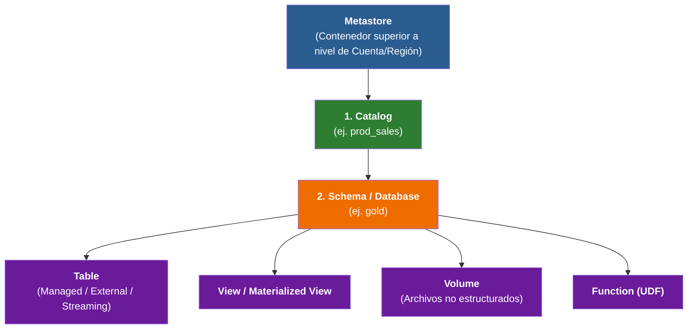

# Unity Catalog

## 1. ¿Qué es Unity Catalog?

**Unity Catalog (UC)** es la solución unificada de gobernanza de datos e inteligencia artificial en Databricks. Permite administrar de forma centralizada los metadatos, el control de acceso (permisos), el linaje de datos (*Data Lineage*), la auditoría y el descubrimiento de activos a través de múltiples workspaces dentro de una misma cuenta de Databricks.

### Beneficios clave para el Data Analyst:
* **Gobernanza centralizada (*Define once, secure everywhere*):** Los permisos definidos sobre una tabla se aplican automáticamente sin importar si accedes desde el SQL Editor, un AI/BI Dashboard, un Genie Space, Power BI o un Notebook.
* **Linaje de datos automático (*Data Lineage*):** Rastrea en tiempo real de qué tablas origen proviene cada columna y qué dashboards o consultas dependen de ella.
* **Catalog Explorer (Descubrimiento de datos):** Interfaz visual para buscar tablas, inspeccionar esquemas, ver muestras de datos, leer descripciones y revisar quién es el propietario (*Owner*).


## 2. Jerarquía de Objetos y Espacio de Nombres de Tres Niveles (¡Clave de Examen!)

En Unity Catalog, todos los activos de datos se organizan dentro de un **Metastore** (el contenedor superior a nivel de región en la cuenta de Databricks) siguiendo una estructura jerárquica estricta de **tres niveles**:

    

### Sintaxis de Tres Niveles (`catalog.schema.object`)
Para referenciar cualquier tabla o vista sin ambigüedad en Databricks SQL, se utiliza la notación separada por puntos:

```sql
-- Consulta usando el espacio de nombres completo de 3 niveles
SELECT customer_id, SUM(amount) AS total_spent
FROM prod_sales.gold.fact_orders
GROUP BY customer_id;
```

### Comandos para gestionar el contexto actual en el SQL Editor:
Si no quieres escribir los tres niveles en cada consulta, puedes fijar tu catálogo y esquema por defecto en la sesión:

```sql
-- Establecer el catálogo activo
USE CATALOG prod_sales;

-- Establecer el esquema activo (DATABASE es un sinónimo válido de SCHEMA)
USE SCHEMA gold;

-- Ahora puedes consultar directamente usando solo el nombre de la tabla
SELECT * FROM fact_orders LIMIT 10;

-- Ver cuál es tu catálogo y esquema actual
SELECT current_catalog(), current_schema();
```

### Crear un catálogo

```sql
-- Create a new catalog
CREATE CATALOG production;

-- Create with properties
CREATE CATALOG analytics
COMMENT 'Analytics and reporting catalog'
WITH DBPROPERTIES (
    owner = 'analytics_team',
    environment = 'production',
    pii_data = 'false'
);

-- View catalogs
SHOW CATALOGS;
-- Output: production, analytics, main (default)
```


## 3. Tipos de Catálogos y Objetos dentro de un Esquema

### A. Tipos de Catálogos en Unity Catalog
1. **Standard Catalog (Catálogo Estándar):** El catálogo habitual donde se crean esquemas y tablas gestionadas o externas en el Lakehouse.
2. **Foreign Catalog (Catálogo Externo / Federado):** Mapea una base de datos externa (PostgreSQL, MySQL, Snowflake, SQL Server, etc.) mediante **Lakehouse Federation** para consultarla en modo solo lectura sin mover los datos.
3. **Shared Catalog (Catálogo Compartido):** Catálogo de solo lectura montado por un destinatario que recibe datos de otro proveedor a través de **Delta Sharing**.
4. **Catálogos del Sistema (`system` y `samples`):**
   * `samples`: Catálogo integrado de solo lectura con datasets públicos de prueba (ej. `samples.nyctaxi.trips`, `samples.tpch.orders`).
   * `system`: Contiene las **System Tables** (tablas de auditoría, facturación `system.billing.usage`, historial de consultas `system.query.history` y linaje `system.access.table_lineage`).
   * *(Nota: `hive_metastore` aparece en workspaces antiguos para tablas heredadas sin Unity Catalog, pero no forma parte de la gobernanza de UC).*

### B. Objetos contenidos dentro de un Esquema (`Schema`)
* **Tables (Tablas):**
  * **Managed Tables (Gestionadas):** Unity Catalog gestiona tanto los metadatos como los archivos físicos. Al hacer `DROP TABLE`, se borran ambos.
  * **External Tables (Externas):** Creadas con la cláusula `LOCATION '...'`. Al hacer `DROP TABLE`, solo se borran los metadatos; los archivos permanecen en la nube.
  * **Streaming Tables:** Tablas Delta optimizadas para ingesta incremental (*append-only*).
* **Views (Vistas):**
  * **Standard Views (`VIEW`):** Consultas SQL guardadas (no almacenan datos físicos).
  * **Materialized Views (`MATERIALIZED VIEW`):** Vistas que almacenan resultados precalculados físicamente en Delta Lake.
* **Volumes (Volúmenes):** Representan almacenamiento gobernado para **archivos no estructurados o semiestructurados** (CSV, JSON, PDF, imágenes) accesibles mediante rutas `/Volumes/catalogo/esquema/volumen/archivo.csv`.
* **Functions (UDFs):** Funciones definidas por el usuario en SQL o Python registradas en el esquema.


## 4. Modelo de Permisos en Unity Catalog (¡Trampa Clásica de Examen!)

A diferencia de sistemas antiguos, **los permisos en Unity Catalog NO se heredan hacia abajo automáticamente sobre las tablas a menos que se otorguen en el contenedor padre**, y para leer una tabla **necesitas permisos en toda la cadena jerárquica**:

### Regla de Oro de Acceso (Los 3 Privilegios Mínimos para Leer una Tabla):
Para que un analista pueda ejecutar `SELECT * FROM prod_sales.gold.fact_orders`, necesita simultáneamente:
1. **`USE CATALOG`** sobre `prod_sales` (permite entrar al catálogo y ver sus esquemas).
2. **`USE SCHEMA`** sobre `gold` (permite entrar al esquema y ver sus tablas).
3. **`SELECT`** sobre `fact_orders` (permite leer los datos de la tabla o vista).

> **¡Cuidado en el examen!** Tener `USE CATALOG` y `USE SCHEMA` por sí solos **NO** permite leer datos; y tener `SELECT` sobre una tabla **NO** funciona si te falta `USE CATALOG` o `USE SCHEMA` en los niveles superiores.

### Sintaxis SQL de Gestión de Privilegios (`GRANT` / `REVOKE`)
```sql
-- Otorgar acceso de lectura completo a un grupo de analistas
GRANT USE CATALOG ON CATALOG prod_sales TO `data_analysts`;
GRANT USE SCHEMA ON SCHEMA prod_sales.gold TO `data_analysts`;
GRANT SELECT ON TABLE prod_sales.gold.fact_orders TO `data_analysts`;

-- Consultar qué permisos tiene asignados una tabla
SHOW GRANTS ON TABLE prod_sales.gold.fact_orders;
```

### Otros Privilegios Importantes:
* **`ALL PRIVILEGES`:** Otorga todos los privilegios aplicables sobre un objeto (pero **no** convierte al usuario en propietario).
* **`BROWSE`:** Permite descubrir y ver metadatos (nombre, esquema, comentarios, linaje) de un catálogo, esquema o tabla en el **Catalog Explorer** sin poder leer los datos (`SELECT`). Ideal para que los analistas sepan qué tablas existen antes de solicitar acceso.
* **Propiedad (`OWNER`):** Cada objeto en Unity Catalog tiene un propietario (por defecto quien lo crea). El propietario tiene control total, puede otorgar permisos (`GRANT`) y transferir la propiedad con `ALTER TABLE ... SET OWNER TO ...`.


## 5. Seguridad Granular: Vistas Dinámicas, Row Filters y Column Masks

Cuando diferentes analistas consultan la misma tabla pero deben ver datos restringidos según su rol o país:

1. **Row Filters (Filtros de Fila) y Column Masks (Enmascaramiento de Columnas):**
   * Permiten aplicar funciones SQL directamente sobre una tabla en Unity Catalog para ocultar filas o enmascarar columnas sensibles (ej. emails o salarios) de forma nativa sin crear vistas adicionales.
2. **Dynamic Views (Vistas Dinámicas):**
   * Vistas estándar que utilizan funciones de identidad como **`current_user()`** o **`is_account_group_member('grupo')`** dentro de cláusulas `WHERE` o `CASE WHEN` para filtrar filas o enmascarar valores dinámicamente según quién ejecuta la consulta.

```sql
-- Ejemplo de Vista Dinámica para ocultar correos a quienes no sean del grupo de RRHH
CREATE VIEW prod_hr.gold.employees_safe AS
SELECT
    emp_id,
    name,
    CASE
        WHEN is_account_group_member('hr_admins') THEN email
        ELSE '***@REDACTED.COM'
    END AS email
FROM prod_hr.silver.employees
WHERE region = current_user_region() OR is_account_group_member('global_managers');
```


## 6. Patrones de organización de catálogos

### Patrón 1: por entorno

```text
dev
├── schema: raw
├── schema: analytics
└── schema: testing

staging
├── schema: raw
├── schema: validated
└── schema: mirror

production
├── schema: bronze
├── schema: silver
└── schema: gold
```

### Patrón 2: por dominio empresarial

```text
main
├── sales: orders, customers, revenue
├── marketing: campaigns, leads, segments
├── finance: budgets, actuals, forecasts
└── operations: employees, assets, events
```

### Patrón 3: híbrido (entorno + dominio)

```text
prod_analytics
├── sales_gold: final_orders, customer_segments
├── marketing_gold: campaign_results, roi
└── shared_dim: dim_date, dim_customer

dev_analytics
├── sales_dev: test_orders, experiment_segments
└── marketing_dev: test_campaigns
```


## 7. Preguntas Tipo Examen (Autoevaluación)

**Pregunta 1:** *Un nuevo analista intenta ejecutar `SELECT * FROM ventas.gold.clientes;` y recibe un error de permisos. El administrador verifica que el analista ya tiene el privilegio `SELECT` sobre la tabla `clientes` y `USE SCHEMA` sobre `gold`. ¿Qué privilegio adicional necesita obligatoriamente para poder leer la tabla?*
* **Respuesta:** **`USE CATALOG`** sobre el catálogo **`ventas`**.

**Pregunta 2:** *La empresa quiere que todos los analistas puedan buscar tablas en el Catalog Explorer, leer sus descripciones y ver qué columnas contienen para saber qué datos existen en la organización, pero sin permitirles consultar ni ver las filas reales de las tablas hasta que soliciten aprobación formal. ¿Qué privilegio de Unity Catalog debe otorgarse?*
* **Respuesta:** **`BROWSE`** sobre los catálogos correspondientes.

**Pregunta 3:** *Un analista ejecuta `SELECT * FROM sales.orders;` en el SQL Editor, pero recibe el error `TABLE_OR_VIEW_NOT_FOUND` a pesar de que la tabla `orders` existe dentro del esquema `sales` del catálogo `prod_emea`. Su sesión actual tiene configurado el catálogo `main` por defecto. ¿Cuál es la forma más directa de corregir la consulta?*
* **Respuesta:** Especificar el **espacio de nombres completo de tres niveles** (`SELECT * FROM prod_emea.sales.orders;`) o ejecutar previamente `USE CATALOG prod_emea;`.

Pregunta 4: ¿Dónde puede consultar un analista el historial de facturación, el registro de auditoría de quién consultó una tabla y el historial de ejecuciones SQL mediante consultas SQL estándar dentro de Unity Catalog?
* **Respuesta:** En el catálogo integrado system (las System Tables, como system.query.history y system.access.audit).


## 8. Problemas y errores comunes

### No se pueden explorar los objetos del catálogo

**Escenario:** un usuario no ve las tablas en Data Explorer a pesar de tener el permiso `SELECT`.
**Solución:** el usuario también necesita `USE CATALOG` en el catálogo y `USE SCHEMA` en el esquema; ambos permisos son necesarios para explorar.

## 9. Consejos para el examen

- El espacio de nombres de tres niveles es catalog.schema.table (por ejemplo, `main.sales.orders`)
- El catálogo predeterminado es `main`; se puede cambiar con `USE CATALOG`
- Unity Catalog usa RBAC con herencia jerárquica (los permisos del catálogo se propagan a esquemas y tablas)
- Las tablas se pueden compartir entre workspaces de la misma cuenta de Databricks

## 10. Puntos clave

- **Espacio de nombres de tres niveles**: catalog.schema.table (frente a hive.schema.table)
- **Varios workspaces**: los datos son visibles entre workspaces con Unity Catalog
- **Gobernanza**: control de acceso centralizado, linaje y registros de auditoría
- **Catálogo predeterminado**: `main` es el predeterminado; se puede cambiar con USE CATALOG
- **Ubicaciones externas**: integración con el almacenamiento en la nube mediante credenciales
- **Volúmenes**: para archivos de datos no tabulares
- **Permisos**: jerárquicos, heredados del catálogo a las tablas
- **Linaje**: seguimiento de las dependencias y el origen de los datos

## 11. Temas relacionados

- [Fundamentos de Unity Catalog](../../../shared/fundamentals/unity-catalog-basics.md): fundamentos compartidos de Unity Catalog para todas las certificaciones
- [Guía rápida de Unity Catalog](../../../shared/cheat-sheets/unity-catalog-quick-ref.md): referencia rápida de comandos y permisos de UC
- [Control de acceso y seguridad](../07-securing-data/01-access-control.md): análisis detallado de permisos y RBAC

## 12. Documentación oficial

- [Información general sobre Unity Catalog](https://docs.databricks.com/data-governance/unity-catalog/index.html)
- [Prácticas recomendadas de Unity Catalog](https://docs.databricks.com/data-governance/unity-catalog/best-practices.html)

---

**[↑ Volver a la sección](./README.md) | [Siguiente: Conexiones e integraciones →](./02-connections.md)**
