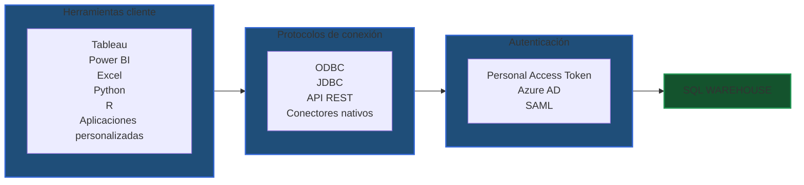

# Conexiones e integraciones

## 1. Ecosistema de Conexiones: Entrada y Salida de Datos

En Databricks SQL, las integraciones se dividen en dos direcciones principales: **consumir datos desde herramientas externas (BI / Apps)** e **ingestar o conectar orígenes externos hacia Databricks**.




### A. Consumo desde Herramientas BI y Aplicaciones Externas (Outbound)
* **Herramientas BI nativas:** Power BI, Tableau, Looker, Qlik Sense, Sigma, ThoughtSpot.
* **Drivers estándar:** JDBC y ODBC (con el driver nativo **Databricks Simba / OSS JDBC-ODBC Driver** optimizado para Cloud Fetch).
* **Conectores programáticos:** Python (`databricks-sql-connector`), Node.js, Go y REST SQL Statement Execution API.

### B. Conexión e Ingesta desde Orígenes Externos (Inbound)
* **Partner Connect:** Portal integrado en Databricks para configurar con pocos clics herramientas de terceros (Fivetran, dbt, Power BI, Tableau, Sigma).
* **Lakehouse Federation (`CONNECTION` + `FOREIGN CATALOG`):** Consultar bases de datos externas (PostgreSQL, MySQL, Snowflake, SQL Server, Oracle, BigQuery, Redshift) en tiempo real sin mover datos.
* **Lakeflow Connect:** Conectores nativos gestionados por Databricks para ingerir datos incrementalmente desde aplicaciones SaaS y bases de datos (Salesforce, Workday, SQL Server, Postgres, SharePoint) directamente a Unity Catalog.
* **Ingesta de archivos en la nube:** `COPY INTO` y la función `read_files()` (Auto Loader en SQL) desde almacenamiento cloud gobernado por **External Locations** y **Storage Credentials** en Unity Catalog.


## 2. Integración con Herramientas de BI (Power BI y Tableau) — ¡Clásico de Examen!

### A. Requisitos para conectar una herramienta BI a Databricks
Para conectar Power BI o Tableau a Databricks SQL necesitas obtener **tres datos de conexión** desde la pestaña **Connection Details** del **SQL Warehouse**:
1. **Server Hostname:** Dirección del servidor del workspace (ej. `adb-123456789.12.azuredatabricks.net`).
2. **HTTP Path:** Ruta específica que identifica al **SQL Warehouse** concreto que ejecutará las consultas (ej. `/sql/1.0/warehouses/a1b2c3d4e5f6`).
3. **Credenciales de autenticación:**
   * **OAuth 2.0 / SSO (Entra ID, Okta, Google):** Método recomendado en producción (cada usuario entra con su identidad corporativa).
   * **Personal Access Token (PAT):** Token generado por el usuario o Service Principal.

### B. Modos de Conexión en BI: **DirectQuery / Live** vs. **Import / Extract** (¡Muy Preguntado!)

| Característica | DirectQuery (Power BI) / Live (Tableau) | Import (Power BI) / Extract (Tableau) |
| :--- | :--- | :--- |
| **Dónde viven los datos** | Permanecen en **Databricks (Delta Lake)**. No se copian a la herramienta BI. | Se **copian y almacenan** en la memoria/caché de la herramienta BI. |
| **Cuándo se consulta el SQL Warehouse** | **En cada interacción** del usuario (al abrir el panel o cambiar un filtro). | **Solo durante la actualización programada** (*Scheduled Refresh*). |
| **Volumen de datos ideal** | **Tablas masivas** (cientos de millones o billones de filas) y datos en tiempo real. | **Datasets pequeños o medianos** preagregados donde se busca interacción instantánea. |
| **Gobernanza en Unity Catalog** | **Máxima:** Aplica permisos, *Row Filters* y *Column Masks* en tiempo real según el usuario conectado (SSO/OAuth). | ⚠️ Riesgo de seguridad si se extraen datos sin filtrar a un archivo local compartido. |
| **SQL Warehouse recomendado** | **Serverless SQL Warehouse** (por su arranque en segundos y escalado elástico ante concurrencia). | Cualquiera (Serverless, Pro o Classic). |

### C. Tecnología **Cloud Fetch** (¡Pregunta habitual de rendimiento!)
* **Qué es:** Mecanismo de optimización integrado en los drivers JDBC/ODBC de Databricks y conectores nativos (Power BI/Tableau).
* **Cómo funciona:** En lugar de enviar grandes volúmenes de resultados fila por fila a través del nodo *Driver* del SQL Warehouse (creando un cuello de botella), Databricks escribe los resultados en archivos temporales cifrados en el almacenamiento en la nube (S3/ADLS/GCS) y envía enlaces seguros pre-firmados para que la herramienta BI los descargue **en paralelo a alta velocidad**.


## 3. Partner Connect

**Databricks Partner Connect** es un portal dentro de la interfaz de Databricks (menú lateral izquierdo -> *Marketplace / Partner Connect*) que simplifica la integración con socios tecnológicos validados (Fivetran, dbt, Power BI, Tableau, Sigma, etc.).

### Qué automatiza Partner Connect con un clic:
1. Crea automáticamente un **SQL Warehouse** dedicado (si no existe).
2. Crea un **Service Principal** o token de acceso con los permisos mínimos necesarios.
3. Genera y descarga el archivo de configuración listo para abrir en la herramienta externa (por ejemplo, un archivo `.pbids` para Power BI o `.tds` para Tableau).


## 4. Objetos de Conectividad en Unity Catalog (Resumen de Gobernanza)

Cuando integras Databricks con almacenamiento en la nube o bases de datos externas, Unity Catalog gestiona la seguridad mediante objetos securizables específicos:

| Objeto en Unity Catalog | Para qué sirve | Uso típico del Analista / Ingeniero |
| :--- | :--- | :--- |
| **Storage Credential** | Encapsula una identidad IAM / Managed Identity de la nube para acceder al almacenamiento cloud sin claves expuestas. | Base para crear ubicaciones externas. |
| **External Location** | Vincula una ruta de almacenamiento cloud (`s3://...`, `abfss://...`, `gs://...`) con una *Storage Credential*. | Leer archivos crudos con `read_files()` o `COPY INTO`, y crear tablas externas. |
| **Connection** | Almacena host, puerto y credenciales de una base de datos externa (Postgres, Snowflake, SQL Server, etc.). | Base para crear un *Foreign Catalog* en Lakehouse Federation. |
| **Foreign Catalog** | Expone las tablas de una `Connection` externa dentro del espacio de nombres de 3 niveles de Unity Catalog. | Hacer `SELECT` y `JOIN` federados sin mover datos. |


## 5. Ingesta Rápida de Archivos mediante SQL (`COPY INTO` vs. `read_files`)

Cuando el analista necesita cargar archivos externos (CSV, JSON, Parquet) ubicados en una *External Location* o un *Volume* de Unity Catalog hacia una tabla Delta:

1. **`COPY INTO` (Carga idempotente):**
   * Carga archivos desde una ruta hacia una tabla Delta existente.
   * **Idempotencia:** Lleva un registro interno de qué archivos ya fueron procesados; si vuelves a ejecutar el mismo comando `COPY INTO`, **ignora los archivos ya cargados** y solo ingesta los nuevos.
   ```sql
   COPY INTO sales.bronze.raw_events
   FROM '/Volumes/sales/landing/events_vol/'
   FILEFORMAT = JSON
   FORMAT_OPTIONS ('inferSchema' = 'true');
   ```
2. **Función tabular `read_files()`:**
   * Permite consultar archivos directamente con `SELECT` (para inspección ad-hoc o dentro de `CREATE TABLE AS SELECT` / `STREAMING TABLE`).
   ```sql
   SELECT *
   FROM read_files(
       '/Volumes/sales/landing/events_vol/ventas_2026.csv',
       format => 'csv',
       header => true
   );
   ```


## 6. Preguntas Tipo Examen (Autoevaluación)

**Pregunta 1:** *Un analista necesita conectar Power BI Desktop a un SQL Warehouse de Databricks para visualizar una tabla de hechos de 3,000 millones de filas que se actualiza cada 15 minutos, asegurando además que se respeten las políticas de seguridad a nivel de fila de Unity Catalog para cada usuario. ¿Qué modo de conectividad debe elegir en Power BI?*
* **Respuesta:** **DirectQuery** (autenticando mediante **OAuth / Entra ID**), ya que mantiene los datos en Databricks, consulta los datos actualizados en tiempo real y aplica la seguridad de Unity Catalog por usuario.

**Pregunta 2:** *Un equipo de BI descarga conjuntos de datos de 5 millones de filas desde Databricks hacia Tableau mediante el conector ODBC oficial. ¿Qué característica de la arquitectura de conectividad de Databricks permite transferir esos millones de filas en paralelo sin saturar el nodo Driver del SQL Warehouse?*
* **Respuesta:** **Cloud Fetch**, que descarga los resultados en paralelo directamente desde el almacenamiento en la nube mediante enlaces pre-firmados seguros.

**Pregunta 3:** *Tienes una carpeta en almacenamiento en la nube donde un sistema externo deposita cada noche un archivo CSV nuevo con las ventas del día. Quieres ejecutar una sentencia SQL diaria que cargue únicamente los archivos nuevos en tu tabla Delta sin duplicar los archivos cargados en días anteriores. ¿Qué comando SQL es el más adecuado?*
* **Respuesta:** **`COPY INTO`**, debido a su garantía de **idempotencia** (rastrea los archivos ya ingeridos y omite los duplicados automáticamente).

**Pregunta 4:** *¿Qué dos datos de configuración específicos de un SQL Warehouse debes copiar desde Databricks para configurar manualmente una conexión JDBC/ODBC desde una herramienta externa?*
* **Respuesta:** El **Server Hostname** y el **HTTP Path** del SQL Warehouse (junto con el método de autenticación OAuth o PAT).


## 7. Problemas y errores comunes

### Se interrumpen las conexiones JDBC/ODBC

**Escenario:** una herramienta de BI pierde la conexión con el SQL warehouse tras un periodo de inactividad.
**Solución:** los SQL warehouses se suspenden automáticamente cuando están inactivos. Configure la herramienta de BI para que se reconecte automáticamente o aumente el tiempo de suspensión automática del warehouse.


## 8. Consejos para el examen

- PAT (Personal Access Token) es el método de autenticación más habitual para integraciones con herramientas
- HTTP Path identifica el SQL warehouse concreto que utiliza una conexión
- Las conexiones de Databricks SQL usan el puerto 443 (HTTPS)
- Conozca la diferencia entre JDBC (aplicaciones Java, Tableau) y ODBC (Excel, Power BI, herramientas heredadas)


## 9. Puntos clave

- **JDBC**: aplicaciones Java y herramientas como Tableau y Qlik
- **ODBC**: herramientas heredadas, Excel, Power BI y SQL Server
- **API REST**: integraciones personalizadas y acceso programático
- **Autenticación**: PAT (la más habitual), OAuth, M2M y AAD
- **Cadena de conexión**: contiene host, ruta, autenticación y ajustes SSL
- **Catálogo/Esquema**: ruta completa de la tabla en configuraciones con varios workspaces
- **Agrupación de conexiones**: reutilizar conexiones para mejorar el rendimiento
- **HTTP Path**: específico del warehouse, con el formato `/sql/1.0/warehouses/id`


## 10. Temas relacionados

- [Workspace de Databricks](../../../shared/fundamentals/databricks-workspace.md): comprender el entorno del workspace para las conexiones
- [Fundamentos de Unity Catalog](../../../shared/fundamentals/unity-catalog-basics.md): cómo afectan los espacios de nombres del catálogo a las rutas de conexión
- [Guía rápida de la API de PySpark](../../../shared/cheat-sheets/pyspark-api-quick-ref.md): patrones de la API de Python para conexiones con Databricks


## 11. Documentación oficial

- [Controladores de Databricks SQL](https://docs.databricks.com/integrations/jdbc-odbc-bi.html)
- [Partner Connect](https://docs.databricks.com/integrations/partner-connect/index.html)

---

**[← Anterior: Unity Catalog](./01-unity-catalog.md) | [↑ Volver a la sección](./README.md) | [Siguiente: Componentes de la plataforma, Catalog Explorer y Marketplace →](./03-platform-components-and-marketplace.md)**
