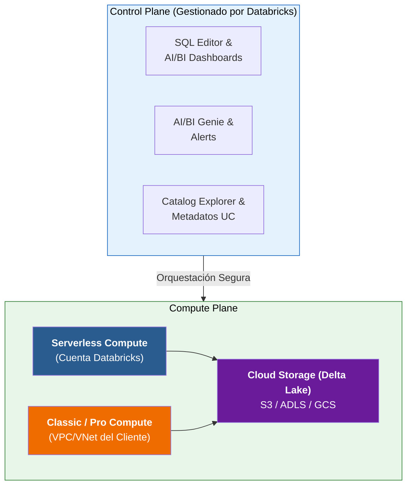

# Componentes de la plataforma, Catalog Explorer y Marketplace

## 1. Arquitectura de la Plataforma Databricks (Control Plane vs. Compute Plane)

Antes de navegar por las herramientas de usuario, el examen evalúa la arquitectura básica de dos planos en la que opera Databricks:

### A. Control Plane (Plano de Control — El "Cerebro")

Es la infraestructura gestionada íntegramente por Databricks en su propia cuenta en la nube.
• Qué contiene: La interfaz web (UI) donde inicias sesión, el SQL Editor, los AI/BI Dashboards, Genie Spaces, las Alertas, los metadatos de Unity Catalog, la programación de tareas (Workflows) y las APIs.
• Qué NO contiene: Nunca almacena tus tablas ni tus archivos de datos (salvo pequeños resultados cacheados o metadatos).

### B. Compute Plane (Plano de Cómputo — El "Músculo" y tus Datos)

Es donde realmente se ejecutan las consultas SQL, se procesan los datos y residen tus tablas Delta Lake. Se divide en dos modalidades:
• Classic / Pro Compute Plane (En tu propia nube): Las máquinas virtuales (clústeres y Classic / Pro SQL Warehouses) y el almacenamiento en la nube (S3, ADLS o GCS) viven dentro de tu propia cuenta y red privada (VPC/VNet) de AWS, Azure o Google Cloud. Tus datos nunca salen de tu cuenta.
• Serverless Compute Plane (En la cuenta de Databricks): Cuando usas un Serverless SQL Warehouse, Databricks gestiona los servidores en una red aislada dentro de su cuenta para darte arranque en segundos, pero sigue leyendo y escribiendo los datos directamente en tu almacenamiento en la nube bajo las reglas de Unity Catalog.

## 2. Catalog Explorer (Explorador de Catálogos)

El **Catalog Explorer** (anteriormente llamado *Data Explorer*) es la interfaz visual centralizada de **Unity Catalog** donde los analistas descubren, inspeccionan, documentan y gobiernan los activos de datos.

### Pestañas y funcionalidades clave en Catalog Explorer (¡Muy Preguntado!):

| Pestaña / Función | Qué puede hacer el Data Analyst aquí |
| :--- | :--- |
| **Overview (Resumen)** | Ver el propietario (*Owner*), tipo de tabla (*Managed* vs. *External*), ubicación en la nube, comentarios descriptivos, etiquetas (*Tags*) y columnas con sus tipos de datos y comentarios. |
| **Sample Data (Datos de muestra)** | Previsualizar rápidamente las primeras filas de la tabla o vista sin necesidad de abrir el SQL Editor ni escribir `SELECT * ... LIMIT`. |
| **Details (Detalles)** | Inspeccionar propiedades técnicas de Delta Lake (`TBLPROPERTIES`), formato, columnas de partición o *Liquid Clustering* (`CLUSTER BY`), y ubicación física. |
| **Permissions (Permisos)** | Ver quién tiene privilegios sobre el objeto (`SELECT`, `USE SCHEMA`, `MODIFY`) y otorgar/revocar permisos (`GRANT`/`REVOKE`) si eres el propietario o administrador. |
| **History (Historial)** | Interfaz visual equivalente a `DESCRIBE HISTORY`: muestra todas las versiones de la tabla Delta, marcas de tiempo, usuario que hizo cada cambio y métricas de operación. |
| **Lineage (Linaje de Datos)** | Visualizar el grafo interactivo **Upstream** (de qué tablas o archivos nacen los datos) y **Downstream** (qué vistas, dashboards, consultas o notebooks consumen esta tabla), tanto a **nivel de tabla** como a **nivel de columna**. |
| **Insights (Estadísticas de uso)** | Ver qué usuarios consultan más la tabla, qué consultas frecuentes se ejecutan sobre ella y qué otros objetos suelen unirse (`JOIN`) con ella (muy útil para optimizar modelos o crear *Genie Spaces*). |
| **Quality (Lakehouse Monitoring)** | Revisar perfiles estadísticos de calidad de datos (valores nulos, distribuciones, anomalías o deriva de datos). |

> **Nota clave de examen sobre Catalog Explorer:**  
> * Un analista puede editar **descripciones/comentarios** o **etiquetas (*Tags*)** de una tabla o columna si es el propietario (`OWNER`) o tiene el privilegio `MODIFY` / `APPLY TAG`.
> * Databricks incluye **AI-generated documentation** en Catalog Explorer para sugerir automáticamente descripciones de tablas y columnas basándose en sus nombres y metadatos.

## 3. Databricks Marketplace y Partner Connect

Dentro del menú lateral de la plataforma se encuentran dos ecosistemas clave para ampliar datos y herramientas:

### A. Databricks Marketplace
Es un **foro abierto impulsado por el protocolo Delta Sharing** para intercambiar productos de datos (*Data Products*), conjuntos de datos públicos/comerciales, modelos de IA y notebooks de solución entre proveedores y consumidores.

* **Cómo funciona para el Data Analyst:**
  1. Buscas un dataset en el Marketplace (ej. datos demográficos, meteorológicos, financieros o de movilidad).
  2. Si es gratuito/abierto, haces clic en **Get instant access** (si es de pago/privado, solicitas acceso al proveedor).
  3. Databricks monta el dataset **directamente como un catálogo de solo lectura en tu Unity Catalog** (`SHARED CATALOG`).
  4. **Sin ETL ni copias:** Puedes consultar y hacer `JOIN` inmediato entre los datos del Marketplace y tus tablas internas usando SQL estándar, sin descargar archivos CSV ni construir pipelines de ingesta.

### B. Partner Connect (Diferencia frente a Marketplace)
* **Databricks Marketplace:** Sirve para adquirir y consumir **datos, modelos y soluciones** (impulsado por *Delta Sharing*).
* **Databricks Partner Connect:** Sirve para conectar **herramientas de software de terceros** (Power BI, Tableau, Fivetran, dbt, Sigma) automatizando la creación del SQL Warehouse, Service Principal y archivo de conexión.

## 4. Preguntas Tipo Examen (Autoevaluación)

**Pregunta 1:** *Un analista necesita modificar la definición de una columna en una tabla de producción, pero antes quiere saber exactamente qué dashboards de AI/BI y qué vistas dependen de esa columna para no romper ningún reporte existente. ¿Dónde debe revisar esta información?*
* **Respuesta:** En la pestaña **Lineage (Linaje de datos)** dentro de **Catalog Explorer**, seleccionando el linaje **Downstream a nivel de columna**.

**Pregunta 2:** *El equipo de marketing necesita enriquecer sus análisis de ventas en tiendas físicas con datos meteorológicos históricos de terceros. Quieren acceder a estos datos directamente mediante consultas SQL en Unity Catalog sin tener que descargar archivos ni mantener procesos ETL de actualización. ¿Qué funcionalidad de Databricks deben utilizar?*
* **Respuesta:** **Databricks Marketplace**, montando el conjunto de datos meteorológicos como un catálogo compartido en Unity Catalog mediante **Delta Sharing**.

**Pregunta 3:** *Un analista descubre una tabla nueva en el esquema `sales.gold` y quiere inspeccionar rápidamente una muestra de sus filas, ver quién es el propietario de la tabla y revisar cuántas filas se insertaron en la última actualización, todo sin escribir código SQL. ¿Qué herramienta de la plataforma debe abrir?*
* **Respuesta:** **Catalog Explorer**, utilizando las pestañas **Sample Data**, **Overview** e **History**.

**Pregunta 4:** *¿Cuál es la diferencia principal entre Databricks Marketplace y Databricks Partner Connect?*
* **Respuesta:** **Marketplace** permite descubrir y consumir **conjuntos de datos y activos de IA** directamente en Unity Catalog mediante Delta Sharing, mientras que **Partner Connect** facilita la configuración e integración con **herramientas externas de software** (como Power BI, Tableau, Fivetran o dbt).

## 5. Problemas y errores comunes

### La pestaña de linaje está vacía

**Escenario:** una tabla no muestra ningún linaje.
**Solución:** el linaje solo aparece para lecturas y escrituras realizadas a través de interfaces compatibles, se pierde tras cambiar el nombre del objeto y no está disponible para fechas anteriores al 1 de septiembre de 2024. También se necesita `BROWSE` en el catálogo.

### «Get access» de Marketplace no está disponible

**Escenario:** un analista que explora el Marketplace público no puede solicitar un conjunto de datos.
**Solución:** solicite productos de Marketplace desde un workspace de Databricks.

## 6. Consejos para el examen

- Delta Lake = formato de almacenamiento; Unity Catalog = gobernanza; Databricks SQL = data warehousing y BI
- «DeltaLive tables» en el examen = Lakeflow Spark Declarative Pipelines actualmente
- La insignia de certificada = etiqueta `system.certification_status`, no una prueba de calidad
- Los datos de Marketplace se comparten en vivo, no se copian

## 7. Puntos clave

- Aprenda los nombres del examen **y** los nombres actuales
- Catalog Explorer es donde se consultan la certificación, las etiquetas y el linaje
- Marketplace entrega productos de datos como catálogos compartidos

## 8. Temas relacionados

- [Unity Catalog](./01-unity-catalog.md)
- [Descubrimiento, etiquetado y limpieza de datos](../06-managing-data/02-discovering-tagging-and-cleaning-data.md)
- [Importación de datos](../08-importing-data/01-importing-data-overview.md): Marketplace y Delta Sharing como fuentes de datos

## 9. Documentación oficial

- [¿Qué es Databricks?](https://docs.databricks.com/aws/en/introduction/)
- [¿Qué es Databricks Marketplace?](https://docs.databricks.com/aws/en/marketplace/)
- [Ver el linaje de datos con Unity Catalog](https://docs.databricks.com/aws/en/data-governance/unity-catalog/data-lineage)
- [Marcar datos como certificados u obsoletos](https://docs.databricks.com/aws/en/data-governance/unity-catalog/certify-deprecate-data)

---

**[← Anterior: Conexiones e integraciones](./02-connections.md) | [↑ Volver a la sección](./README.md)**
