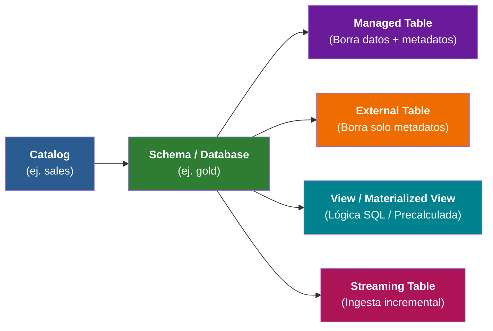

# Tablas y esquemas

## 1. Esquemas (Schemas / Databases) en Unity Catalog

En Unity Catalog, un **Esquema (`SCHEMA`)** es el segundo nivel del espacio de nombres de tres niveles (`catalogo.esquema.tabla`). Actúa como un contenedor lógico dentro de un catálogo para agrupar tablas, vistas, volúmenes y funciones relacionadas (por ejemplo, según las capas de la **Arquitectura Medallion**: `bronze`, `silver`, `gold` o por departamento).



### Reglas y sintaxis clave de Esquemas:
* **`SCHEMA` y `DATABASE` son sinónimos exactos** en Databricks SQL (`CREATE SCHEMA` y `CREATE DATABASE` hacen exactamente lo mismo).
* **Ubicación gestionada opcional (`MANAGED LOCATION`):** Un esquema puede tener su propia ruta de almacenamiento gestionado en la nube; si no se especifica, hereda la ubicación gestionada del catálogo padre.
* **Comportamiento de `DROP SCHEMA`:**
  * `DROP SCHEMA ventas.staging;` -> Falla si el esquema contiene tablas o vistas (*RESTRICT* por defecto).
  * `DROP SCHEMA ventas.staging CASCADE;` -> Elimina el esquema **y todos los objetos que contiene**.

```sql
-- Crear un esquema con comentario descriptivo
CREATE SCHEMA IF NOT EXISTS sales.gold
COMMENT 'Capa de datos curados y listos para consumo BI';

-- Cambiar al esquema activo en la sesión
USE SCHEMA sales.gold;

-- Listar esquemas disponibles en el catálogo actual
SHOW SCHEMAS;
```


## 2. Tipos de Tablas en Databricks (Comparativa de Examen)

En Databricks SQL existen distintos tipos de tablas según **dónde y cómo se almacenan sus datos** y **qué ocurre al eliminarlas**:

| Tipo de Tabla | Formato | Cláusula `LOCATION` | Qué borra `DROP TABLE` | Caso de uso principal |
| :--- | :--- | :---: | :--- | :--- |
| **Managed Table (Gestionada)** | Delta Lake (por defecto) | ❌ **No** | Metadatos **Y** archivos de datos | **Opción por defecto recomendada** por Databricks; soporta optimización automática (*Predictive Optimization*). |
| **External Table (Externa)** | Delta, Parquet, CSV, JSON | ✅ **Sí** (`LOCATION '...'`) | **Solo metadatos** (los archivos quedan intactos en la nube) | Datos compartidos con herramientas externas fuera de Databricks o en ubicaciones gobernadas existentes. |
| **Streaming Table** | Delta Lake | ❌ No | Metadatos **Y** archivos de datos | Ingesta incremental (*append-only*) mediante `STREAM()` o `read_files()`. |
| **Foreign Table (Federada)** | Motor externo (Postgres, Snowflake, etc.) | *N/A (vía `CONNECTION`)* | *No se borran desde Databricks (solo lectura)* | Consultas federadas sin mover datos (*Lakehouse Federation*). |


## 3. Creación y Modificación de Tablas (DDL y DML Clave)

### A. Crear tabla con esquema explícito (`CREATE TABLE`)
```sql
CREATE TABLE IF NOT EXISTS sales.gold.dim_products (
    product_id INT NOT NULL,
    product_name STRING COMMENT 'Nombre comercial del producto',
    category STRING,
    unit_price DECIMAL(10, 2),
    is_active BOOLEAN DEFAULT true
)
CLUSTER BY (category, product_id)
COMMENT 'Dimensión maestra de productos';
```

### B. Crear tabla desde consulta (`CTAS` y `CRAS`)
* **`CREATE TABLE AS SELECT` (CTAS):** Crea la tabla nueva y la puebla con datos. Falla si la tabla ya existe (salvo que uses `IF NOT EXISTS`).
* **`CREATE OR REPLACE TABLE ... AS SELECT` (CRAS):** Reemplaza completamente el esquema y los datos de una tabla Delta existente de forma **atómica** manteniendo el historial de versiones en el `_delta_log` (mejor práctica frente a hacer `DROP TABLE` + `CREATE TABLE`).

```sql
CREATE OR REPLACE TABLE sales.gold.top_customers AS
SELECT customer_id, SUM(amount) AS total_spent
FROM sales.silver.orders
GROUP BY customer_id
HAVING SUM(amount) > 1000;
```

### C. Modificar estructura y metadatos (`ALTER TABLE`)
```sql
-- Añadir una nueva columna
ALTER TABLE sales.gold.dim_products ADD COLUMNS (brand STRING COMMENT 'Marca del fabricante');

-- Renombrar columna (requiere Column Mapping en Delta Lake)
ALTER TABLE sales.gold.dim_products RENAME COLUMN unit_price TO base_price;

-- Añadir o actualizar comentario de tabla o columna
COMMENT ON TABLE sales.gold.dim_products IS 'Catálogo oficial de productos actualizado';
ALTER TABLE sales.gold.dim_products ALTER COLUMN category COMMENT 'Categoría principal de venta';

-- Cambiar el propietario (Owner) de una tabla
ALTER TABLE sales.gold.dim_products SET OWNER TO `data_analysts_group`;
```


## 4. Tipos de Datos y Restricciones (Constraints) en Databricks SQL

### Tipos de datos más frecuentes en el examen:
* **Numéricos:** `INT` / `BIGINT`, `DOUBLE`, `DECIMAL(p, s)` (recomendado para importes financieros exactos).
* **Texto y binarios:** `STRING`, `BINARY`.
* **Fecha y hora:**
  * `DATE`: Solo fecha (`YYYY-MM-DD`).
  * `TIMESTAMP`: Fecha y hora con zona horaria (*Timestamp with time zone*).
  * `TIMESTAMP_NTZ`: Fecha y hora **sin** zona horaria (*No Time Zone*).
* **Tipos complejos / semiestructurados (¡Muy importantes!):**
  * `ARRAY<tipo>`: Lista ordenada de elementos (acceso por índice base 0: `arr[0]`, expandir filas con `EXPLODE(arr)`).
  * `MAP<clave, valor>`: Pares clave-valor (acceso por clave: `mapa['clave']`).
  * `STRUCT<campo1: tipo, campo2: tipo>`: Objeto anidado con campos nombrados (acceso con punto: `direccion.ciudad`).
  * `VARIANT`: Tipo de dato moderno optimizado para almacenar JSON semiestructurado de esquema variable con alto rendimiento (acceso con `datos:campo::STRING`).

### Restricciones (`Constraints`) en Delta Lake:
1. **`NOT NULL` y `CHECK`:** Se **aplican estrictamente (*enforced*)** al escribir datos; si un registro viola la regla, la escritura falla.
   * Ejemplo: `ALTER TABLE sales.gold.orders ADD CONSTRAINT valid_amount CHECK (amount >= 0);`
2. **`PRIMARY KEY` y `FOREIGN KEY`:** Son **informativas (*informational / NOT ENFORCED*)** en Databricks; no bloquean inserciones duplicadas, pero ayudan al optimizador de consultas y a **AI/BI Genie** a entender las relaciones entre tablas.


## 5. Comandos de Inspección para Analistas (`DESCRIBE` y `SHOW`)

| Comando SQL | Qué información devuelve |
| :--- | :--- |
| `DESCRIBE TABLE tabla;` | Lista de columnas, tipos de datos y comentarios básicos. |
| `DESCRIBE EXTENDED tabla;` (o `DESCRIBE DETAIL tabla;`) | Metadatos completos: tipo (`MANAGED` o `EXTERNAL`), ubicación en la nube (`Location`), formato (`delta`), propietario (`Owner`), número de archivos y tamaño en bytes. |
| `SHOW CREATE TABLE tabla;` | Devuelve la sentencia DDL `CREATE TABLE` exacta necesaria para recrear la tabla. |
| `SHOW TABLES IN catalogo.esquema;` | Lista todas las tablas y vistas dentro del esquema indicado. |
| `SHOW TBLPROPERTIES tabla;` | Muestra las propiedades técnicas configuradas en la tabla Delta. |


## 6. Preguntas Tipo Examen (Autoevaluación)

**Pregunta 1:** *Un analista ejecuta `DESCRIBE EXTENDED sales.gold.customers;` y observa que el campo `Type` indica `MANAGED`. Si posteriormente un administrador ejecuta `DROP TABLE sales.gold.customers;`, ¿qué ocurrirá con los metadatos y los archivos subyacentes?*
* **Respuesta:** Al ser una **Tabla Gestionada (*Managed*)**, se eliminarán **tanto los metadatos en Unity Catalog como los archivos de datos físicos** en el almacenamiento en la nube.

**Pregunta 2:** *Tienes una tabla Delta con una columna `items` de tipo `ARRAY<STRING>` que contiene los productos comprados en cada pedido (una fila por pedido). Necesitas generar una fila independiente por cada producto comprado para poder contar cuántas veces se vendió cada artículo. ¿Qué función SQL debes usar?*
* **Respuesta:** **`EXPLODE(items)`**, que descompone cada elemento de un array en una fila separada.

**Pregunta 3:** *Un ingeniero de datos define una restricción `PRIMARY KEY` sobre la columna `order_id` en una tabla de Unity Catalog y luego inserta por error dos filas con el mismo `order_id`. ¿Qué sucederá?*
* **Respuesta:** **Ambas filas se insertarán sin error**, porque las restricciones `PRIMARY KEY` y `FOREIGN KEY` en Databricks son únicamente **informativas (*NOT ENFORCED*)** (a diferencia de `NOT NULL` y `CHECK`, que sí se validan al escribir).

**Pregunta 4:** *Necesitas recalcular y sobrescribir completamente una tabla de resumen diario (`gold.resumen_diario`) a partir de una consulta `SELECT`, conservando su historial de versiones en Delta Lake y evitando que los usuarios vean la tabla vacía durante la actualización. ¿Qué sentencia debes usar?*
* **Respuesta:** **`CREATE OR REPLACE TABLE gold.resumen_diario AS SELECT ...`**, ya que realiza el reemplazo de forma **atómica** y registra la operación como una nueva versión en el `_delta_log`.


## 7. Problemas y errores comunes

### No se encuentra la tabla después de crearla

**Escenario:** `CREATE TABLE` se ejecuta correctamente, pero `SELECT` falla con un error de tabla no encontrada.
**Solución:** Asegúrate de usar el espacio de nombres de tres niveles correcto (`catalog.schema.table`) y de tener configurados `USE CATALOG` y `USE SCHEMA`.


## 8. Consejos para el examen

- Al eliminar una tabla administrada se borran los datos y los metadatos; al eliminar una tabla externa solo se borran los metadatos
- Delta es el formato de tabla predeterminado y admite transacciones ACID, viajes en el tiempo (*time travel*) y evolución del esquema
- Para tablas grandes filtradas por unas pocas columnas, usa la agrupación líquida (`CLUSTER BY`) en lugar del particionamiento; Databricks la recomienda para todas las tablas nuevas
- Las tablas temporales tienen ámbito de sesión y se eliminan automáticamente cuando termina la sesión


## 9. Puntos clave

- **Tablas administradas**: Databricks administra los datos y los metadatos; al eliminarlas se borra todo
- **Tablas externas**: Databricks administra los metadatos; los datos permanecen en el almacenamiento en la nube
- **Formato Delta**: Predeterminado, cumple con ACID y admite viajes en el tiempo
- **Esquemas**: Contenedores lógicos de tablas; organízalos por dominio/capa/titular
- **Agrupación líquida**: Aplica `CLUSTER BY` a las columnas que más filtras (sustituye el particionamiento en tablas nuevas)
- **Tipos de datos**: Elige los tipos adecuados para un almacenamiento eficiente
- **Tablas temporales**: Con ámbito de sesión, útiles para resultados intermedios


## 10. Temas relacionados

- [Conceptos básicos de Delta Lake](../../../shared/fundamentals/delta-lake-basics.md) - Conceptos fundamentales de Delta Lake y transacciones ACID
- [Hoja de referencia de comandos de Delta Lake](../../../shared/cheat-sheets/delta-lake-commands.md) - Referencia rápida de operaciones con tablas Delta
- [Arquitectura medallón](../../../shared/fundamentals/medallion-architecture.md) - Patrones de organización de esquemas (bronce/plata/oro)


## 11. Documentación oficial

- [CREATE TABLE](https://docs.databricks.com/aws/en/sql/language-manual/sql-ref-syntax-ddl-create-table)
- [Delta Lake Overview](https://docs.databricks.com/delta/index.html)

---

**[↑ Volver a la sección](./README.md) | [Siguiente: Descubrir, etiquetar y limpiar datos →](./02-discovering-tagging-and-cleaning-data.md)**
