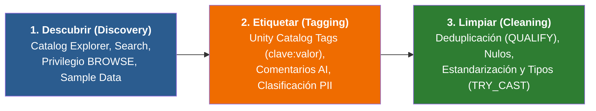

# Descubrir, etiquetar y limpiar datos

## 1. Flujo de Trabajo del Analista: Descubrir, Etiquetar y Limpiar

Antes de construir un dashboard o entrenar un Genie Space, el Data Analyst sigue un ciclo de tres pasos para localizar los datos correctos, enriquecer su gobernanza y prepararlos para el análisis:




## 2. Descubrimiento de Datos (Data Discovery)

### A. Herramientas de Búsqueda en Unity Catalog
1. **Barra de búsqueda global (*Workspace Search* / `Cmd+P` o `Ctrl+P`):**
   * Busca instantáneamente tablas, vistas, columnas, consultas, dashboards, notebooks y activos del Marketplace por nombre, descripción o etiquetas (*Tags*).
2. **Catalog Explorer (Explorador de Catálogos):**
   * **Privilegio `BROWSE`:** Permite a los analistas descubrir qué catálogos, esquemas y tablas existen, leer sus descripciones, ver sus columnas y consultar el **linaje (*Lineage*)** sin tener permiso `SELECT` para leer las filas de datos.
   * **Sample Data (Datos de muestra):** Permite previsualizar filas directamente en la interfaz sin lanzar consultas manuales.
   * **Insights (Estadísticas de uso):** Muestra qué tablas son las más consultadas en la empresa, quiénes son sus usuarios principales y con qué otras tablas se suelen unir (`JOIN`), ayudando a identificar la "fuente única de verdad" (*Single Source of Truth*).
   * **Lakehouse Monitoring (Pestaña *Quality*):** Permite revisar perfiles estadísticos automáticos (porcentaje de nulos, valores mínimos/máximos, cardinalidad y distribución) antes de escribir una sola línea de SQL.

### B. Exploración Rápida mediante SQL
```sql
-- Buscar tablas cuyo nombre coincida con un patrón
SHOW TABLES IN sales.gold LIKE '*customer*';

-- Inspeccionar columnas, tipos de datos y comentarios
DESCRIBE TABLE sales.gold.customers;

-- Perfilado rápido de nulos y valores distintos en SQL
SELECT
    COUNT(*) AS total_filas,
    COUNT(email) AS emails_no_nulos,
    COUNT(*) - COUNT(email) AS emails_nulos,
    COUNT(DISTINCT customer_id) AS clientes_unicos
FROM sales.silver.customers;
```


## 3. Etiquetado y Documentación de Datos (Unity Catalog Tags)

Las **Etiquetas (*Tags*)** en Unity Catalog son pares **clave-valor (`key = 'value'`)** que se asignan a catálogos, esquemas, tablas, vistas o columnas individuales para facilitar la búsqueda, clasificar datos sensibles (PII) y aplicar políticas de seguridad basadas en atributos (ABAC).

### Reglas clave de Tags en el examen:
* **Objetos etiquetables:** Catálogos, esquemas, tablas, vistas, volúmenes y **columnas**.
* **Privilegio necesario para etiquetar:** Ser el propietario (`OWNER`) del objeto o tener el privilegio **`APPLY TAG`** sobre el objeto (junto con `USE CATALOG` / `USE SCHEMA`).
* **Etiquetas gobernadas (*Governed Tags*):** Permiten a los administradores restringir qué claves y valores válidos pueden usarse (ej. clave `pii` con valores permitidos únicamente `'email'`, `'ssn'`, `'phone'`), evitando errores tipográficos como `PII` vs `pii`.
* **Comentarios generados por IA (*AI-generated comments*):** En Catalog Explorer, Databricks puede generar descripciones automáticas para tablas y columnas basándose en los metadatos, mejorando tanto la documentación humana como la precisión de **AI/BI Genie** y **Databricks Assistant**.

### Sintaxis SQL para Etiquetas (`SET TAGS` / `UNSET TAGS`)
```sql
-- Asignar etiquetas a una tabla
ALTER TABLE sales.gold.customers
SET TAGS ('departamento' = 'ventas', 'nivel_calidad' = 'certificado');

-- Asignar una etiqueta de clasificación PII a una columna específica
ALTER TABLE sales.gold.customers
ALTER COLUMN email SET TAGS ('pii' = 'email', 'sensibilidad' = 'alta');

-- Eliminar una etiqueta
ALTER TABLE sales.gold.customers UNSET TAGS ('nivel_calidad');

-- Buscar todas las columnas etiquetadas como PII mediante System Tables (Information Schema)
SELECT catalog_name, schema_name, table_name, column_name, tag_name, tag_value
FROM system.information_schema.column_tags
WHERE tag_name = 'pii';
```


## 4. Limpieza de Datos en Databricks SQL (Técnicas Evaluadas en el Examen)

### A. Eliminación de Duplicados (Deduplicación)
Existen tres patrones principales según el caso de uso:
1. **`SELECT DISTINCT`:** Elimina filas donde **todas** las columnas seleccionadas son idénticas.
2. **`QUALIFY ROW_NUMBER()` (Patrón más preguntado):** Cuando dos filas tienen el mismo ID pero distinta marca de tiempo o estado, conserva exactamente el registro más reciente o prioritario:
   ```sql
   SELECT customer_id, email, country, updated_at
   FROM sales.bronze.customers_raw
   QUALIFY ROW_NUMBER() OVER (
       PARTITION BY customer_id
       ORDER BY updated_at DESC
   ) = 1;
   ```
3. **`MERGE INTO` (Upsert idempotente):** Actualiza registros existentes e inserta nuevos en una tabla Delta destino evitando duplicados en cargas incrementales.

### B. Manejo de Valores Nulos y Vacíos
* **`COALESCE(col1, col2, 'Desconocido')`:** Sustituye valores `NULL` por el primer valor no nulo disponible.
* **`NULLIF(TRIM(col), '')`:** Convierte cadenas vacías (`''`) o espacios en blanco en `NULL` reales para unificar el tratamiento de datos faltantes.
* **`FILTER` o `WHERE col IS NOT NULL`:** Excluye registros incompletos antes de realizar agregaciones o divisiones.

### C. Limpieza y Estandarización de Texto

| Función SQL | Qué hace | Ejemplo |
| :--- | :--- | :--- |
| **`TRIM()` / `LTRIM()` / `RTRIM()`** | Elimina espacios en blanco innecesarios al inicio o final. | `TRIM('  Madrid  ')` -> `'Madrid'` |
| **`UPPER()` / `LOWER()` / `INITCAP()`** | Normaliza mayúsculas y minúsculas para evitar fallos en `GROUP BY` o `JOIN`. | `LOWER(TRIM(email))` -> `'ana@empresa.com'` |
| **`REGEXP_REPLACE(col, patron, reemplazo)`** | Limpia caracteres especiales, símbolos de moneda o formatea teléfonos usando expresiones regulares. | `REGEXP_REPLACE(telefono, '[^0-9]', '')` -> `'600123456'` |
| **`SPLIT(col, separador)`** | Divide una cadena en un `ARRAY` según un delimitador. | `SPLIT('ES-28001', '-')[0]` -> `'ES'` |

### D. Conversión Segura de Tipos y Fechas (`TRY_*`)
En Databricks SQL, el modo ANSI está activo por defecto, por lo que `CAST('abc' AS INT)` **lanza un error y detiene la consulta**. Para limpiar datos sucios sin romper el pipeline:
* **`TRY_CAST(col AS tipo)`:** Intenta convertir el valor; si el formato es inválido, devuelve **`NULL`** en lugar de fallar.
* **`TRY_TO_DATE(col, formato)` / `TRY_TO_TIMESTAMP(col, formato)`:** Parsea fechas en formatos no estándar de forma segura (ej. `TRY_TO_DATE('26/11/2026', 'dd/MM/yyyy')`).
* **`TRY_DIVIDE(numerador, denominador)`:** Devuelve `NULL` si el denominador es `0`.

```sql
-- Ejemplo completo de limpieza en una vista o tabla Silver
CREATE OR REPLACE TABLE sales.silver.orders_clean AS
SELECT
    TRIM(order_id) AS order_id,
    LOWER(TRIM(customer_email)) AS customer_email,
    UPPER(COALESCE(NULLIF(TRIM(country_code), ''), 'UNKNOWN')) AS country_code,
    TRY_CAST(REGEXP_REPLACE(amount_str, '[^0-9.]', '') AS DECIMAL(10, 2)) AS amount,
    TRY_TO_DATE(order_date_str, 'dd/MM/yyyy') AS order_date
FROM sales.bronze.orders_raw
WHERE order_id IS NOT NULL
QUALIFY ROW_NUMBER() OVER (PARTITION BY TRIM(order_id) ORDER BY ingestion_ts DESC) = 1;
```


## 5. Preguntas Tipo Examen (Autoevaluación)

**Pregunta 1:** *El equipo de cumplimiento normativo pide a los analistas etiquetar todas las columnas que contengan información personal identificable (`PII`) en las tablas de clientes para facilitar futuras auditorías en Unity Catalog. ¿Qué privilegio necesita un analista sobre una tabla (si no es el propietario) para poder añadir etiquetas a sus columnas?*
* **Respuesta:** El privilegio **`APPLY TAG`** sobre la tabla (junto con `USE CATALOG` y `USE SCHEMA` en los niveles superiores).

**Pregunta 2:** *Una tabla cruda `raw_transactions` contiene una columna de texto `precio` con valores sucios como `'125.50'`, `'99.00'` y ocasionalmente `'GRATIS'` o `'N/A'`. Si ejecutas `CAST(precio AS DECIMAL(10,2))`, la consulta falla. ¿Qué función debes usar para convertir los precios válidos y transformar los textos no numéricos en `NULL` sin interrumpir la consulta?*
* **Respuesta:** **`TRY_CAST(precio AS DECIMAL(10,2))`**.

**Pregunta 3:** *Tienes una tabla de eventos de usuarios donde cada actualización de perfil genera una nueva fila con el mismo `user_id` y una columna `event_timestamp`. Necesitas crear una tabla limpia con una única fila por `user_id` conservando exclusivamente su estado más reciente. ¿Qué combinación SQL es la más limpia y recomendada?*
* **Respuesta:** Utilizar **`QUALIFY ROW_NUMBER() OVER (PARTITION BY user_id ORDER BY event_timestamp DESC) = 1`**.

**Pregunta 4:** *¿En qué vista del sistema (`Information Schema`) puede un analista consultar mediante SQL todas las columnas de un catálogo que han sido etiquetadas con la clave `'pii'`?*
* **Respuesta:** En **`<catalogo>.information_schema.column_tags`** o en la vista global **`system.information_schema.column_tags`**.


## 6. Problemas y errores comunes

### "Asignar certificación" aparece desactivada

**Escenario:** Un usuario no puede certificar una tabla de la cual es propietario.
**Solución:** También necesita `ASSIGN` en la etiqueta gobernada `system.certification_status`.

### `CAST` falla con valores incorrectos

**Escenario:** `CAST(qty AS INT)` produce un error con `'n/a'`.
**Solución:** Usa `try_cast` y luego trata los NULL.


## 7. Consejos para el examen

- Certificado/obsoleto = etiqueta gobernada `system.certification_status`
- El etiquetado requiere `APPLY TAG` (o la propiedad del objeto); las etiquetas gobernadas también requieren `ASSIGN`
- `COALESCE` rellena los NULL; `NULLIF` los crea; `try_cast` evita errores
- `DELETE ... WHERE` elimina las filas no válidas y queda registrado en el historial


## 8. Puntos clave

- Descubre los datos mediante la búsqueda y Catalog Explorer; confía en lo que está certificado
- Las etiquetas y el linaje se encuentran en las páginas del objeto en Catalog Explorer
- Limpia los datos con SQL estándar en tablas de la capa plata


## 9. Temas relacionados

- [Tablas y esquemas](./01-tables-schemas.md)
- [Componentes de la plataforma, Catalog Explorer y Marketplace](../05-understanding-databricks-platform/03-platform-components-and-marketplace.md)
- [Modelado de datos con Databricks SQL](../09-data-modeling-with-databricks-sql/01-data-modeling-overview.md) - Dónde se ubica la limpieza en la arquitectura medallón


## 10. Documentación oficial

- [Marcar datos como certificados u obsoletos](https://docs.databricks.com/aws/en/data-governance/unity-catalog/certify-deprecate-data)
- [Aplicar etiquetas a objetos protegibles de Unity Catalog](https://docs.databricks.com/aws/en/database-objects/tags)
- [Ver el linaje de datos con Unity Catalog](https://docs.databricks.com/aws/en/data-governance/unity-catalog/data-lineage)

---

**[← Anterior: Tablas y esquemas](./01-tables-schemas.md) | [↑ Volver a la sección](./README.md)**
