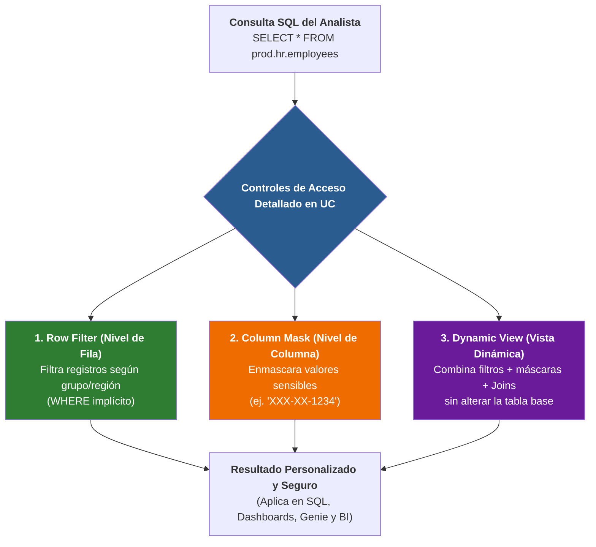

# Propiedad, acceso detallado y PII

## 1. Propiedad de Objetos en Unity Catalog (`OWNER`)

En Unity Catalog, **todo objeto securizable** (Metastore, Catalog, Schema, Table, View, Volume, Function, Connection, Share) tiene exactamente **un propietario (`OWNER`)**.

### Reglas críticas sobre la Propiedad (¡Muy Preguntado en el Examen!):
1. **Asignación automática al crear:** Por defecto, el usuario o *Service Principal* que crea un objeto se convierte automáticamente en su propietario.
2. **Poderes del propietario (`OWNER`):**
   * Tiene **control total** sobre el objeto: puede leerlo, modificarlo, cambiar sus metadatos/etiquetas, eliminarlo (`DROP`) y otorgar o revocar privilegios (`GRANT` / `REVOKE`) a otros usuarios o grupos.
   * **Importante:** Tener el privilegio `ALL PRIVILEGES` **NO** convierte a un usuario en propietario (por ejemplo, no puede eliminar el objeto ni transferir su propiedad).
   * **Regla de cadena jerárquica:** Aunque seas el `OWNER` de una tabla dentro de `prod.sales.orders`, **sigues necesitando** `USE CATALOG` en `prod` y `USE SCHEMA` en `sales` para acceder a ella (a menos que también seas el propietario del catálogo o esquema padre).
3. **Mejor práctica de gobernanza (Grupos vs. Usuarios):**
   * En entornos de producción, la propiedad nunca debe quedarse en un usuario individual (si esa persona deja la empresa, el objeto queda huérfano). Siempre se debe transferir la propiedad a un **Grupo de cuenta (*Account-level Group*)**.

```sql
-- Transferir la propiedad de una tabla a un grupo de ingeniería/analítica
ALTER TABLE prod_sales.gold.fact_orders SET OWNER TO `data_stewards_group`;

-- Transferir la propiedad de un esquema completo
ALTER SCHEMA prod_sales.gold SET OWNER TO `data_stewards_group`;

-- Verificar quién es el propietario actual de una tabla
DESCRIBE TABLE EXTENDED prod_sales.gold.fact_orders;
```


## 2. Acceso Detallado (Fine-Grained Access Control — FGAC)

El **Acceso Detallado** permite restringir exactamente **qué filas** y **qué columnas** puede ver cada usuario dentro de una misma tabla, evitando la necesidad de crear copias físicas de datos por departamento o país.



### Comparativa: ¿Qué mecanismo elegir en el examen?

| Mecanismo | Dónde se aplica | Cuándo elegirlo en el examen |
| :--- | :--- | :--- |
| **Row Filter (Filtro de Fila)** | Directamente sobre la **tabla base** (`SET ROW FILTER`). | Cuando quieres que todos los usuarios consulten la tabla original, pero cada grupo solo vea las filas de su país, departamento o tenant. |
| **Column Mask (Máscara de Columna)** | Directamente sobre una **columna de la tabla base** (`ALTER COLUMN ... SET MASK`). | Cuando quieres ocultar parcialmente o anonimizar campos sensibles (SSN, teléfono, salario) en la tabla original sin romper el esquema (`SELECT *` sigue funcionando). |
| **Dynamic View (Vista Dinámica)** | En una **vista SQL (`CREATE VIEW`)** sobre una o varias tablas. | Cuando **no eres el propietario de la tabla base** (o es una tabla compartida/externa de solo lectura) y quieres exponer una capa segura con filtros y máscaras combinados. |

### Implementación SQL de Acceso Detallado
```sql
-- 1. Función de Filtro de Fila (solo ve su región, salvo auditores globales)
CREATE FUNCTION prod_sales.gold.filter_by_region(reg STRING)
RETURN is_account_group_member('global_auditors') OR reg = 'EMEA';

ALTER TABLE prod_sales.gold.orders
SET ROW FILTER prod_sales.gold.filter_by_region ON (region);

-- 2. Función de Enmascaramiento de Columna (oculta correo salvo grupo autorizado)
CREATE FUNCTION prod_sales.gold.mask_email(email STRING)
RETURN CASE
    WHEN is_account_group_member('pii_authorized') THEN email
    ELSE CONCAT(LEFT(email, 2), '****@****.com')
END;

ALTER TABLE prod_sales.gold.customers
ALTER COLUMN email SET MASK prod_sales.gold.mask_email;
```


## 3. Gestión y Protección de Datos PII (Personally Identifiable Information)

Los datos **PII** (Información Personal Identificable: nombres, correos electrónicos, teléfonos, DNI/SSN, direcciones IP, datos bancarios) requieren un ciclo de vida gobernado en Databricks para cumplir normativas como **GDPR**, **CCPA** o **HIPAA**:

### Ciclo de Gestión de PII (4 Pasos Clave):

1. **Detección y Clasificación (Discovery & Tagging):**
   * **Etiquetado manual o automatizado:** Asignar etiquetas (**Unity Catalog Tags**) a las columnas sensibles (ej. `ALTER TABLE clientes ALTER COLUMN dni SET TAGS ('pii' = 'national_id')`).
   * **Etiquetas Gobernadas (*Governed Tags*):** Restringen los valores permitidos para mantener consistencia en toda la organización.
2. **Pseudonimización / Anonimización en Ingesta (ETL):**
   * Aplicar funciones criptográficas irreversiblemente (`SHA2(email, 256)`) o tokenización en las capas **Silver/Gold** cuando los analistas no necesitan el valor original para calcular métricas agregadas (ej. contar clientes únicos).
3. **Protección en Tiempo de Consulta (FGAC):**
   * Aplicar **Column Masks** o **Dynamic Views** usando `is_account_group_member()` para que solo el personal con autorización explícita vea el dato sin enmascarar.
4. **Derecho al Olvido (*Right to be Forgotten* / GDPR Deletes):**
   * Gracias a las transacciones ACID de Delta Lake, se eliminan registros específicos de un usuario mediante **`DELETE FROM tabla WHERE user_id = '...'`**.
   * **¡Trampa crítica de examen con GDPR y Time Travel!** Ejecutar `DELETE` elimina el registro de la versión actual, pero **el dato sigue existiendo en las versiones históricas (Time Travel)** hasta que se ejecuta **`VACUUM`** una vez superado el periodo de retención (`delta.deletedFileRetentionDuration`). Para cumplir estricto borrado GDPR, hay que ejecutar `DELETE` + `VACUUM` tras ajustar la retención.


## 4. Auditoría de PII y Propiedad con System Tables

Los administradores y equipos de seguridad supervisan el cumplimiento de PII consultando las **System Tables** en Unity Catalog:

```sql
-- 1. Localizar todas las columnas marcadas como PII en el catálogo
SELECT catalog_name, schema_name, table_name, column_name, tag_value
FROM system.information_schema.column_tags
WHERE tag_name = 'pii';

-- 2. Auditar qué usuarios consultaron una tabla con datos PII
SELECT event_time, user_identity.email AS usuario, action_name, request_params.full_name_arg AS tabla
FROM system.access.audit
WHERE action_name = 'getTable'
  AND request_params.full_name_arg = 'prod_sales.gold.customers'
ORDER BY event_time DESC;
```


## 5. Preguntas Tipo Examen (Autoevaluación)

**Pregunta 1:** *Un analista de datos creó una tabla `marketing.gold.leads` hace seis meses y ahora va a cambiar de departamento. El equipo quiere asegurarse de que el grupo `marketing_engineers` tenga control total sobre la tabla, incluida la capacidad de cambiar permisos y eliminarla en el futuro. ¿Qué sentencia SQL debe ejecutarse?*
* **Respuesta:** **`ALTER TABLE marketing.gold.leads SET OWNER TO \`marketing_engineers\`;`** (ya que otorgar `ALL PRIVILEGES` no transfiere la propiedad ni permite borrar el objeto).

**Pregunta 2:** *Una tabla `hr.gold.employees` contiene la columna `salary`. El departamento de cumplimiento exige que todos los analistas puedan consultar la tabla (`SELECT *`), pero que la columna `salary` muestre `NULL` para cualquier usuario que no pertenezca al grupo de cuenta `compensation_team`, sin crear una vista separada. ¿Qué funcionalidad de Unity Catalog debes usar?*
* **Respuesta:** Aplicar una **Máscara de Columna (*Column Mask*)** directamente sobre `hr.gold.employees.salary` utilizando una función SQL con **`is_account_group_member('compensation_team')`**.

**Pregunta 3:** *Un cliente solicita la eliminación permanente de todos sus datos personales (`customer_id = 9876`) en cumplimiento con el reglamento GDPR. El ingeniero ejecuta `DELETE FROM sales.gold.customers WHERE customer_id = 9876;`. ¿Por qué esta acción por sí sola no garantiza la eliminación física inmediata de los datos en el almacenamiento en la nube?*
* **Respuesta:** Porque Delta Lake conserva los archivos anteriores para permitir **Time Travel** durante el periodo de retención por defecto (**7 días**). Para eliminar físicamente los archivos antiguos del almacenamiento en la nube es necesario ejecutar posteriormente el comando **`VACUUM`**.

**Pregunta 4:** *Quieres construir un informe de retención de clientes únicos (`COUNT(DISTINCT email)`) en la capa Gold, pero las políticas de privacidad prohíben almacenar correos electrónicos en texto plano en esa capa. ¿Qué función SQL de Databricks permite transformar los correos en un identificador irreversible manteniendo la capacidad de contar usuarios únicos?*
* **Respuesta:** Aplicar una función hash criptográfica como **`SHA2(LOWER(TRIM(email)), 256)`** durante la transformación hacia la capa Gold.


## 6. Problemas y errores comunes

### El propietario abandonó la empresa

**Escenario:** Nadie puede cambiar los permisos de una tabla cuyo propietario es un exempleado.
**Solución:** Un administrador de metastore (o el propietario del objeto superior, o un usuario con `MANAGE`) transfiere la propiedad a un grupo.

### La máscara no tiene efecto para un usuario

**Escenario:** Un usuario sigue viendo valores sin enmascarar.
**Solución:** Compruebe la lógica de grupos de la función y que el usuario no pertenezca al grupo de cuenta privilegiado; recuerde que `is_member()` no reconoce los grupos de cuenta.


## 7. Consejos para el examen

- El administrador de metastore es el rol opcional
- Propietario = todos los privilegios; `MANAGE` = gestionar sin ser propietario
- Los volúmenes son el tercer nivel para archivos: `/Volumes/catalog/schema/volume/...`
- Filtro de filas = qué filas; máscara de columna = qué valores; no hay `DENY` en Unity Catalog


## 8. Conclusiones clave

- Proteja los datos con privilegios, propiedad y controles detallados en Unity Catalog
- Proteja los objetos del workspace con ACL y una configuración de uso compartido cuidadosa
- PII: etiquetar → enmascarar/filtrar → otorgar a grupos → revisar


## 9. Temas relacionados

- [Control de acceso y seguridad](./01-access-control.md)
- [Uso compartido y colaboración](../02-creating-dashboards-and-visualizations/04-sharing-collaboration.md) - Configuración de uso compartido de paneles
- [Unity Catalog](../05-understanding-databricks-platform/01-unity-catalog.md)


## 10. Documentación oficial

- [Privilegios de administrador en Unity Catalog](https://docs.databricks.com/aws/en/data-governance/unity-catalog/manage-privileges/admin-privileges)
- [Gestionar la propiedad de objetos de Unity Catalog](https://docs.databricks.com/aws/en/data-governance/unity-catalog/manage-privileges/ownership)
- [Filtros de filas y máscaras de columna](https://docs.databricks.com/aws/en/data-governance/unity-catalog/filters-and-masks/)
- [¿Qué son los volúmenes de Unity Catalog?](https://docs.databricks.com/aws/en/volumes/)

---

**[← Anterior: Control de acceso y seguridad](./01-access-control.md) | [↑ Volver a la sección](./README.md)**
