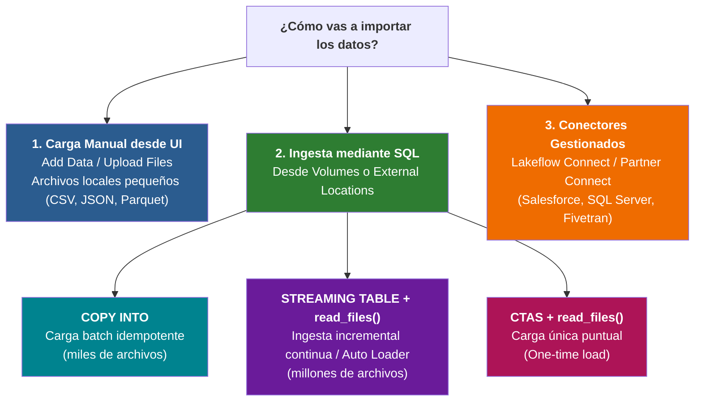

# Descripción general de la importación de datos


# Guía de Estudio: Descripción General de la Importación de Datos en Databricks
**Certificación:** Databricks Certified Data Analyst Associate  
**Dominio del examen:** Data Ingestion, File Loading (`COPY INTO`, `read_files`, Streaming Tables) & UI Upload  


## 1. Panorama de Métodos de Importación de Datos

En Databricks existen múltiples formas de llevar datos hacia **Delta Lake / Unity Catalog**. En el examen de Data Analyst te evaluarán cuál elegir según el **volumen de datos**, la **frecuencia de llegada** (única vez vs. incremental) y el **perfil del usuario** (interfaz gráfica vs. SQL):




## 2. Tabla Comparativa: ¿Qué Método Elegir en el Examen?

| Método de Importación | Caso de uso ideal | ¿Es Incremental / Idempotente? | Evolución de Esquema (*Schema Evolution*) |
| :--- | :--- | :---: | :---: |
| **UI Upload (*Add Data*)** | Subir archivos locales desde tu ordenador (CSV, TSV, JSON, Parquet, Excel) para análisis ad-hoc rápidos. | ❌ No (carga puntual) | Manual en la interfaz |
| **`CTAS` + `read_files()`** | Crear una tabla Delta nueva a partir de archivos en la nube o *Volumes* en una **única ejecución puntual**. | ❌ No (sobrescribe o crea una vez) | Inferencia automática |
| **`COPY INTO`** | Cargas periódicas por lotes (*batch*) desde carpetas con **miles de archivos** nuevos que aterrizan regularmente. | ✅ **Sí (Idempotente):** ignora archivos ya cargados. | ✅ Sí (`'mergeSchema' = 'true'`) |
| **`STREAMING TABLE` + `STREAM read_files()`** | Ingesta continua o programada de **millones de archivos** nuevos (usa **Auto Loader** en SQL). | ✅ **Sí (*Exactly-once*):** rastrea estado de archivos nuevos. | ✅ Sí (automática / configurable) |
| **Lakeflow Connect / Partner Connect** | Ingesta directa desde bases de datos operacionales (SQL Server, Postgres) o apps SaaS (Salesforce, Workday). | ✅ **Sí** (CDC / incremental) | ✅ Sí |


## 3. Detalle y Sintaxis de los Métodos SQL (¡Clásico de Examen!)

### A. Carga Rápida desde la Interfaz Gráfica (*Add Data -> Upload Data*)
* **Dónde está:** Menú lateral izquierdo -> **`+ New`** -> **`Add or upload data`** (o directamente sobre un esquema en *Catalog Explorer*).
* **Funcionamiento:** Arrastras un archivo local (ej. `presupuesto_2026.csv`), eliges el **Catálogo** y **Esquema** de Unity Catalog, previsualizas columnas/tipos y Databricks crea automáticamente una tabla Delta gestionada.
* **Limitación:** Pensado para archivos locales pequeños/medianos (hasta ~2 GB desde navegador), no para pipelines automatizados en producción.

### B. `COPY INTO` (Carga Incremental Idempotente)
Es el comando SQL estándar para cargar archivos desde almacenamiento en la nube (*External Location*) o un *Volume* hacia una tabla Delta existente.
* **Garantía de Idempotencia:** Databricks mantiene un registro interno de qué archivos ya fueron ingeridos en esa tabla; si vuelves a ejecutar `COPY INTO`, **omite los archivos antiguos y carga únicamente los nuevos**.
* **Requisito:** La tabla destino debe **existir previamente** (`CREATE TABLE ...`).

```sql
-- 1. Crear la tabla destino vacía
CREATE TABLE IF NOT EXISTS sales.bronze.daily_orders (
    order_id STRING,
    customer_id INT,
    amount DECIMAL(10, 2),
    order_date DATE
);

-- 2. Ingestar solo archivos CSV nuevos desde un Volume de Unity Catalog
COPY INTO sales.bronze.daily_orders
FROM '/Volumes/sales/landing/orders_volume/'
FILEFORMAT = CSV
FORMAT_OPTIONS (
    'header' = 'true',
    'inferSchema' = 'true',
    'mergeSchema' = 'true'
)
COPY_OPTIONS (
    'mergeSchema' = 'true'
);
```

### C. `read_files()` (Consultas Directas y Streaming Tables)
La función tabular **`read_files()`** permite leer archivos CSV, JSON, Parquet, Avro, ORC o XML directamente desde SQL:

```sql
-- 1. Carga única puntual mediante CTAS (Create Table As Select)
CREATE TABLE sales.bronze.products_snapshot AS
SELECT *
FROM read_files(
    '/Volumes/sales/landing/products/catalogo.json',
    format => 'json'
);

-- 2. Ingesta incremental escalable con Streaming Table (Auto Loader en SQL)
CREATE STREAMING TABLE sales.bronze.events_stream
SCHEDULE EVERY 1 HOUR
AS
SELECT *
FROM STREAM read_files(
    's3://empresa-datalake/raw/events/',
    format => 'parquet'
);
```


## 4. Gobernanza y Permisos Necesarios para Importar Datos

Para que un analista pueda importar archivos desde almacenamiento en la nube o *Volumes* hacia Unity Catalog, necesita permisos tanto en el **origen** como en el **destino**:

| Ubicación | Privilegio Requerido en Unity Catalog |
| :--- | :--- |
| **Origen (External Location)** | **`READ FILES`** sobre la *External Location* que cubre la ruta S3/ADLS/GCS. |
| **Origen (Unity Catalog Volume)** | **`READ VOLUME`** sobre el volumen (además de `USE CATALOG` y `USE SCHEMA`). |
| **Destino (Esquema y Tabla)** | **`USE CATALOG`**, **`USE SCHEMA`** y **`CREATE TABLE`** (para crear nueva tabla) o **`MODIFY`** (para insertar en tabla existente). |

### Columna `_rescued_data` (Rescate de Datos Corruptos)
* Al usar `read_files()` o Auto Loader (*Streaming Tables*), Databricks incluye por defecto una columna especial llamada **`_rescued_data`** (de tipo `STRING` en formato JSON).
* **Para qué sirve:** Si un archivo contiene una columna inesperada o un valor cuyo tipo de dato no coincide con el esquema (ej. texto en una columna `INT`), en lugar de fallar toda la carga, Databricks guarda esos campos problemáticos dentro de `_rescued_data` para que el analista pueda auditarlos después.


## 5. Preguntas Tipo Examen (Autoevaluación)

**Pregunta 1:** *Un analista de negocio tiene un archivo Excel/CSV de 15 MB en su ordenador portátil con objetivos de ventas trimestrales y necesita subirlo rápidamente a Unity Catalog para cruzarlo con sus tablas en un AI/BI Dashboard. ¿Cuál es la forma más sencilla y rápida de hacerlo?*
* **Respuesta:** Utilizar la herramienta **Upload Data / Add Data** en la interfaz web de Databricks para cargar el archivo local directamente como una tabla Delta gestionada en Unity Catalog.

**Pregunta 2:** *Un proveedor deposita diariamente archivos JSON con nuevas transacciones en un Volume de Unity Catalog (`/Volumes/finance/raw/payments/`). Un analista quiere ejecutar una consulta SQL programada cada noche que cargue únicamente los archivos nuevos en la tabla `finance.bronze.payments` sin duplicar los archivos ya procesados días anteriores. ¿Qué comando debe usar?*
* **Respuesta:** **`COPY INTO finance.bronze.payments FROM '/Volumes/finance/raw/payments/' FILEFORMAT = JSON;`**, aprovechando su comportamiento **idempotente**.

**Pregunta 3:** *Tienes un directorio en almacenamiento en la nube que acumula decenas de millones de archivos pequeños de logs JSON a lo largo del tiempo y crece cada minuto. ¿Qué enfoque de ingesta en Databricks SQL ofrece mayor escalabilidad y rendimiento frente a `COPY INTO`?*
* **Respuesta:** Crear una **Tabla de Streaming (`CREATE STREAMING TABLE`)** utilizando **`STREAM read_files(...)`** (Auto Loader en SQL), ya que escala de forma eficiente sobre millones de archivos rastreando el estado incrementalmente.

**Pregunta 4:** *Al ingerir archivos CSV mediante `read_files()`, notas una columna adicional llamada `_rescued_data` que contiene fragmentos JSON en algunas filas. ¿Qué indica esto?*
* **Respuesta:** Indica que esas filas contenían **datos que no coincidían con el esquema esperado** (por ejemplo, tipos de datos incompatibles o columnas adicionales no declaradas) y Databricks los capturó automáticamente en `_rescued_data` para evitar pérdida de información o fallos en la carga.


## 6. Problemas y errores comunes

- **Desajuste de esquema en `COPY INTO`**: use `COPY_OPTIONS ('mergeSchema' = 'true')` o declare el esquema de destino.
- **Carga rechazada**: la carga a tablas no acepta archivos zip/tar ni archivos que superen los límites (10 archivos, 2 GB en total); use un volumen y `COPY INTO`.
- **Acceso denegado en una ruta S3**: cree u obtenga acceso a una ubicación externa (o volumen) que cubra la ruta.


## 7. Consejos para el examen

> [!tip]
>
> - `COPY INTO` es idempotente: las repeticiones de la ejecución son seguras
> - Miles de archivos → `COPY INTO`; millones → Auto Loader
> - Delta Sharing = en vivo, solo lectura, sin copia; los receptores crean un catálogo a partir del recurso compartido
> - Auto Loader en SQL = tabla de streaming + `STREAM read_files`


## 8. Conclusiones clave

- Seis rutas: carga desde la UI, lote desde S3 (`COPY INTO`), Auto Loader, Delta Sharing, ingesta mediante API, Marketplace
- Unity Catalog gobierna todas las rutas (volúmenes, ubicaciones externas, catálogos compartidos)
- La federación consulta in situ en lugar de importar


## 9. Temas relacionados

- [Creación de tablas y Delta Time Travel](../01-executing-queries-databricks-sql-warehouses/06-creating-tables-and-time-travel.md) - `read_files` y CTAS
- [Vistas materializadas y tablas de streaming](../01-executing-queries-databricks-sql-warehouses/07-materialized-views-and-streaming-tables.md)
- [Gestión de datos](../06-managing-data/01-tables-schemas.md)


## 10. Documentación oficial

- [Crear o modificar una tabla mediante la carga de archivos](https://docs.databricks.com/aws/en/ingestion/create-or-modify-table)
- [Ingesta de datos desde almacenamiento de objetos en la nube](https://docs.databricks.com/aws/en/ingestion/cloud-object-storage/)
- [COPY INTO](https://docs.databricks.com/aws/en/ingestion/cloud-object-storage/copy-into/)
- [¿Qué es Auto Loader?](https://docs.databricks.com/aws/en/ingestion/cloud-object-storage/auto-loader/)
- [¿Qué es OpenSharing?](https://docs.databricks.com/aws/en/delta-sharing/)
- [Descripción general de Zerobus Ingest](https://docs.databricks.com/aws/en/ingestion/zerobus-overview)

---

**[↑ Volver a la sección](./README.md)**
