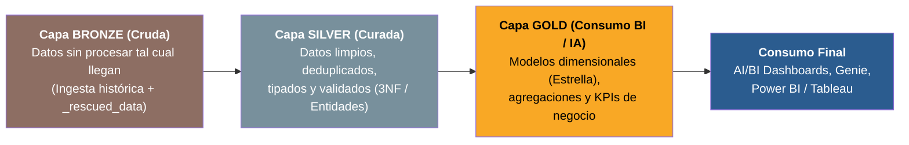
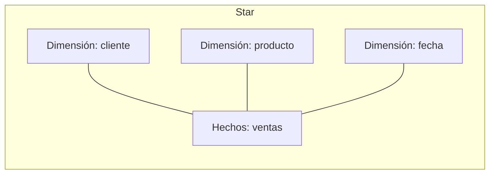
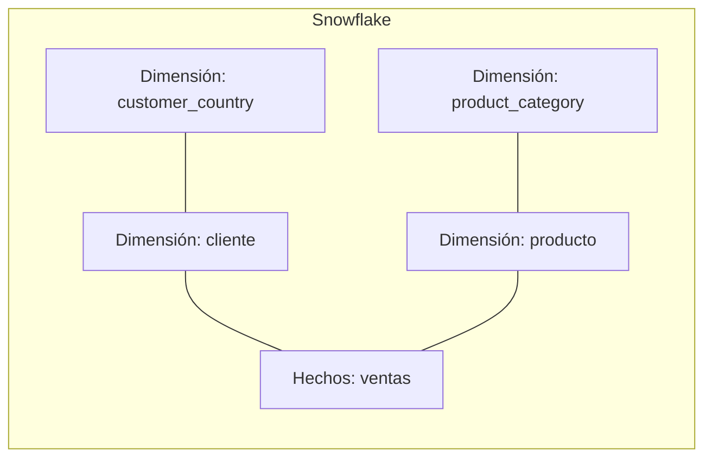

# Descripción general del modelado de datos con Databricks SQL

## 1. Arquitectura Medallion (Bronze, Silver, Gold)

En Databricks, el estándar de diseño de datos es la **Arquitectura Medallion** (*Multi-Hop Architecture*), que organiza los datos en tres capas progresivas de calidad y estructura dentro de Unity Catalog:



### Papel del Data Analyst en cada capa:
* **Bronze (Ingesta cruda):** Almacena el historial completo sin alterar (*append-only* mediante `COPY INTO` o `STREAMING TABLE`). El analista rara vez consulta esta capa directamente para reportes.
* **Silver (Limpia y conformada):** Datos filtrados, sin duplicados (`QUALIFY ROW_NUMBER()`), con tipos de datos corregidos (`TRY_CAST`) y reglas de calidad aplicadas (`CHECK`, `NOT NULL`). Sirve como fuente de verdad empresarial (*Enterprise Data Warehouse* / 3NF).
* **Gold (Agregada y Dimensional):** Capa optimizada para lectura rápida y autoservicio. Aquí es donde el **Data Analyst** construye **Esquemas en Estrella (*Star Schema*)**, **Vistas Materializadas** y tablas desnormalizadas que alimentan **AI/BI Dashboards** y **Genie Spaces**.


## 2. Modelado Dimensional en la Capa Gold: Star Schema vs. Snowflake Schema
Para maximizar el rendimiento de consultas analíticas y simplificar la exploración en herramientas BI y Genie, Databricks recomienda el **Modelado Dimensional**:

### A. Tablas de Hechos (*Fact Tables*) vs. Tablas de Dimensiones (*Dimension Tables*)

| Característica | Tabla de Hechos (*Fact Table*) | Tabla de Dimensión (*Dimension Table*) |
| :--- | :--- | :--- |
| **Qué almacena** | **Eventos, transacciones o métricas numéricas** cuantificables (ej. `fact_sales`, `fact_web_clicks`). | **Contexto descriptivo** (el *quién, qué, dónde y cuándo*: `dim_customer`, `dim_product`, `dim_date`). |
| **Estructura** | Muchas filas (millones/billones) y pocas columnas (claves foráneas + medidas numéricas como `amount`, `quantity`). | Menos filas, pero muchas columnas descriptivas de texto/atributos (`category`, `city`, `segment`). |
| **Optimización física** | **`CLUSTER BY (fecha, fk_cliente)`** (Liquid Clustering) para filtrar rápido por rangos de tiempo o claves. | Tablas pequeñas/medianas que Databricks suele distribuir en memoria (**Broadcast Hash Join**) automáticamente. |

### B. Esquema en Estrella (*Star Schema*) vs. Copo de Nieve (*Snowflake Schema*)
* **Star Schema (Recomendado en Databricks SQL):** La tabla de hechos central se une directamente mediante un solo nivel de `JOIN` a tablas de dimensiones **desnormalizadas**. Reduce el número de `JOIN` costosos y facilita que **AI/BI Genie** genere SQL sin errores.
* **Snowflake Schema:** Las dimensiones están normalizadas en múltiples sub-tablas (ej. `fact_sales` -> `dim_product` -> `dim_subcategory` -> `dim_category`). Solo se usa si una dimensión es gigantesca y tiene alta redundancia, ya que exige más `JOIN` en cada consulta.






## 3. Claves Primarias, Foráneas y Subrogadas en Databricks SQL

### A. Restricciones Declarativas (`PRIMARY KEY` / `FOREIGN KEY`)
En Unity Catalog puedes declarar claves primarias y foráneas sobre tablas Delta:

```sql
-- 1. Definir Dimensión con Clave Primaria (informativa)
CREATE TABLE sales.gold.dim_customers (
    customer_sk BIGINT GENERATED ALWAYS AS IDENTITY,
    customer_id STRING NOT NULL,
    customer_name STRING,
    country STRING,
    CONSTRAINT pk_customers PRIMARY KEY (customer_sk)
);

-- 2. Definir Tabla de Hechos con Clave Foránea hacia la Dimensión
CREATE TABLE sales.gold.fact_orders (
    order_id STRING NOT NULL,
    customer_sk BIGINT,
    order_date DATE,
    revenue DECIMAL(12, 2),
    CONSTRAINT pk_orders PRIMARY KEY (order_id),
    CONSTRAINT fk_orders_customer FOREIGN KEY (customer_sk) REFERENCES sales.gold.dim_customers(customer_sk)
);
```

> **Regla crítica de examen sobre `PK` y `FK`:**  
> En Databricks, las restricciones `PRIMARY KEY` y `FOREIGN KEY` son **informativas (*NOT ENFORCED*)** (no bloquean la inserción de duplicados). Sin embargo, son fundamentales porque:
> 1. Permiten que **AI/BI Genie** deduzca automáticamente cómo unir las tablas (`JOIN`).
> 2. Ayudan al optimizador **Catalyst** a eliminar `JOIN` innecesarios cuando se especifica la palabra clave **`RELY`**.
> 3. Documentan el modelo entidad-relación en el diagrama de linaje y **Catalog Explorer**.

### B. Claves Subrogadas (*Surrogate Keys*) y Slowly Changing Dimensions (SCD)
* **Columnas de Identidad (`GENERATED ALWAYS AS IDENTITY` o `GENERATED BY DEFAULT AS IDENTITY`):** Generan automáticamente valores numéricos secuenciales únicos, ideales como **claves subrogadas (*Surrogate Keys*)** en dimensiones.
* **SCD Tipo 1 vs. SCD Tipo 2 (Concepto clave de modelado):**
  * **SCD Tipo 1:** Sobrescribe el valor antiguo con el nuevo (no guarda historial de cambios en el atributo). Se implementa con `MERGE INTO ... WHEN MATCHED THEN UPDATE`.
  * **SCD Tipo 2:** Conserva el historial completo de cambios creando una **nueva fila** con columnas de vigencia (`effective_date`, `end_date`, `is_current = true`) y una clave subrogada única por versión.


## 4. Elección del Objeto de Modelado en la Capa Gold

| Objeto SQL | Cuándo elegirlo en tu modelo de datos |
| :--- | :--- |
| **Tabla Delta (`CREATE TABLE` / `CTAS`)** | Cuando necesitas persistir datos transformados con soporte completo para **Liquid Clustering (`CLUSTER BY`)**, Time Travel y máximo rendimiento de lectura. |
| **Vista Estándar (`CREATE VIEW`)** | Para crear una capa semántica ligera (renombrar columnas, ocultar complejidad de `JOIN` o aplicar lógica de negocio) sin duplicar almacenamiento cuando la consulta base es rápida. |
| **Vista Materializada (`CREATE MATERIALIZED VIEW`)** | Cuando la vista une múltiples tablas grandes o calcula agregaciones pesadas (`GROUP BY`) que alimentan dashboards con alta concurrencia y necesita **precalcular y refrescar incrementalmente** los resultados. |


## 5. Preguntas Tipo Examen (Autoevaluación)

**Pregunta 1:** *Un analista está diseñando la capa Gold para un conjunto de AI/BI Dashboards y un Genie Space de ventas. Actualmente los datos están normalizados en 12 tablas en la capa Silver, lo que obliga a escribir consultas con 8 `JOIN` cada vez y provoca respuestas lentas y errores en Genie. ¿Qué estrategia de modelado debe aplicar en la capa Gold?*
* **Respuesta:** Desnormalizar las entidades en un **Esquema en Estrella (*Star Schema*)** (una tabla de hechos `fact_sales` rodeada de dimensiones planas como `dim_customer` y `dim_product`), declarando sus claves `PRIMARY KEY` y `FOREIGN KEY` en Unity Catalog.

**Pregunta 2:** *Necesitas diseñar una tabla de dimensión `dim_employees` en la capa Gold donde sea obligatorio conservar el historial completo de cada vez que un empleado cambia de departamento o puesto de trabajo a lo largo de los años. ¿Qué técnica de modelado dimensional debes implementar?*
* **Respuesta:** **Slowly Changing Dimension Tipo 2 (SCD Type 2)**, utilizando una clave subrogada (`GENERATED ALWAYS AS IDENTITY`) y columnas de control de vigencia (`start_date`, `end_date`, `is_current`).

**Pregunta 3:** *Un ingeniero añade una restricción `PRIMARY KEY (id)` a una tabla Delta en Unity Catalog. ¿Cuál es el impacto real de esta restricción en Databricks SQL?*
* **Respuesta:** Es **informativa (*NOT ENFORCED*)**: no impide insertar filas con `id` duplicados, pero ayuda al optimizador de consultas y permite a herramientas como **AI/BI Genie** y **Catalog Explorer** identificar las relaciones entre tablas.

**Pregunta 4:** *En la Arquitectura Medallion, ¿qué capa está destinada a almacenar datos limpios, deduplicados y con tipos de datos estandarizados a nivel de entidad antes de crear agregaciones específicas para departamentos de negocio?*
* **Respuesta:** La **capa Silver**.


## 6. Problemas y errores comunes

- **Consultar Bronze directamente** para paneles: lento, frágil y a menudo sin la limpieza necesaria
- **Vistas materializadas desactualizadas**: establezca una programación de actualización acorde con las necesidades de actualidad del negocio
- **Uso excesivo del copo de nieve**: uniones adicionales para un beneficio de normalización marginal
- **Renombrar una columna referenciada por vistas**: las vistas pueden dejar de funcionar silenciosamente hasta que se consultan


## 7. Consejos para el examen

> [!tip]
>
> - Los analistas recurren por defecto a **Gold**. Bronze y Silver suelen ser competencia de ingenieros.
> - La estrella gana por defecto en BI; el copo de nieve solo cuando la normalización importa.
> - **Vista = cómputo al leer; MV = almacenamiento + cómputo programado**. Elija según la frecuencia de lectura frente a la necesidad de actualidad.
> - Data Vault = hubs (claves de negocio), links (relaciones), satellites (atributos + historial); normalmente en Silver.
> - Los esquemas estrella suelen estar en Gold, sobre una capa Silver depurada o un Data Vault.
> - Las tablas de streaming (`CREATE STREAMING TABLE`) son la tercera opción, junto a las vistas y las MV; consulte [Vistas materializadas y tablas de streaming](../01-executing-queries-databricks-sql-warehouses/07-materialized-views-and-streaming-tables.md).


## 8. Conclusiones clave

- Medallion = capas de calidad Bronze / Silver / Gold
- Estrella = opción habitual en BI; copo de nieve = dimensiones normalizadas
- Data Vault (Silver) → esquemas estrella (Gold)
- Vista = sin almacenamiento, lectura lenta; MV = almacenamiento, lectura rápida
- Los analistas consultan principalmente Gold


## 9. Temas relacionados

- [Gestión de datos](../06-managing-data/01-tables-schemas.md)
- [Arquitectura Medallion (compartido)](../../../shared/fundamentals/medallion-architecture.md)


## 10. Documentación oficial

- [`CREATE VIEW`](https://docs.databricks.com/aws/en/sql/language-manual/sql-ref-syntax-ddl-create-view)
- [Usar vistas materializadas independientes](https://docs.databricks.com/aws/en/views/materialized)
- [¿Qué es la arquitectura lakehouse Medallion?](https://docs.databricks.com/aws/en/lakehouse/medallion)
- [Esquema estrella (glosario de Databricks)](https://www.databricks.com/glossary/star-schema)

---

**[↑ Volver a la sección](./README.md)**
